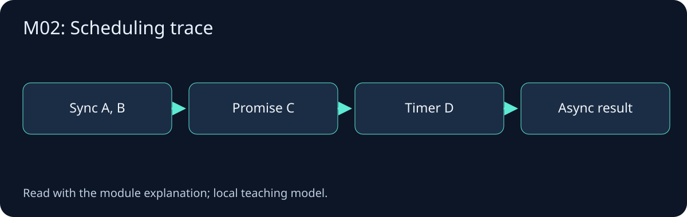

# EDP Module 02: The JavaScript Event Loop, Concurrency, and Async Primitives

[Module index](README.md) | [Setup and commands](../examples/README.md)

**Period:** Prelim · **Meeting:** 60–90 minutes · **Assessment:** Coding activity

## A. Lesson Preview & Review

A program prints A, B, C and D, but the source code mentions D before B. This is predictable scheduling—not random behavior.

**In a nutshell:** Predict synchronous, promise and timer output in the supplied example. We will run a small example, explain its behavior and change one part ourselves.

**Learning targets**

1. Predict synchronous, promise and timer output in the supplied example.
2. Write and handle a promise using async/await.
3. Distinguish concurrency from CPU parallelism.

**Before class:** Earlier core lessons or their supplied runnable checkpoints. No database or broker installation is required for this lesson. Read the example filenames below and keep a clean copy before editing.

**60-minute route:** 5 minutes preview, 15 explanation/demo, 30 coding, 10 review. For 90 minutes, add 15 guided exploration and 15 debugging/feedback.

**Scope:** Prioritize the runnable core and learning targets. The later comparisons are reference reading or teacher demonstrations; do not attempt every extension in one meeting. Finals modules introduce no new infrastructure.

## Visual Guide & HTML Presentation Notes

**Technology visual anchors:** 



**What the sample image explains:** This is the supplied example trace, not a universal ordering diagram for every Node context.

**Suggested slides:**

1. Opening: show this diagram and ask students to predict the flow before revealing the explanation.
2. Concept: reveal one labeled stage at a time; connect it to the matching code rather than putting the whole lesson on screen.
3. Code/output: use a readable code panel beside a real output capture from the supplied example. Label input, expected output and any failure state.
4. Practice: keep the quiz or coding task readable and separate from its answer/explanation.

**Sample image to capture:** Run this module’s supplied program and capture the terminal with the meaningful result visible. Include a caption naming the command and the observed behavior; avoid invented output screenshots.

**Projector text:** use scalable text, minimum 16px everywhere; aim for 24–32px body text on classroom screens. Scale code and diagram labels too. Give a diagram its own slide when labels would become small. See the [visual guide and scalable presentation prompt](../visuals/README.md).

## B. Main Lesson

### The engine and its host

JavaScript executes function calls on a call stack. A call adds a frame; returning removes it. Objects live in managed memory, often described as the heap. The engine executes language instructions, while the host supplies capabilities such as timers, files or networking. Browsers expose DOM/Web APIs; Node combines its own APIs with runtime infrastructure including libuv. Do not draw browser DOM work inside Node as though every environment were identical.

Ordinary synchronous code runs to completion before another queued callback can use that JavaScript thread. In our example the initial logs run first. Resolving a promise schedules its reaction; it does not run that reaction in the middle of the current statements. The timer callback becomes eligible later. For this particular example, the promise reaction precedes the zero-delay timer.

### Tasks and microtasks

Browser task sources include timers and input events. Promise reactions and `queueMicrotask` use the microtask mechanism. At a microtask checkpoint, queued microtasks are drained, including newly queued ones. A never-ending chain can prevent other work from progressing. Rendering opportunities depend on browser scheduling; “every timer causes a repaint” is not a valid rule.

Node has phases such as timers, poll, check and close callbacks. `setImmediate` relates to the check phase; `process.nextTick` has special Node scheduling behavior and can starve I/O if abused. The relative ordering of nextTick, promises, timers and immediate callbacks depends on context, including CommonJS versus ES modules. Our files are ES modules. Learn the measured trace first; do not memorize one global diagram as a guarantee for all contexts.

### A promise describes one eventual outcome

A promise starts pending and settles fulfilled or rejected. Its executor runs immediately when constructed. In `prepare`, the executor schedules a timer, then the timer later calls `resolve` or `reject`. Settling is different from a repeated event stream: one promise does not keep producing values.

An `async` function returns a promise. `await` suspends that function's continuation until the awaited result is available; it does not pause all JavaScript. Use `try/catch` around awaited operations to handle rejection, and `finally` for cleanup that should occur on either path. In the example A2 rejects, so its success log is skipped and the catch runs. A finally block is not proof of success.

### Concurrency, parallelism and responsiveness

Concurrency means operations can make progress during overlapping periods, such as waiting for two requests. Parallelism means work actually executes simultaneously. Writing `async` before a function containing a huge CPU loop does not move the loop to another thread. Use a worker for suitable CPU-heavy work, or break work into bounded pieces when appropriate.

Event-loop lag is the difference between when work could ideally run and when it gets an opportunity. Measure it rather than assuming a timer is an exact clock. A lag demonstration must use a short, bounded loop—never intentionally freeze classroom machines indefinitely. Worker and stream details return in Module 10.

## C. Analogy, Guided Program & Practice

### Everyday connection

While the kitchen cooks, the cashier serves someone else. That is overlapping waiting. Two cooks working simultaneously illustrate parallel work. One cashier cannot perform an endless calculation and serve customers at the same instant.

### Run the complete example

Run commands from the `EDP/examples` folder. Install the pinned dependencies once with `npm ci`; most `.mjs` examples otherwise use only Node built-ins. See the setup guide for the verified runtime.

```powershell
node m02.mjs
```

Wait for completion and compare behavior with the expected trace before editing.

### File: `m02.mjs`

[Open runnable file](../examples/m02.mjs)

```javascript
console.log('A: synchronous start');
setTimeout(() => console.log('D: timer callback'), 0);
Promise.resolve().then(() => console.log('C: promise callback'));
console.log('B: synchronous end');
function prepare(id, fail = false) {
  return new Promise((resolve, reject) => {
    setTimeout(() => {
      if (fail) reject(new Error(`Unavailable: ${id}`));
      else resolve(`Ready: ${id}`);
    }, 30);
  });
}
async function main() {
  try {
    console.log(await prepare('A1'));
    console.log(await prepare('A2', true));
  } catch (error) {
    console.log('Handled:', error.message);
  } finally {
    console.log('Preparation finished');
  }
}
await main();
```

### Expected behavior and explanation checkpoint

A → B → C → D → Ready: A1 → Handled: Unavailable: A2 → Preparation finished. The numerical timer delays are not exact wall-clock promises.

Before editing, identify the producer/input, callback or consumer, state/output, and cleanup boundary in the code. Trace one value through the program. Explain which line changes the outcome rather than only reading the console aloud.

### Your independent change

Add a successful A3 preparation after the handled failure by giving it its own try/catch scope. Explain why a statement after the rejecting await inside the original try does not run.

**Checkpoint:** Predict → run → explain → modify. *Hindi sapat na gumana dahil kinopya; dapat kaya mong sabihin kung bakit at baguhin ang isang behavior.*

### Troubleshooting and common mistake

A rejected promise without a handler may terminate a Node process. A function that starts a promise but does not return or await it can appear complete before its work finishes.

If a command fails before any lesson output, check the working folder, filename, Node version and installed packages first. Distinguish setup errors from a deliberately rejected input or handled runtime failure.

### Sa madaling salita

Habang naghihintay ang isang async operation, puwedeng umusad ang ibang gawain. Pero ang mabigat na synchronous loop ay nakaharang pa rin sa thread.

[Quick reference and glossary](QUICK_REFERENCE.md)

## D. Assessment, Wrap-Up & References

### One coding activity

**Task:** Add a successful A3 preparation after the handled failure by giving it its own try/catch scope. Explain why a statement after the rejecting await inside the original try does not run.

**Submit one folder or archive containing:**

1. Your complete modified program and any files needed to run it.
2. A short README with the exact command and expected result.
3. Evidence of one successful case and one rejected/failing case, plus a brief explanation of your independent change.

| Criterion | Points | Evidence |
| --- | ---: | --- |
| Required behavior | 4 | Core works (2); requested independent change works (2) |
| Error/edge behavior | 2 | Failure is detected (1); response preserves intended state or reports a clear limit (1) |
| Understanding | 2 | Explain event/data flow (1); explain your own change (1) |
| Reproducibility/readability | 2 | Commands/files are complete (1); names and small structure are understandable (1) |
| Total | 10 | One activity, no separate quiz |

### Wrap-up

Predict synchronous, promise and timer output in the supplied example. Distinguish concurrency from CPU parallelism.

**Exit reflection (ungraded):** What event or operation started the flow, what state changed, and what happens if that flow cannot complete? Name one assumption the sample deliberately makes.

**Next connection:** The next module builds on this core. Keep your working checkpoint; an independent starter is supplied if you need to restart.

### References and further reading

- [Official/reference documentation: developer.mozilla.org](https://developer.mozilla.org/en-US/docs/Web/JavaScript/Reference/Execution_model)
- [Official/reference documentation: developer.mozilla.org](https://developer.mozilla.org/en-US/docs/Web/JavaScript/Guide/Using_promises)
- [Official/reference documentation: nodejs.org](https://nodejs.org/en/learn/asynchronous-work/event-loop-timers-and-nexttick)

The prose and classroom code are original teaching examples informed by the references. Source reports are research inputs, not authority for unverified claims. Read [validation notes](../instructor/VALIDATION.md) before distributing a new toolchain version.
