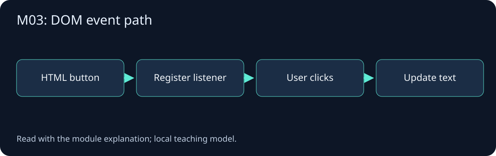
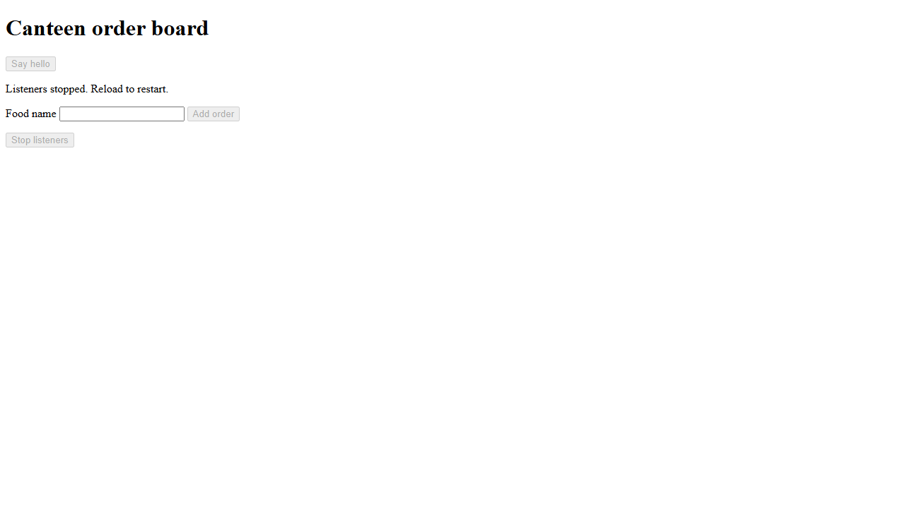

# EDP Module 03: Client-Side DOM Events and Interactive Interfaces

[Module index](README.md) | [Setup and commands](../examples/README.md)

**Period:** Prelim · **Meeting:** 60–90 minutes · **Assessment:** 10-item quiz

## A. Lesson Preview & Review

Make a plain HTML button respond before adding frameworks. The first success is simply seeing your own message appear when you click.

**In a nutshell:** Connect a button to a handler inside a script block. We will run a small example, explain its behavior and change one part ourselves.

**Learning targets**

1. Connect a button to a handler inside a script block.
2. Handle form input safely and explain event propagation.
3. Remove a group of listeners and verify that responses stop.

**Before class:** Earlier core lessons or their supplied runnable checkpoints. No database or broker installation is required for this lesson. Read the example filenames below and keep a clean copy before editing.

**60-minute route:** 5 minutes preview, 25 explanation/demo, 15 guided code, 10 quiz, 5 feedback. For 90 minutes, add 15 minutes practice and 15 discussion/debugging.

**Scope:** Prioritize the runnable core and learning targets. The later comparisons are reference reading or teacher demonstrations; do not attempt every extension in one meeting. Finals modules introduce no new infrastructure.

## Visual Guide & HTML Presentation Notes

**Technology visual anchors:**  



**What the sample image explains:** Show the real button screenshot beside this diagram; registration happens before the click.

**Suggested slides:**

1. Opening: show this diagram and ask students to predict the flow before revealing the explanation.
2. Concept: reveal one labeled stage at a time; connect it to the matching code rather than putting the whole lesson on screen.
3. Code/output: use a readable code panel beside a real output capture from the supplied example. Label input, expected output and any failure state.
4. Practice: keep the quiz or coding task readable and separate from its answer/explanation.

**Sample image to capture:** Use the checked browser screenshot linked below, then capture your own edited result.

**Projector text:** use scalable text, minimum 16px everywhere; aim for 24–32px body text on classroom screens. Scale code and diagram labels too. Give a diagram its own slide when labels would become small. See the [visual guide and scalable presentation prompt](../visuals/README.md).



## B. Main Lesson

### The first listener, step by step

Open the supplied HTML file and first focus only on the hello button, message paragraph and their click handler. The script is below the elements, so they exist when selected. `getElementById('hello')` selects an element; `addEventListener('click', callback)` registers a function; a click invokes it; `textContent` changes the visible text. Registering a callback is not the same as calling it immediately.

An inline `<script>` block contains JavaScript. An `onclick` HTML attribute is a different arrangement and is not required. To split the file, move the script body into `app.js` and use `<script src="app.js" defer></script>` in the head. `defer` applies to that external classic script, not as a way to delay an inline classic script. Browsers do not type-check or directly execute ordinary TypeScript syntax in this exercise.

### Forms and accessible controls

A native button already supports keyboard activation. A form's submit event can arise from clicking its submit button or pressing Enter. Listen to submit rather than only the button's click so both routes work. `preventDefault()` suppresses the form's default navigation, but does not stop propagation. A label associates text with the input; `aria-live` makes status changes available to assistive technology without replacing clear visible feedback.

Read input, trim whitespace, validate, and only then create a row. HTML `required` helps but does not make all whitespace invalid. User text goes into text nodes or `textContent`, not into HTML markup. These choices prevent input from being interpreted as executable markup in this example.

### Propagation and delegation

Many events travel through capture, target and bubble phases. `target` identifies the originating target; `currentTarget` is the element whose listener currently runs. A list can keep one click listener while rows are added later. The handler narrows `event.target` to an Element, finds the closest matching button, and confirms it belongs to the list. This is event delegation.

Not all events bubble: for example, mouseenter/pointerenter differ from mouseover/pointerover. Select a suitable event or capture strategy rather than assuming delegation always works. `stopPropagation()` stops further propagation, while `stopImmediatePropagation()` also prevents later listeners on the same target. Neither automatically cancels a default action. Avoid stopping propagation without a clear need.

### Listener lifetime and other sources

The shared AbortController provides a signal to several listeners. Calling abort removes them together. A separately registered once-only stop button also disables the controls, preventing a now-unhandled form from navigating. With manual removal, retain the same callback reference and matching capture option; a new arrow function is a different function. A passive listener cannot cancel the default action with preventDefault.

The custom `order-added` event carries data in `detail`; dispatch is synchronous, not a promise. Its default does not bubble unless requested. Browser exceptions reported from listeners are not identical to catching an ordinary Node emit call. Later lessons compare channels such as BroadcastChannel and postMessage. Resize/Intersection/MutationObserver observe particular changes; requestAnimationFrame schedules visual work; visibilitychange and pagehide support lifecycle handling. They are not interchangeable replacements for click listeners.

## C. Analogy, Guided Program & Practice

### Everyday connection

The HTML control is the doorbell, registration is connecting the wire, the click is a press, and the handler is the response. A disconnected wire explains why the same press stops doing anything.

### Run the complete example

Run commands from the `EDP/examples` folder. Install the pinned dependencies once with `npm ci`; most `.mjs` examples otherwise use only Node built-ins. See the setup guide for the verified runtime.

```powershell
npm run serve
```

Start with http://127.0.0.1:4173/m03-first.html: a complete minimal button-and-script page. After that works, open http://127.0.0.1:4173/m03.html for the form/list/cleanup extension. Stop the server with Ctrl+C.

### File: `m03-first.html`

[Open runnable file](../examples/m03-first.html)

```html
<!doctype html>
<html lang="en"><meta charset="utf-8"><title>My first event listener</title>
<body>
<h1>My first event listener</h1>
<button id="hello" type="button">Say hello</button>
<p id="message" aria-live="polite">Waiting for your click.</p>
<script>
const button = document.getElementById('hello');
const message = document.getElementById('message');
if (button && message) {
  button.addEventListener('click', () => {
    message.textContent = 'Hello, coder! Kaya mo ito.';
  });
}
</script>
</body></html>
```

### File: `m03.html`

[Open runnable file](../examples/m03.html)

```html
<!doctype html>
<html lang="en"><meta charset="utf-8"><title>EDP Order Board</title>
<body>
<h1>Canteen order board</h1>
<button id="hello" type="button">Say hello</button>
<p id="message" aria-live="polite">Waiting for your click.</p>
<form id="orderForm">
  <label for="food">Food name</label>
  <input id="food" maxlength="40" required>
  <button>Add order</button>
</form>
<ul id="orders"></ul>
<button id="stop" type="button">Stop listeners</button>
<script>
const hello = document.getElementById('hello');
const message = document.getElementById('message');
const form = document.getElementById('orderForm');
const food = document.getElementById('food');
const orders = document.getElementById('orders');
const stop = document.getElementById('stop');
const controller = new AbortController();
const options = { signal: controller.signal };
let count = 0;
hello.addEventListener('click', () => {
  message.textContent = 'Hello, coder!';
}, options);
form.addEventListener('submit', (event) => {
  event.preventDefault();
  const title = food.value.trim();
  if (!title) { message.textContent = 'Enter a food name.'; return; }
  const row = document.createElement('li');
  row.dataset.id = String(++count);
  row.append(document.createTextNode(title + ' '));
  const button = document.createElement('button');
  button.type = 'button';
  button.textContent = 'Collected';
  button.dataset.action = 'collect';
  row.append(button);
  orders.append(row);
  food.value = '';
  orders.dispatchEvent(new CustomEvent('order-added', { detail: { id: count } }));
}, options);
orders.addEventListener('click', (event) => {
  if (!(event.target instanceof Element)) return;
  const button = event.target.closest('button[data-action="collect"]');
  if (!button || !orders.contains(button)) return;
  button.closest('li').remove();
  message.textContent = 'Order collected.';
}, options);
orders.addEventListener('order-added', (event) => {
  message.textContent = 'Added order ' + event.detail.id;
}, options);
stop.addEventListener('click', () => {
  controller.abort();
  hello.disabled = true;
  form.querySelector('button').disabled = true;
  for (const button of orders.querySelectorAll('button')) button.disabled = true;
  stop.disabled = true;
  message.textContent = 'Listeners stopped. Reload to restart.';
}, { once: true });
</script>
</body></html>
```

### Expected behavior and explanation checkpoint

Click Say hello → “Hello, coder!”; submit “Pandesal” → one row and “Added order 1”; press Collected → row removed; Stop listeners → controls disabled; reload restores the page.

Before editing, identify the producer/input, callback or consumer, state/output, and cleanup boundary in the code. Trace one value through the program. Explain which line changes the outcome rather than only reading the console aloud.

### Your independent change

Change the hello message and add a count of successful orders. Keep blank submissions from incrementing it. The dynamic list is a guided extension if time remains after the first button.

**Checkpoint:** Predict → run → explain → modify. *Hindi sapat na gumana dahil kinopya; dapat kaya mong sabihin kung bakit at baguhin ang isang behavior.*

### Troubleshooting and common mistake

A null element usually means a misspelled ID or early script execution. A page reload on submission suggests preventDefault is missing. Duplicate reactions suggest repeated listener registration.

If a command fails before any lesson output, check the working folder, filename, Node version and installed packages first. Distinguish setup errors from a deliberately rejected input or handled runtime failure.

### Sa madaling salita

Piliin ang element, ikabit ang listener, saka hintayin ang click. Ang handler ang nagsasabi kung ano ang magbabago sa page.

[Quick reference and glossary](QUICK_REFERENCE.md)

## D. Assessment, Wrap-Up & References

### 10-item quiz

One point per item. Answer after the explanation and guided practice. Give short answers; no extra graded coding submission today. The instructor keeps the answer key separately.

1. What does addEventListener register?
2. Which property safely displays user text without interpreting HTML?
3. Does preventDefault also stop propagation?
4. In the full order-board page (m03.html), what text appears after the first Say hello click?
5. A student submits whitespace only. Does the JavaScript create an order?
6. A new row is added after the parent click listener was registered. Can its Collected button work?
7. getElementById returns null. Name one likely cause.
8. Why does removeEventListener with a newly written arrow function fail to remove the old handler?
9. Which event should handle both Enter submission and clicking a form submit button?
10. Several listeners belong to a destroyed screen. Suggest grouped cleanup.
### Wrap-up

Connect a button to a handler inside a script block. Remove a group of listeners and verify that responses stop.

**Exit reflection (ungraded):** What event or operation started the flow, what state changed, and what happens if that flow cannot complete? Name one assumption the sample deliberately makes.

**Next connection:** The next module builds on this core. Keep your working checkpoint; an independent starter is supplied if you need to restart.

### References and further reading

- [Official/reference documentation: developer.mozilla.org](https://developer.mozilla.org/en-US/docs/Learn_web_development/Core/Scripting/Events)
- [Official/reference documentation: developer.mozilla.org](https://developer.mozilla.org/en-US/docs/Web/API/EventTarget/addEventListener)
- [Official/reference documentation: developer.mozilla.org](https://developer.mozilla.org/en-US/docs/Web/API/CustomEvent)

The prose and classroom code are original teaching examples informed by the references. Source reports are research inputs, not authority for unverified claims. Read [validation notes](../instructor/VALIDATION.md) before distributing a new toolchain version.
