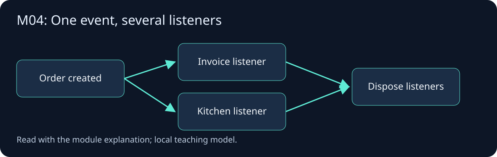

# EDP Module 04: In-Process Node.js Events and Native Event Sources

[Module index](README.md) | [Setup and commands](../examples/README.md)

**Period:** Prelim · **Meeting:** 60–90 minutes · **Assessment:** Coding activity

## A. Lesson Preview & Review

One order should notify the kitchen and receipt printer without the order creator containing both implementations.

**In a nutshell:** Register, emit, remove and run a listener once with EventEmitter. We will run a small example, explain its behavior and change one part ourselves.

**Learning targets**

1. Register, emit, remove and run a listener once with EventEmitter.
2. Explain synchronous ordering and handle an error deliberately.
3. Wait for an event without missing it and clean up listeners.

**Before class:** Earlier core lessons or their supplied runnable checkpoints. No database or broker installation is required for this lesson. Read the example filenames below and keep a clean copy before editing.

**60-minute route:** 5 minutes preview, 15 explanation/demo, 30 coding, 10 review. For 90 minutes, add 15 guided exploration and 15 debugging/feedback.

**Scope:** Prioritize the runnable core and learning targets. The later comparisons are reference reading or teacher demonstrations; do not attempt every extension in one meeting. Finals modules introduce no new infrastructure.

## Visual Guide & HTML Presentation Notes

**Technology visual anchors:** 



**What the sample image explains:** Invoice and kitchen both react; the arrows here show reading order, not an async queue.

**Suggested slides:**

1. Opening: show this diagram and ask students to predict the flow before revealing the explanation.
2. Concept: reveal one labeled stage at a time; connect it to the matching code rather than putting the whole lesson on screen.
3. Code/output: use a readable code panel beside a real output capture from the supplied example. Label input, expected output and any failure state.
4. Practice: keep the quiz or coding task readable and separate from its answer/explanation.

**Sample image to capture:** Run this module’s supplied program and capture the terminal with the meaningful result visible. Include a caption naming the command and the observed behavior; avoid invented output screenshots.

**Projector text:** use scalable text, minimum 16px everywhere; aim for 24–32px body text on classroom screens. Scale code and diagram labels too. Give a diagram its own slide when labels would become small. See the [visual guide and scalable presentation prompt](../visuals/README.md).

## B. Main Lesson

### EventEmitter as an in-process dispatcher

Import EventEmitter from Node's built-in `node:events`; no npm package is needed. `on(name, listener)` registers; `emit(name, payload)` invokes matching listeners in registration order. These listeners run synchronously unless they themselves schedule later work. `emit` does not await an async listener's returned promise. Its Boolean return indicates whether the event had listeners, not whether the business operation succeeded.

An event name is a contract. Publishers and consumers must agree on both spelling and payload meaning. `order.created` carries an ID here; a real invoice may also require line items and currency. Decide whether the consumer gets enough information or must query a service. More information reduces follow-up requests but can spread sensitive or stale data.

### Lifetime, identity and once

`once` registers a listener removed after its first invocation. `off` removes a particular registered function. Save the reference to invoice so removal can find it. Registering the same callback repeatedly is not deduplicated for you. `listenerCount` and `eventNames` help diagnose leaks; increasing maximum listeners merely hides a warning if the real problem is forgotten cleanup.

Use removeAllListeners only when you own the emitter and all its listeners, as this standalone demonstration does. A shared service should expose targeted unsubscribe functions. Composition keeps a private emitter inside a service; subclassing EventEmitter exposes its interface. Choose according to the intended API rather than making every object an emitter.

### Three distinct failure paths

Emitting the special `error` event without a listener throws in ordinary EventEmitter use. Our explicit error listener records a printer failure. A synchronous listener that throws can interrupt emit; decide whether to catch around dispatch or isolate that reaction. An async listener can reject after emit returns. `captureRejections: true` routes supported rejected listener promises to error handling, but is not a transaction or universal rollback. Keep the error handler itself simple and do not create another unhandled rejected promise there.

The example emits an error deliberately; this is not evidence that every library uses the same error policy. A real order system must decide whether receipt failure invalidates the order or simply needs a retry.

### Awaiting and other Node sources

`events.once(emitter, name)` returns a promise for the next matching event's arguments. Create that promise before emitting, otherwise the event can be missed and the program can wait forever. `events.on` offers an async iterator, but a producer can outpace a consumer; stopping iteration and aborting work must be planned.

Node HTTP requests, worker messages and file watchers also produce events. `fs.readFile` reads once; `fs.watch` observes changes but behavior and reliability vary by platform. During shutdown, stop accepting work, drain bounded pending work, and close watchers/listeners. Process signals are environment-sensitive; use the lifecycle supported by the classroom host.

## C. Analogy, Guided Program & Practice

### Everyday connection

The order service is a public-address microphone. Invoice and kitchen listen to the same announcement. Muting invoice does not remove the kitchen listener.

### Run the complete example

Run commands from the `EDP/examples` folder. Install the pinned dependencies once with `npm ci`; most `.mjs` examples otherwise use only Node built-ins. See the setup guide for the verified runtime.

```powershell
node m04.mjs
```

Wait for completion and compare behavior with the expected trace before editing.

### File: `m04.mjs`

[Open runnable file](../examples/m04.mjs)

```javascript
import { EventEmitter, once } from 'node:events';
const orders = new EventEmitter({ captureRejections: true });
function invoice(order) { console.log('Invoice:', order.id); }
orders.on('error', error => console.log('Handled:', error.message));
orders.on('order.created', invoice);
orders.on('order.created', order => console.log('Kitchen:', order.id));
orders.once('order.created', () => console.log('First order bonus'));
orders.emit('order.created', { id: 'A1' });
orders.off('order.created', invoice);
orders.emit('order.created', { id: 'A2' });
orders.emit('error', new Error('Printer offline'));
const ready = once(orders, 'ready'); // Subscribe BEFORE emitting.
orders.emit('ready', 'A2');
console.log('Ready:', (await ready)[0]);
orders.removeAllListeners();
console.log('Remaining:', orders.eventNames().length);
```

### Expected behavior and explanation checkpoint

A1 produces Invoice, Kitchen, First order bonus. A2 produces Kitchen only. The printer error is handled, Ready prints A2, and Remaining prints 0.

Before editing, identify the producer/input, callback or consumer, state/output, and cleanup boundary in the code. Trace one value through the program. Explain which line changes the outcome rather than only reading the console aloud.

### Your independent change

Add an independent inventory listener, remove it after A1, and prove it does not run for A2. Keep the deliberate printer failure handled.

**Checkpoint:** Predict → run → explain → modify. *Hindi sapat na gumana dahil kinopya; dapat kaya mong sabihin kung bakit at baguhin ang isang behavior.*

### Troubleshooting and common mistake

If ready never resolves, registration may have happened after emit. If cleanup fails, check function identity. If an async listener fails later, a try/catch around emit alone is insufficient.

If a command fails before any lesson output, check the working folder, filename, Node version and installed packages first. Distinguish setup errors from a deliberately rejected input or handled runtime failure.

### Sa madaling salita

Isang order event, maraming puwedeng reaction. Alisin ang listener kapag tapos na ang may-ari nito para walang dobleng response.

[Quick reference and glossary](QUICK_REFERENCE.md)

## D. Assessment, Wrap-Up & References

### One coding activity

**Task:** Add an independent inventory listener, remove it after A1, and prove it does not run for A2. Keep the deliberate printer failure handled.

**Submit one folder or archive containing:**

1. Your complete modified program and any files needed to run it.
2. A short README with the exact command and expected result.
3. Evidence of one successful case and one rejected/failing case, plus a brief explanation of your independent change.

| Criterion | Points | Evidence |
| --- | ---: | --- |
| Required behavior | 4 | Core works (2); requested independent change works (2) |
| Error/edge behavior | 2 | Failure is detected (1); response preserves intended state or reports a clear limit (1) |
| Understanding | 2 | Explain event/data flow (1); explain your own change (1) |
| Reproducibility/readability | 2 | Commands/files are complete (1); names and small structure are understandable (1) |
| Total | 10 | One activity, no separate quiz |

### Wrap-up

Register, emit, remove and run a listener once with EventEmitter. Wait for an event without missing it and clean up listeners.

**Exit reflection (ungraded):** What event or operation started the flow, what state changed, and what happens if that flow cannot complete? Name one assumption the sample deliberately makes.

**Next connection:** The next module builds on this core. Keep your working checkpoint; an independent starter is supplied if you need to restart.

### References and further reading

- [Official/reference documentation: nodejs.org](https://nodejs.org/api/events.html)
- [Official/reference documentation: nodejs.org](https://nodejs.org/api/fs.html#fswatchfilename-options-listener)

The prose and classroom code are original teaching examples informed by the references. Source reports are research inputs, not authority for unverified claims. Read [validation notes](../instructor/VALIDATION.md) before distributing a new toolchain version.
