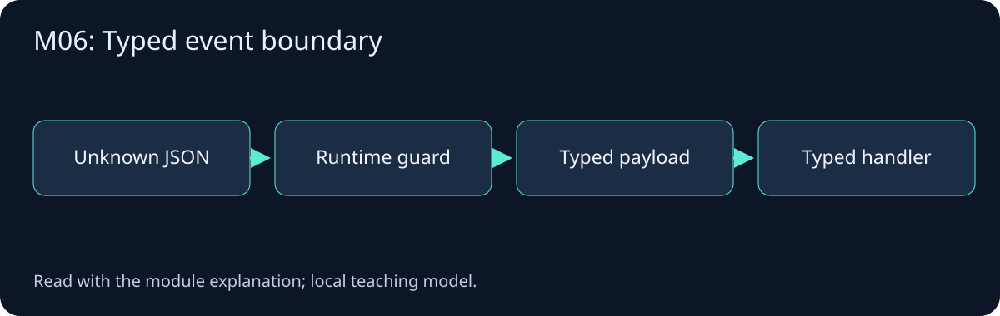

# EDP Module 06: Type-Safe Event Systems in TypeScript

[Module index](README.md) | [Setup and commands](../examples/README.md)

**Period:** Midterm · **Meeting:** 60–90 minutes · **Assessment:** Coding activity

## A. Lesson Preview & Review

An invoice handler expects a numeric total, but receives the word “sixty.” Catch that mistake both while coding and when data arrives at runtime.

**In a nutshell:** Define a typed event map and generic channel. We will run a small example, explain its behavior and change one part ourselves.

**Learning targets**

1. Define a typed event map and generic channel.
2. Reject malformed external data with a runtime guard.
3. Explain callback lifetime and compile-time versus runtime checks.

**Before class:** Earlier core lessons or their supplied runnable checkpoints. No database or broker installation is required for this lesson. Read the example filenames below and keep a clean copy before editing.

**60-minute route:** 5 minutes preview, 15 explanation/demo, 30 coding, 10 review. For 90 minutes, add 15 guided exploration and 15 debugging/feedback.

**Scope:** Prioritize the runnable core and learning targets. The later comparisons are reference reading or teacher demonstrations; do not attempt every extension in one meeting. Finals modules introduce no new infrastructure.

## Visual Guide & HTML Presentation Notes

**Technology visual anchors:** 



**What the sample image explains:** TypeScript checks source; the runtime guard checks external data.

**Suggested slides:**

1. Opening: show this diagram and ask students to predict the flow before revealing the explanation.
2. Concept: reveal one labeled stage at a time; connect it to the matching code rather than putting the whole lesson on screen.
3. Code/output: use a readable code panel beside a real output capture from the supplied example. Label input, expected output and any failure state.
4. Practice: keep the quiz or coding task readable and separate from its answer/explanation.

**Sample image to capture:** Run this module’s supplied program and capture the terminal with the meaningful result visible. Include a caption naming the command and the observed behavior; avoid invented output screenshots.

**Projector text:** use scalable text, minimum 16px everywhere; aim for 24–32px body text on classroom screens. Scale code and diagram labels too. Give a diagram its own slide when labels would become small. See the [visual guide and scalable presentation prompt](../visuals/README.md).

## B. Main Lesson

### Describe payloads before broadcasting them

An interface or type alias describes the shape of a value for the compiler. `Order` contains a string ID and numeric total. The event map associates each name with its own payload. `keyof Events` represents allowed event names; `Events[K]` selects the corresponding payload type. A generic function preserves that relationship for a concrete call.

The mapped `Channels<M>` type creates a channel for every key in M. This avoids one untyped dictionary accepting any payload everywhere. Each `Channel<T>` stores listeners that accept T. The public on method returns an unsubscribe function, so callers do not need access to the Set itself. A snapshot of listeners is iterated: adding a new listener during dispatch affects a later emission, rather than extending the current iteration.

### Static checking is not external validation

Run `npm run typecheck`. Uncommenting the wrong total produces a compiler error. Node's ability to execute erasable TypeScript syntax does not perform these checks. JSON.parse returns data that must not be trusted merely because we want it to be an Order. Assign it to `unknown`, inspect it, and narrow it using `isOrder`.

The guard rejects null, checks primitive types, requires a nonempty ID and checks that total is finite and nonnegative. `typeof NaN` is number, so typeof alone is not enough for all numeric rules. A guard's claimed type predicate is a promise made by the programmer; a bad guard can lie. Schema libraries such as Zod/Valibot offer another approach, but their schemas still need correct business constraints.

### DOM and domain unions

In browser TypeScript, a selected element may be null or a general HTMLElement. Narrow with an instanceof check before reading input-specific properties. An event target is not automatically the input you expected. A domain union can discriminate between `{ type: 'created', ... }` and `{ type: 'cancelled', ... }`; switching on type then narrows the data. These patterns help make invalid states harder to express.

CustomEvent<T> describes detail for typed code, but does not validate messages crossing a trust boundary. The same is true of typed Socket.IO or emitter APIs. Incoming network data needs runtime checks irrespective of how carefully local interfaces were declared.

### Define behavioral contracts too

Our channel dispatch is synchronous, ignores returned listener results and propagates a thrown synchronous listener error. It is not EventEmitter and has no special error event. Type safety alone says nothing about retries, buffering, cancellation or async rejections. Document these choices alongside types. The unsubscribe demonstration emits A3 after removal and intentionally produces no invoice output.

Keep code checking and program execution as separate commands. The pack pins TypeScript and Node typings; upgrading either can expose new errors that should be reviewed rather than suppressed with broad any casts.

## C. Analogy, Guided Program & Practice

### Everyday connection

The event map is a labeled delivery form: “order.created” needs an ID and amount. The type checker checks forms you fill out in the office; runtime validation checks parcels arriving from outside.

### Run the complete example

Run commands from the `EDP/examples` folder. Install the pinned dependencies once with `npm ci`; most `.mjs` examples otherwise use only Node built-ins. See the setup guide for the verified runtime.

```powershell
npm run typecheck
node m06.ts
```

The verified Node 24 runtime executes this erasable TypeScript syntax; typecheck is still required. Node execution alone does not validate types.

### File: `m06.ts`

[Open runnable file](../examples/m06.ts)

```typescript
type Order = { id: string; total: number };
type Events = { 'order.created': Order; 'order.cancelled': { id: string } };
class Channel<T> {
  private listeners = new Set<(payload: T) => void>();
  on(listener: (payload: T) => void): () => void {
    this.listeners.add(listener);
    return () => { this.listeners.delete(listener); };
  }
  emit(payload: T): void {
    for (const listener of [...this.listeners]) listener(payload);
  }
}
type Channels<M> = { [K in keyof M]: Channel<M[K]> };
const bus: Channels<Events> = {
  'order.created': new Channel<Order>(),
  'order.cancelled': new Channel<{ id: string }>()
};
function emit<K extends keyof Events>(name: K, payload: Events[K]): void {
  bus[name].emit(payload);
}
function isOrder(value: unknown): value is Order {
  if (typeof value !== 'object' || value === null) return false;
  const candidate = value as Record<string, unknown>;
  return typeof candidate.id === 'string' && candidate.id.length > 0
    && typeof candidate.total === 'number'
    && Number.isFinite(candidate.total) && candidate.total >= 0;
}
const off = bus['order.created'].on(order => console.log('Invoice:', order.id, order.total));
const input: unknown = JSON.parse('{"id":"A1","total":60}');
if (isOrder(input)) emit('order.created', input);
const bad: unknown = { id: 'A2', total: 'sixty' };
console.log('Bad payload accepted:', isOrder(bad));
off();
emit('order.created', { id: 'A3', total: 30 });
// Uncomment to see a compile-time error, then restore before submitting:
// emit('order.created', { id: 'A4', total: 'wrong' });
```

### Expected behavior and explanation checkpoint

Invoice: A1 60; Bad payload accepted: false. A3 prints no invoice because the listener was removed.

Before editing, identify the producer/input, callback or consumer, state/output, and cleanup boundary in the code. Trace one value through the program. Explain which line changes the outcome rather than only reading the console aloud.

### Your independent change

Add a string reason to order.cancelled and a listener that displays it. Demonstrate one valid call, one intentionally invalid compile-time call (comment it afterward), and one invalid runtime payload.

**Checkpoint:** Predict → run → explain → modify. *Hindi sapat na gumana dahil kinopya; dapat kaya mong sabihin kung bakit at baguhin ang isang behavior.*

### Troubleshooting and common mistake

Using `as Order` on untrusted JSON suppresses doubt rather than checking data. A channel must not accept async listeners without an explicit rejection policy just because TypeScript allows a callback shape.

If a command fails before any lesson output, check the working folder, filename, Node version and installed packages first. Distinguish setup errors from a deliberately rejected input or handled runtime failure.

### Sa madaling salita

Tinutulungan tayo ng types habang nagsusulat. Pero ang data galing sa labas ay kailangan pa ring suriin habang tumatakbo ang program.

[Quick reference and glossary](QUICK_REFERENCE.md)

## D. Assessment, Wrap-Up & References

### One coding activity

**Task:** Add a string reason to order.cancelled and a listener that displays it. Demonstrate one valid call, one intentionally invalid compile-time call (comment it afterward), and one invalid runtime payload.

**Submit one folder or archive containing:**

1. Your complete modified program and any files needed to run it.
2. A short README with the exact command and expected result.
3. Evidence of one successful case and one rejected/failing case, plus a brief explanation of your independent change.

| Criterion | Points | Evidence |
| --- | ---: | --- |
| Required behavior | 4 | Core works (2); requested independent change works (2) |
| Error/edge behavior | 2 | Failure is detected (1); response preserves intended state or reports a clear limit (1) |
| Understanding | 2 | Explain event/data flow (1); explain your own change (1) |
| Reproducibility/readability | 2 | Commands/files are complete (1); names and small structure are understandable (1) |
| Total | 10 | One activity, no separate quiz |

### Wrap-up

Define a typed event map and generic channel. Explain callback lifetime and compile-time versus runtime checks.

**Exit reflection (ungraded):** What event or operation started the flow, what state changed, and what happens if that flow cannot complete? Name one assumption the sample deliberately makes.

**Next connection:** The next module builds on this core. Keep your working checkpoint; an independent starter is supplied if you need to restart.

### References and further reading

- [Official/reference documentation: www.typescriptlang.org](https://www.typescriptlang.org/docs/handbook/2/generics.html)
- [Official/reference documentation: www.typescriptlang.org](https://www.typescriptlang.org/docs/handbook/2/narrowing.html)
- [Official/reference documentation: www.typescriptlang.org](https://www.typescriptlang.org/docs/handbook/2/mapped-types.html)

The prose and classroom code are original teaching examples informed by the references. Source reports are research inputs, not authority for unverified claims. Read [validation notes](../instructor/VALIDATION.md) before distributing a new toolchain version.
