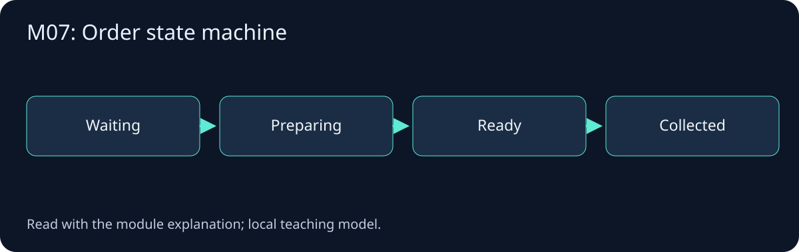

# EDP Module 07: Core Patterns, State Machines, and Framework Connections

[Module index](README.md) | [Setup and commands](../examples/README.md)

**Period:** Midterm · **Meeting:** 60–90 minutes · **Assessment:** 10-item quiz

## A. Lesson Preview & Review

An order cannot be collected before it is ready. Naming events is not enough; we also need rules for valid transitions.

**In a nutshell:** Differentiate Observer, Pub/Sub and mediator. We will run a small example, explain its behavior and change one part ourselves.

**Learning targets**

1. Differentiate Observer, Pub/Sub and mediator.
2. Read and change a finite state machine.
3. Separate commands, facts and queries in a small domain.

**Before class:** Earlier core lessons or their supplied runnable checkpoints. No database or broker installation is required for this lesson. Read the example filenames below and keep a clean copy before editing.

**60-minute route:** 5 minutes preview, 25 explanation/demo, 15 guided code, 10 quiz, 5 feedback. For 90 minutes, add 15 minutes practice and 15 discussion/debugging.

**Scope:** Prioritize the runnable core and learning targets. The later comparisons are reference reading or teacher demonstrations; do not attempt every extension in one meeting. Finals modules introduce no new infrastructure.

## Visual Guide & HTML Presentation Notes



**What the sample image explains:** Only allowed transitions succeed. A direct waiting-to-collected command is rejected.

**Suggested slides:**

1. Opening: show this diagram and ask students to predict the flow before revealing the explanation.
2. Concept: reveal one labeled stage at a time; connect it to the matching code rather than putting the whole lesson on screen.
3. Code/output: use a readable code panel beside a real output capture from the supplied example. Label input, expected output and any failure state.
4. Practice: keep the quiz or coding task readable and separate from its answer/explanation.

**Sample image to capture:** Run this module’s supplied program and capture the terminal with the meaningful result visible. Include a caption naming the command and the observed behavior; avoid invented output screenshots.

**Projector text:** use scalable text, minimum 16px everywhere; aim for 24–32px body text on classroom screens. Scale code and diagram labels too. Give a diagram its own slide when labels would become small. See the [visual guide and scalable presentation prompt](../visuals/README.md).

## B. Main Lesson

### Patterns solve different coupling problems

Observer lets a subject notify registered observers. Pub/Sub routes publications through topics or channels so publishers need not hold each consumer reference. A mediator centralizes collaboration rules between participants. An event bus can implement part of these patterns, but the existence of a bus does not automatically create a well-designed architecture.

Ask what must change when a new reaction is added. If the publisher contains every consumer's implementation, coupling remains high. If nobody can trace who handles a topic, an overly broad bus creates hidden dependencies. Keep event names specific, payloads documented and ownership clear.

### Commands ask; events tell

`prepare` requests a transition. It can be rejected. An `order.preparing` fact would only be published after accepting the transition. A query reads current status without changing it. Do not label an unapproved request as an already completed fact. When several effects must occur, decide which one establishes the fact and which are follow-up reactions.

State is the program's current condition; a transition maps a valid command in that state to another state. Our table permits waiting → preparing → ready → collected, with cancellation from waiting. Collected and cancelled are terminal in this tiny model. Undefined entries mean invalid actions, not “do whatever the UI requested.”

### Guards, actions and testable rules

A guard is a condition checked before allowing a transition, such as a payment requirement. An action is work performed because the transition happens. Keep pure transition decisions separate from side effects where possible so tests can explore rules without contacting a real service. A diagram helps identify missing cases: can a preparing order be cancelled, and if so what happens to inventory?

The sample mutates a single local state variable for readability. A larger design can return a new state from a pure reducer. UI controls should reflect allowed commands, but disabling a button is not a security boundary. Server-side rules must still reject invalid commands.

### Framework connections and domain modeling

React handlers update state, reducers encode transitions and effects manage external synchronization. Vue/Angular and signals-based systems offer other mechanisms to track dependencies and updates. Signals generally describe reactive value dependencies; domain events describe occurrences. Avoid pretending all frameworks share one lifecycle or that using a framework replaces explicit cleanup.

For a short event-storming exercise, write commands, events and actors on separate cards. Start with “student places order,” “order created,” and “kitchen starts preparation.” Mark where failure can occur and who owns the decision. This is a discussion tool, not a demand to deploy microservices. Python/asyncio can be compared conceptually if present in the source reports; required implementation remains JS/TS.

## C. Analogy, Guided Program & Practice

### Everyday connection

A parcel has statuses: received, dispatched, delivered. You cannot truthfully announce delivery merely because someone pressed a button. The state machine enforces the story.

### Run the complete example

Run commands from the `EDP/examples` folder. Install the pinned dependencies once with `npm ci`; most `.mjs` examples otherwise use only Node built-ins. See the setup guide for the verified runtime.

```powershell
node m07.mjs
```

Wait for completion and compare behavior with the expected trace before editing.

### File: `m07.mjs`

[Open runnable file](../examples/m07.mjs)

```javascript
const transitions = {
  waiting: { prepare: 'preparing', cancel: 'cancelled' },
  preparing: { finish: 'ready' },
  ready: { collect: 'collected' },
  collected: {}, cancelled: {}
};
let state = 'waiting';
function send(command) {
  const next = transitions[state][command];
  if (!next) { console.log('Rejected:', command, 'in', state); return false; }
  console.log(state, '->', next);
  state = next;
  return true;
}
send('collect');
send('prepare'); send('finish'); send('collect');
send('collect');
```

### Expected behavior and explanation checkpoint

collect is rejected in waiting; waiting → preparing → ready → collected; another collect is rejected.

Before editing, identify the producer/input, callback or consumer, state/output, and cleanup boundary in the code. Trace one value through the program. Explain which line changes the outcome rather than only reading the console aloud.

### Your independent change

Sketch a cancelled transition from preparing and specify its required recovery action before changing code. Explain why a direct jump to collected should remain rejected.

**Checkpoint:** Predict → run → explain → modify. *Hindi sapat na gumana dahil kinopya; dapat kaya mong sabihin kung bakit at baguhin ang isang behavior.*

### Troubleshooting and common mistake

Many independent Boolean flags can describe impossible combinations such as ready and cancelled at once. One explicit state plus guards can make those combinations visible.

If a command fails before any lesson output, check the working folder, filename, Node version and installed packages first. Distinguish setup errors from a deliberately rejected input or handled runtime failure.

### Sa madaling salita

Hindi lahat ng action ay puwede sa lahat ng state. Kung hindi pa ready ang order, hindi pa dapat tanggapin ang collect.

[Quick reference and glossary](QUICK_REFERENCE.md)

## D. Assessment, Wrap-Up & References

### 10-item quiz

One point per item. Answer after the explanation and guided practice. Give short answers; no extra graded coding submission today. The instructor keeps the answer key separately.

1. What is a state-machine guard?
2. What responsibility does a mediator centralize?
3. Is order.created a request or an accepted fact?
4. In the supplied machine, what happens to collect in waiting?
5. Starting at waiting, apply prepare then finish. What is the state?
6. After collect from ready, what happens to another collect?
7. Why can independent isReady and isCancelled flags be risky?
8. A button is disabled, so the server skips transition validation. What is wrong?
9. When should a preparing fact be emitted?
10. A team cannot trace who handles events on one giant bus. Suggest one improvement.
### Wrap-up

Differentiate Observer, Pub/Sub and mediator. Separate commands, facts and queries in a small domain.

**Exit reflection (ungraded):** What event or operation started the flow, what state changed, and what happens if that flow cannot complete? Name one assumption the sample deliberately makes.

**Next connection:** The next module builds on this core. Keep your working checkpoint; an independent starter is supplied if you need to restart.

### References and further reading

- [Official/reference documentation: react.dev](https://react.dev/learn/extracting-state-logic-into-a-reducer)
- [Official/reference documentation: developer.mozilla.org](https://developer.mozilla.org/en-US/docs/Web/API/EventTarget)

The prose and classroom code are original teaching examples informed by the references. Source reports are research inputs, not authority for unverified claims. Read [validation notes](../instructor/VALIDATION.md) before distributing a new toolchain version.
