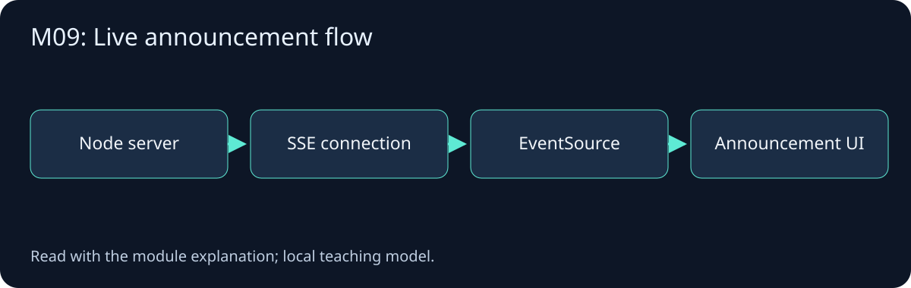

# EDP Module 09: Client–Server Real-Time Events and Messaging Channels

[Module index](README.md) | [Setup and commands](../examples/README.md)

**Period:** Midterm · **Meeting:** 60–90 minutes · **Assessment:** 10-item quiz

## A. Lesson Preview & Review

An announcement board should update without students repeatedly pressing Refresh. We will use a real local HTTP connection, not pretend that a local emitter crosses the network.

**In a nutshell:** Select SSE versus WebSocket for a communication need. We will run a small example, explain its behavior and change one part ourselves.

**Learning targets**

1. Select SSE versus WebSocket for a communication need.
2. Run a local SSE server and validate received messages.
3. Handle connection status and close the stream.

**Before class:** Earlier core lessons or their supplied runnable checkpoints. No database or broker installation is required for this lesson. Read the example filenames below and keep a clean copy before editing.

**60-minute route:** 5 minutes preview, 25 explanation/demo, 15 guided code, 10 quiz, 5 feedback. For 90 minutes, add 15 minutes practice and 15 discussion/debugging.

**Scope:** Prioritize the runnable core and learning targets. The later comparisons are reference reading or teacher demonstrations; do not attempt every extension in one meeting. Finals modules introduce no new infrastructure.

## Visual Guide & HTML Presentation Notes

**Technology visual anchors:** 



**What the sample image explains:** The stream is server-to-client; the sample has no durable replay.

**Suggested slides:**

1. Opening: show this diagram and ask students to predict the flow before revealing the explanation.
2. Concept: reveal one labeled stage at a time; connect it to the matching code rather than putting the whole lesson on screen.
3. Code/output: use a readable code panel beside a real output capture from the supplied example. Label input, expected output and any failure state.
4. Practice: keep the quiz or coding task readable and separate from its answer/explanation.

**Sample image to capture:** Use the checked browser screenshot linked below, then capture your own edited result.

**Projector text:** use scalable text, minimum 16px everywhere; aim for 24–32px body text on classroom screens. Scale code and diagram labels too. Give a diagram its own slide when labels would become small. See the [visual guide and scalable presentation prompt](../visuals/README.md).


## B. Main Lesson

### Choose the direction and lifetime

Polling asks the server for updates repeatedly. Server-sent events (SSE) keeps an HTTP response open so the server can stream text events to the client. WebSocket supports two-way messaging over an upgraded connection. Socket.IO is a higher-level protocol/library with its own handshake and behavior; a Socket.IO endpoint is not automatically compatible with a raw WebSocket client.

A one-way order board fits SSE. Interactive chat might use WebSocket, though client requests plus SSE can also solve some two-way application workflows. Decide from requirements, reconnect behavior, infrastructure and deployment constraints—not from which name sounds newer.

### The wire format and browser client

The server replies with `text/event-stream`. Each message has fields such as id, event and data, and ends with a blank line. The data field contains serialized JSON, but SSE itself is text framing. Our client listens for the custom announcement event, parses data and verifies that text is a string. It appends text safely and caps visible rows at 20.

EventSource emits open/error notifications and ordinarily reconnects after an interrupted connection. Our status shows that attempt rather than claiming successful recovery. Closing the source explicitly stops it. On the server, closing the request clears that connection's interval so disconnected users do not leave timers running.

### Delivery is not automatically durable

The example restarts its counter for each connection and retains no history. Although it sends IDs, it does not implement replay from Last-Event-ID. Reconnection can therefore miss or repeat business information. A production service needs stable IDs, a retention policy, resume semantics and an appropriate deduplication strategy. Transport connectivity is not equivalent to exactly-once business processing.

Validate messages and authenticate users on a real service. Decide how credentials are carried using supported mechanisms; do not put private secrets into URLs. Rate limits, connection limits, TLS, proxy buffering and idle timeouts matter for deployment. Keep this server bound to loopback for the classroom.

### Other communication channels

BroadcastChannel exchanges messages among compatible same-origin contexts; it is not an internet broker. MessageChannel connects two message ports. postMessage can communicate between windows/workers: validate origin, source and payload, and use a specific target origin when sending cross-window data. A worker message is another boundary requiring a clear data contract.

For today's core, start the supplied server, open the page, observe messages, stop the server to see reconnect status, then restart and finally press Disconnect. Full broker setup, remote hosting and authentication implementation are beyond this short lesson.

## C. Analogy, Guided Program & Practice

### Everyday connection

SSE is a school announcement speaker: the office speaks and listeners receive. WebSocket is closer to a phone call where both ends can send messages during the connection.

### Run the complete example

Run commands from the `EDP/examples` folder. Install the pinned dependencies once with `npm ci`; most `.mjs` examples otherwise use only Node built-ins. See the setup guide for the verified runtime.

```powershell
npm run serve
```

Open http://127.0.0.1:4173/m09.html. Keep the terminal running. Stop/restart it to observe connection status; press Disconnect to close the stream. Do not start a second server on the same port.

### File: `server.mjs`

[Open runnable file](../examples/server.mjs)

```javascript
import { createServer } from 'node:http';
import { readFile } from 'node:fs/promises';
const routes = new Map([
  ['/', 'm03-first.html'], ['/m03-first.html', 'm03-first.html'],
  ['/m03.html', 'm03.html'], ['/m08.html', 'm08.html'], ['/m09.html', 'm09.html'],
  ['/vendor/rxjs.umd.min.js', 'node_modules/rxjs/dist/bundles/rxjs.umd.min.js']
]);
const server = createServer(async (req, res) => {
  if (req.url === '/events') {
    res.writeHead(200, { 'Content-Type': 'text/event-stream', 'Cache-Control': 'no-cache' });
    let id = 0;
    const timer = setInterval(() => {
      res.write(`id: ${++id}\nevent: announcement\ndata: ${JSON.stringify({ text: 'Order ready ' + id })}\n\n`);
    }, 300);
    req.on('close', () => clearInterval(timer));
    return;
  }
  const file = routes.get(req.url);
  if (!file) { res.writeHead(404); res.end('Not found'); return; }
  try {
    const content = await readFile(new URL(file, import.meta.url));
    res.writeHead(200, { 'Content-Type': file.endsWith('.js') ? 'text/javascript; charset=utf-8' : 'text/html; charset=utf-8' });
    res.end(content);
  } catch { res.writeHead(500); res.end('Cannot read lesson file'); }
});
server.listen(4173, '127.0.0.1', () => console.log('Open http://127.0.0.1:4173/m03.html or /m09.html'));
// Stop with Ctrl+C. This loopback teaching service has no auth or durable replay.
```

### File: `m09.html`

[Open runnable file](../examples/m09.html)

```html
<!doctype html><html lang="en"><meta charset="utf-8"><title>Live announcements</title>
<body><h1>Live announcements</h1><p id="status" aria-live="polite">Connecting</p>
<ul id="messages"></ul><button id="stop">Disconnect</button>
<script>
const status = document.getElementById('status');
const list = document.getElementById('messages');
const source = new EventSource('/events');
source.addEventListener('open', () => { status.textContent = 'Connected'; });
source.addEventListener('error', () => { status.textContent = 'Connection interrupted; retrying'; });
source.addEventListener('announcement', event => {
  try {
    const message = JSON.parse(event.data);
    if (typeof message.text !== 'string') throw new Error('Invalid message');
    const li = document.createElement('li');
    li.textContent = message.text;
    list.append(li);
    if (list.children.length > 20) list.firstElementChild.remove();
  } catch { status.textContent = 'Rejected invalid announcement'; }
});
function close() { source.close(); status.textContent = 'Disconnected'; }
document.getElementById('stop').addEventListener('click', close);
window.addEventListener('pagehide', close, { once: true });
</script></body></html>
```

### Expected behavior and explanation checkpoint

Connected appears, followed by Order ready 1, 2, 3… Disconnect changes status and stops new rows. Restarting the server creates a fresh sequence; it does not recover missed history.

Before editing, identify the producer/input, callback or consumer, state/output, and cleanup boundary in the code. Trace one value through the program. Explain which line changes the outcome rather than only reading the console aloud.

### Your independent change

Add a visible received-message count independent of the capped list. Explain whether reconnect duplicates should count as new business events.

**Checkpoint:** Predict → run → explain → modify. *Hindi sapat na gumana dahil kinopya; dapat kaya mong sabihin kung bakit at baguhin ang isang behavior.*

### Troubleshooting and common mistake

Opening m09.html as a file gives the wrong origin for /events; use the local HTTP URL. A proxy that buffers responses can prevent timely updates even when server code is correct.

If a command fails before any lesson output, check the working folder, filename, Node version and installed packages first. Distinguish setup errors from a deliberately rejected input or handled runtime failure.

### Sa madaling salita

May tunay na network connection dito. Kapag reconnect, hindi ibig sabihin na naibalik na rin ang lahat ng nawalang messages.

[Quick reference and glossary](QUICK_REFERENCE.md)

## D. Assessment, Wrap-Up & References

### 10-item quiz

One point per item. Answer after the explanation and guided practice. Give short answers; no extra graded coding submission today. The instructor keeps the answer key separately.

1. Which direction does an SSE connection carry its streamed events?
2. Is a raw WebSocket client automatically a Socket.IO client?
3. What MIME type identifies the SSE response?
4. The sample receives JSON containing text: Order ready 1. What is displayed?
5. What happens after pressing Disconnect?
6. Does restarting this sample server replay missed history?
7. Why does opening m09.html directly as a file fail to connect properly to /events?
8. Why can a message be unsafe even when JSON.parse succeeds?
9. Choose a simple transport for a one-way school announcement feed.
10. How should cross-window postMessage receivers validate messages?
### Wrap-up

Select SSE versus WebSocket for a communication need. Handle connection status and close the stream.

**Exit reflection (ungraded):** What event or operation started the flow, what state changed, and what happens if that flow cannot complete? Name one assumption the sample deliberately makes.

**Next connection:** The next module builds on this core. Keep your working checkpoint; an independent starter is supplied if you need to restart.

### References and further reading

- [Official/reference documentation: developer.mozilla.org](https://developer.mozilla.org/en-US/docs/Web/API/Server-sent_events/Using_server-sent_events)
- [Official/reference documentation: developer.mozilla.org](https://developer.mozilla.org/en-US/docs/Web/API/WebSocket)
- [Official/reference documentation: developer.mozilla.org](https://developer.mozilla.org/en-US/docs/Web/API/Window/postMessage)

The prose and classroom code are original teaching examples informed by the references. Source reports are research inputs, not authority for unverified claims. Read [validation notes](../instructor/VALIDATION.md) before distributing a new toolchain version.
