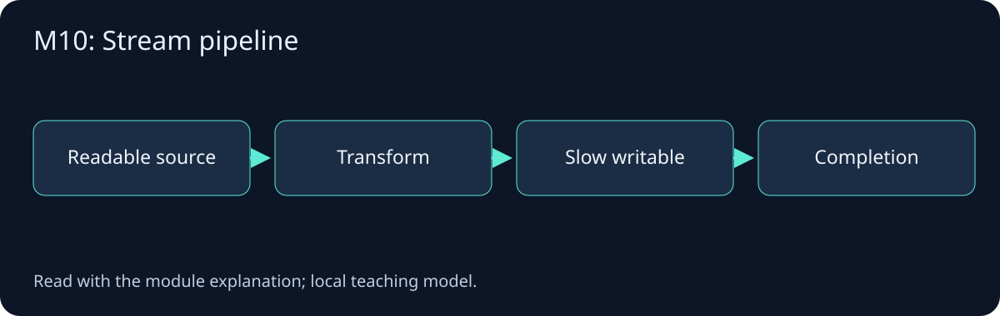

# EDP Module 10: Streams, Backpressure, Workers, and Background Work

[Module index](README.md) | [Setup and commands](../examples/README.md)

**Period:** Midterm · **Meeting:** 60–90 minutes · **Assessment:** Coding activity

## A. Lesson Preview & Review

A producer can generate records faster than a slow writer saves them. More memory is not a sustainable flow-control policy.

**In a nutshell:** Build a readable-transform-writable pipeline. We will run a small example, explain its behavior and change one part ourselves.

**Learning targets**

1. Build a readable-transform-writable pipeline.
2. Explain backpressure and completion/error handling.
3. Compare a worker with ordinary async waiting.

**Before class:** Earlier core lessons or their supplied runnable checkpoints. No database or broker installation is required for this lesson. Read the example filenames below and keep a clean copy before editing.

**60-minute route:** 5 minutes preview, 15 explanation/demo, 30 coding, 10 review. For 90 minutes, add 15 guided exploration and 15 debugging/feedback.

**Scope:** Prioritize the runnable core and learning targets. The later comparisons are reference reading or teacher demonstrations; do not attempt every extension in one meeting. Finals modules introduce no new infrastructure.

## Visual Guide & HTML Presentation Notes

**Technology visual anchors:** 



**What the sample image explains:** Backpressure communicates capacity upstream; highWaterMark is not a universal hard memory cap.

**Suggested slides:**

1. Opening: show this diagram and ask students to predict the flow before revealing the explanation.
2. Concept: reveal one labeled stage at a time; connect it to the matching code rather than putting the whole lesson on screen.
3. Code/output: use a readable code panel beside a real output capture from the supplied example. Label input, expected output and any failure state.
4. Practice: keep the quiz or coding task readable and separate from its answer/explanation.

**Sample image to capture:** Run this module’s supplied program and capture the terminal with the meaningful result visible. Include a caption naming the command and the observed behavior; avoid invented output screenshots.

**Projector text:** use scalable text, minimum 16px everywhere; aim for 24–32px body text on classroom screens. Scale code and diagram labels too. Give a diagram its own slide when labels would become small. See the [visual guide and scalable presentation prompt](../visuals/README.md).

## B. Main Lesson

### Streams process chunks

A Readable supplies chunks, a Writable accepts them, a Duplex does both, and a Transform changes input into output. Chunks may be bytes or, in object mode, JavaScript values. Processing incrementally avoids loading an entire large dataset before useful work can begin. It also creates a responsibility to handle errors and completion across the whole chain.

Our source yields three strings. A Transform uppercases each. The Writable simulates a slow save by calling its completion callback later. Calling done signals that this chunk has been handled; forgetting it stalls the pipeline, while calling it twice is a bug. Errors should be passed through the callback or supported promise interface, not swallowed.

### Backpressure is feedback

A writable can signal that its buffer is full enough for the producer to pause. With manual write calls, a false result means wait for drain before continuing. Pipeline handles flow coordination and errors for the linked streams. highWaterMark is a buffering threshold, not a universal hard memory cap; chunk sizes, object references and upstream behavior still matter.

The small example uses object mode and a low threshold so the behavior can be discussed without huge data. Slowing the sink should lengthen completion, not make us spin in a loop checking whether it is ready. A pipeline completion promise means the connected work finished or failed; do not print success immediately after starting it.

### Async iterables and bounded queues

`for await...of` consumes asynchronous sequences and can make flow readable. However, an upstream source can still buffer aggressively. Set queue limits and decide whether overflow should wait, drop, reject or coalesce. These policies depend on the data: dropping intermediate mouse positions may be acceptable; silently dropping payment records is not.

Cancellation should reach sources and destinations, and cleanup should release file handles/listeners. A long-running service should stop accepting new work and allow bounded drain time on shutdown. A service worker in the browser has an OS/browser-managed lifecycle and is not a guaranteed forever-running process.

### Workers for suitable CPU work

Awaiting a file read allows other work while I/O is pending. A heavy JavaScript loop still occupies its thread. A worker provides another JavaScript execution context and communicates through messages; data is usually cloned or deliberately transferred, and startup/communication has overhead. Shared memory requires careful synchronization, not ordinary unsynchronized writes.

The optional worker sums one million integers. Its purpose is to show message exchange and main-thread availability, not to claim that every calculation is faster in a worker. Measure realistic workloads before adding one. The core submission is the stream pipeline; the worker comparison is ungraded extension material.

## C. Analogy, Guided Program & Practice

### Everyday connection

A slow cashier asks the queue attendant to admit fewer customers at a time. Backpressure communicates capacity upstream; it is not merely adding more waiting chairs.

### Run the complete example

Run commands from the `EDP/examples` folder. Install the pinned dependencies once with `npm ci`; most `.mjs` examples otherwise use only Node built-ins. See the setup guide for the verified runtime.

```powershell
node m10.mjs
```

Wait for completion and read the entire output. For Module 10 the worker files are optional; run node m10-worker.mjs separately.

### File: `m10.mjs`

[Open runnable file](../examples/m10.mjs)

```javascript
import { Readable, Transform, Writable } from 'node:stream';
import { pipeline } from 'node:stream/promises';
const source = Readable.from(['order a1', 'order a2', 'order a3']);
const uppercase = new Transform({
  objectMode: true,
  transform(chunk, encoding, done) { done(null, chunk.toUpperCase()); }
});
const destination = new Writable({
  objectMode: true, highWaterMark: 1,
  write(chunk, encoding, done) {
    setTimeout(() => { console.log('Saved:', chunk); done(); }, 10);
  }
});
try { await pipeline(source, uppercase, destination); console.log('Pipeline complete'); }
catch (error) { console.log('Pipeline failed:', error.message); }
```

### File: `m10-worker.mjs`

[Open runnable file](../examples/m10-worker.mjs)

```javascript
import { Worker } from 'node:worker_threads';
const worker = new Worker(new URL('./worker.mjs', import.meta.url), { workerData: 1000000 });
worker.on('message', result => console.log('Worker result:', result));
worker.on('error', error => { console.error(error); process.exitCode = 1; });
worker.on('exit', code => { if (code !== 0) process.exitCode = 1; });
console.log('Main thread remains available');
```

### File: `worker.mjs`

[Open runnable file](../examples/worker.mjs)

```javascript
import { parentPort, workerData } from 'node:worker_threads';
let sum = 0;
for (let i = 1; i <= workerData; i++) sum += i;
parentPort.postMessage(sum);
```

### Expected behavior and explanation checkpoint

Saved: ORDER A1 → Saved: ORDER A2 → Saved: ORDER A3 → Pipeline complete. Optional worker: Main thread remains available, then Worker result: 500000500000.

Before editing, identify the producer/input, callback or consumer, state/output, and cleanup boundary in the code. Trace one value through the program. Explain which line changes the outcome rather than only reading the console aloud.

### Your independent change

Add one fourth record and a deliberate transform error for a chosen record. Verify that failure is reported and success is not falsely printed; document the successful prefix.

**Checkpoint:** Predict → run → explain → modify. *Hindi sapat na gumana dahil kinopya; dapat kaya mong sabihin kung bakit at baguhin ang isang behavior.*

### Troubleshooting and common mistake

Ignoring write(false) in a manual loop can grow memory. Marking a CPU-heavy function async does not move its work off-thread. Exact worker/main output timing should not be inferred from line placement alone.

If a command fails before any lesson output, check the working folder, filename, Node version and installed packages first. Distinguish setup errors from a deliberately rejected input or handled runtime failure.

### Sa madaling salita

Kung mas mabilis ang producer kaysa consumer, kailangan ng kontrol sa daloy. Hindi solusyon ang walang katapusang pag-ipon sa memory.

[Quick reference and glossary](QUICK_REFERENCE.md)

## D. Assessment, Wrap-Up & References

### One coding activity

**Task:** Add one fourth record and a deliberate transform error for a chosen record. Verify that failure is reported and success is not falsely printed; document the successful prefix.

**Submit one folder or archive containing:**

1. Your complete modified program and any files needed to run it.
2. A short README with the exact command and expected result.
3. Evidence of one successful case and one rejected/failing case, plus a brief explanation of your independent change.

| Criterion | Points | Evidence |
| --- | ---: | --- |
| Required behavior | 4 | Core works (2); requested independent change works (2) |
| Error/edge behavior | 2 | Failure is detected (1); response preserves intended state or reports a clear limit (1) |
| Understanding | 2 | Explain event/data flow (1); explain your own change (1) |
| Reproducibility/readability | 2 | Commands/files are complete (1); names and small structure are understandable (1) |
| Total | 10 | One activity, no separate quiz |

### Wrap-up

Build a readable-transform-writable pipeline. Compare a worker with ordinary async waiting.

**Exit reflection (ungraded):** What event or operation started the flow, what state changed, and what happens if that flow cannot complete? Name one assumption the sample deliberately makes.

**Next connection:** The next module builds on this core. Keep your working checkpoint; an independent starter is supplied if you need to restart.

### References and further reading

- [Official/reference documentation: nodejs.org](https://nodejs.org/api/stream.html)
- [Official/reference documentation: nodejs.org](https://nodejs.org/api/worker_threads.html)
- [Official/reference documentation: developer.mozilla.org](https://developer.mozilla.org/en-US/docs/Web/API/Web_Workers_API/Using_web_workers)

The prose and classroom code are original teaching examples informed by the references. Source reports are research inputs, not authority for unverified claims. Read [validation notes](../instructor/VALIDATION.md) before distributing a new toolchain version.
