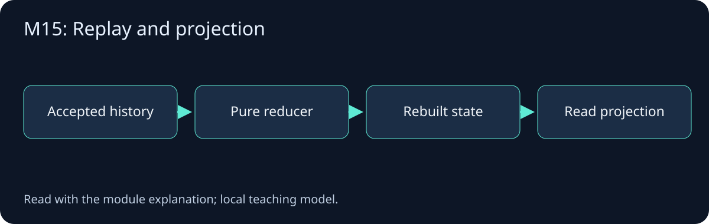

# EDP Module 15: Event Sourcing, Replay, and Read Projections

[Module index](README.md) | [Setup and commands](../examples/README.md)

**Period:** Pre-final · **Meeting:** 60–90 minutes · **Assessment:** 10-item quiz

## A. Lesson Preview & Review

Instead of storing only “8 items left,” keep the accepted stock changes that explain how the inventory reached eight.

**In a nutshell:** Rebuild state from a sequence of domain events. We will run a small example, explain its behavior and change one part ourselves.

**Learning targets**

1. Rebuild state from a sequence of domain events.
2. Separate replay from external side effects.
3. Explain projections, snapshots and concurrency risks.

**Before class:** Earlier core lessons or their supplied runnable checkpoints. No database or broker installation is required for this lesson. Read the example filenames below and keep a clean copy before editing.

**60-minute route:** 5 minutes preview, 25 explanation/demo, 15 guided code, 10 quiz, 5 feedback. For 90 minutes, add 15 minutes practice and 15 discussion/debugging.

**Scope:** Prioritize the runnable core and learning targets. The later comparisons are reference reading or teacher demonstrations; do not attempt every extension in one meeting. Finals modules introduce no new infrastructure.

## Visual Guide & HTML Presentation Notes



**What the sample image explains:** Replay computes state; it must not blindly repeat emails or payments.

**Suggested slides:**

1. Opening: show this diagram and ask students to predict the flow before revealing the explanation.
2. Concept: reveal one labeled stage at a time; connect it to the matching code rather than putting the whole lesson on screen.
3. Code/output: use a readable code panel beside a real output capture from the supplied example. Label input, expected output and any failure state.
4. Practice: keep the quiz or coding task readable and separate from its answer/explanation.

**Sample image to capture:** Run this module’s supplied program and capture the terminal with the meaningful result visible. Include a caption naming the command and the observed behavior; avoid invented output screenshots.

**Projector text:** use scalable text, minimum 16px everywhere; aim for 24–32px body text on classroom screens. Scale code and diagram labels too. Give a diagram its own slide when labels would become small. See the [visual guide and scalable presentation prompt](../visuals/README.md).

## B. Main Lesson

### History as the source of state

Event sourcing stores accepted domain events as the authoritative history from which state is derived. An ordinary debug log is not automatically an event store: logs can be incomplete, unstructured, rotated or unsuitable for deterministic reconstruction. A broker retained log also is not automatically an application's aggregate event store.

The example receives 10 units, reserves 3 and releases 1. Evolving state through that sequence gives 8. The evolve function validates the quantity and event type, then returns the next stock value. Unknown events are rejected instead of quietly ignored, because ignoring them could produce a misleading state.

### Decide before recording

A command asks to reserve stock. Load relevant history, reconstruct current state, check the business rule, and append a fact only when accepted. With concurrent writers, both could read the same old state and over-reserve. An expected version or equivalent concurrency check prevents blindly appending against an obsolete history.

Events need identity and ordering rules for their aggregate. Do not assume timestamps alone establish a safe total order across machines. Store the domain information necessary for reconstruction without treating mutable external services as part of the replay function.

### Projection and replay

A projection transforms events into a useful read model, such as current stock or daily reservations. Different projections can answer different questions. Rebuilding a projection should not resend emails or charge customers: those are live side effects with their own delivery policies. The pure evolve function contains no network calls, which makes repeated replay predictable.

Read models can lag behind the event store. The interface should show pending status where appropriate instead of claiming immediate consistency. A projection consumer also needs duplicate and version handling if delivery can repeat.

### Snapshots and evolution

A snapshot records derived state at a known sequence. Resume replay after that sequence rather than starting from the beginning. It is an optimization, not a replacement for deciding how old events remain interpretable. Our snapshot at sequence 2 holds 7; applying the remaining release yields 8 again.

Changing an old event's meaning can change every future replay. Use explicit schema evolution or carefully designed upcasting rather than rewriting history casually. Privacy, retention, audit and deletion requirements need deliberate design because immutable historical records complicate removal of personal information.

For simple CRUD, storing current state may be sufficient and clearer. Choose event sourcing when reconstructable history, audit or multiple projections justify the additional complexity. The local array teaches replay mechanics, not durable append-only storage or optimistic-concurrency implementation.

## C. Analogy, Guided Program & Practice

### Everyday connection

A bank statement lists transactions that explain a balance. Re-reading the statement should calculate the balance, not execute all the transfers again.

### Run the complete example

Run commands from the `EDP/examples` folder. Install the pinned dependencies once with `npm ci`; most `.mjs` examples otherwise use only Node built-ins. See the setup guide for the verified runtime.

```powershell
node m15.mjs
```

Wait for completion and compare behavior with the expected trace before editing.

### File: `m15.mjs`

[Open runnable file](../examples/m15.mjs)

```javascript
const history = [
  { sequence: 1, type: 'stock.received', quantity: 10 },
  { sequence: 2, type: 'stock.reserved', quantity: 3 },
  { sequence: 3, type: 'stock.released', quantity: 1 }
];
function evolve(stock, event) {
  if (!Number.isInteger(event.quantity) || event.quantity < 0) throw new Error('Invalid quantity');
  switch (event.type) {
    case 'stock.received': case 'stock.released': return stock + event.quantity;
    case 'stock.reserved':
      if (event.quantity > stock) throw new Error('Insufficient stock');
      return stock - event.quantity;
    default: throw new Error('Unknown event');
  }
}
console.log('Rebuilt stock:', history.reduce(evolve, 0));
const snapshot = { sequence: 2, stock: 7 };
console.log('From snapshot:', history.filter(e => e.sequence > snapshot.sequence).reduce(evolve, snapshot.stock));
console.log('Replay again:', history.reduce(evolve, 0));
// No emails, network writes or payments inside evolve().
```

### Expected behavior and explanation checkpoint

Rebuilt stock: 8; From snapshot: 8; Replay again: 8. Replaying is deterministic and sends no external notification.

Before editing, identify the producer/input, callback or consumer, state/output, and cleanup boundary in the code. Trace one value through the program. Explain which line changes the outcome rather than only reading the console aloud.

### Your independent change

Add a valid receipt event and calculate both full replay and snapshot replay by hand. Then try a reservation greater than available stock and explain the rejection.

**Checkpoint:** Predict → run → explain → modify. *Hindi sapat na gumana dahil kinopya; dapat kaya mong sabihin kung bakit at baguhin ang isang behavior.*

### Troubleshooting and common mistake

Side effects inside evolve run again on every replay. A snapshot with the wrong sequence can double-apply an event. A mutable log with missing records is not a reliable source of truth.

If a command fails before any lesson output, check the working folder, filename, Node version and installed packages first. Distinguish setup errors from a deliberately rejected input or handled runtime failure.

### Sa madaling salita

Ang replay ay pagbubuo ulit ng state mula sa history. Hindi ito pahintulot na ulitin ang email, bayad, o ibang external action.

[Quick reference and glossary](QUICK_REFERENCE.md)

## D. Assessment, Wrap-Up & References

### 10-item quiz

One point per item. Answer after the explanation and guided practice. Give short answers; no extra graded coding submission today. The instructor keeps the answer key separately.

1. What is the source of state in event sourcing?
2. What is a projection?
3. What does a snapshot record?
4. Receive 10, reserve 3, release 1. What stock remains?
5. Snapshot stock is 7 at sequence 2; sequence 3 releases 1. What is reconstructed?
6. Replay the same history twice using the pure reducer. Should the result change?
7. Why is sending an email inside the replay reducer dangerous?
8. Why is an ordinary rotating debug log not automatically an event store?
9. How can concurrent writers avoid appending against the same stale aggregate state?
10. Should a simple CRUD app always adopt event sourcing?
### Wrap-up

Rebuild state from a sequence of domain events. Explain projections, snapshots and concurrency risks.

**Exit reflection (ungraded):** What event or operation started the flow, what state changed, and what happens if that flow cannot complete? Name one assumption the sample deliberately makes.

**Next connection:** The next module builds on this core. Keep your working checkpoint; an independent starter is supplied if you need to restart.

### References and further reading

- [Official/reference documentation: learn.microsoft.com](https://learn.microsoft.com/en-us/azure/architecture/patterns/event-sourcing)

The prose and classroom code are original teaching examples informed by the references. Source reports are research inputs, not authority for unverified claims. Read [validation notes](../instructor/VALIDATION.md) before distributing a new toolchain version.
