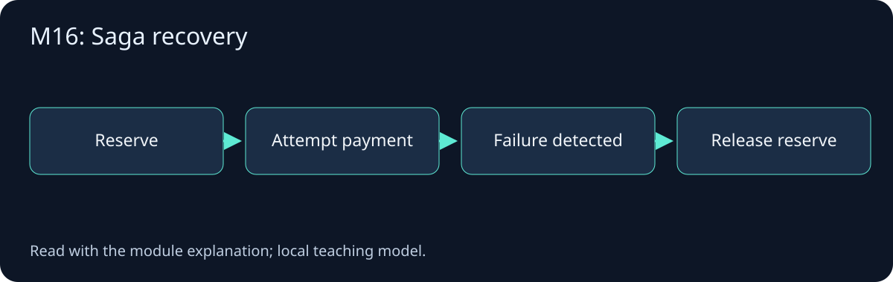

# EDP Module 16: CQRS, Sagas, and Distributed Workflow Coordination

[Module index](README.md) | [Setup and commands](../examples/README.md)

**Period:** Pre-final · **Meeting:** 60–90 minutes · **Assessment:** Coding activity

## A. Lesson Preview & Review

A reservation succeeds but payment fails. The workflow needs a recovery action, not a claim that all services can share one easy rollback.

**In a nutshell:** Distinguish command and query models. We will run a small example, explain its behavior and change one part ourselves.

**Learning targets**

1. Distinguish command and query models.
2. Trace a saga success and compensation path.
3. Explain why compensation is not necessarily a perfect rollback.

**Before class:** Earlier core lessons or their supplied runnable checkpoints. No database or broker installation is required for this lesson. Read the example filenames below and keep a clean copy before editing.

**60-minute route:** 5 minutes preview, 15 explanation/demo, 30 coding, 10 review. For 90 minutes, add 15 guided exploration and 15 debugging/feedback.

**Scope:** Prioritize the runnable core and learning targets. The later comparisons are reference reading or teacher demonstrations; do not attempt every extension in one meeting. Finals modules introduce no new infrastructure.

## Visual Guide & HTML Presentation Notes



**What the sample image explains:** Compensation is a new action and can itself fail; it is not always a perfect rollback.

**Suggested slides:**

1. Opening: show this diagram and ask students to predict the flow before revealing the explanation.
2. Concept: reveal one labeled stage at a time; connect it to the matching code rather than putting the whole lesson on screen.
3. Code/output: use a readable code panel beside a real output capture from the supplied example. Label input, expected output and any failure state.
4. Practice: keep the quiz or coding task readable and separate from its answer/explanation.

**Sample image to capture:** Run this module’s supplied program and capture the terminal with the meaningful result visible. Include a caption naming the command and the observed behavior; avoid invented output screenshots.

**Projector text:** use scalable text, minimum 16px everywhere; aim for 24–32px body text on classroom screens. Scale code and diagram labels too. Give a diagram its own slide when labels would become small. See the [visual guide and scalable presentation prompt](../visuals/README.md).

## B. Main Lesson

### CQRS separates responsibilities

Command Query Responsibility Segregation separates the model used to change state from the model used to read it. A command model enforces rules; a query model serves useful views. They can share one database or use separate stores. CQRS does not inherently require event sourcing, microservices or a message broker.

Our status map is the write-side model; an array of ID/status records is a tiny read projection. In this script the projection is built immediately. In distributed applications it can update later, so a successful command may not instantly appear in every query. Show pending/processing states and define how the UI reconciles them.

### A saga is a workflow of local steps

A saga coordinates operations that cannot use one shared local transaction. Each participant commits its own work. If a later step fails, compensating actions attempt to reach an acceptable business outcome. Reserving inventory can be compensated by releasing it; sending a notification cannot literally be unsent. A refund is a new business operation, not erasure of the original payment.

The example reserves an ID, marks it pending, then either confirms payment or releases the reservation and marks it cancelled. A Set deletion is idempotent in this model. We intentionally simulate payment failure without using a real payment service. The catch path represents one known recovery rule, not “ignore every unknown error.”

### Orchestration versus choreography

An orchestrator explicitly chooses the next step and tracks progress. Choreography lets services react to events and publish further events. Orchestration can make the workflow easier to see; choreography can reduce central coordination but hide cycles and dependencies. Neither eliminates coupling: participants must still agree on contracts and outcomes.

Write down correlation ID, current step, completed steps and retry decisions. A real workflow must persist progress so restart does not forget which actions occurred. Commands and compensations need stable IDs because retries can happen on both forward and recovery paths.

### Failure during recovery

What if releasing inventory fails? The workflow is not simply cancelled and forgotten. It may need a retry, a compensation-pending state or a manual operator action. Use timeouts, deadlines and bounded retries, and distinguish retryable infrastructure errors from a business refusal. A circuit breaker can limit calls into a failing dependency, but does not complete the business recovery by itself.

The sample handles two orders sequentially with in-memory data. It illustrates concepts without distributed transactions or crash recovery. Keep the core activity to one successful and one compensated path. A logistics/payment microservice design from the source reports is an optional architecture diagram, not a required solo deployment.

## C. Analogy, Guided Program & Practice

### Everyday connection

Booking a trip may reserve a room before a flight. If the flight fails, cancelling the room is a separate action that may have its own fee or failure—not time travel.

### Run the complete example

Run commands from the `EDP/examples` folder. Install the pinned dependencies once with `npm ci`; most `.mjs` examples otherwise use only Node built-ins. See the setup guide for the verified runtime.

```powershell
node m16.mjs
```

Wait for completion and compare behavior with the expected trace before editing.

### File: `m16.mjs`

[Open runnable file](../examples/m16.mjs)

```javascript
const reservations = new Set(); const statuses = new Map();
async function checkout(id, failPayment) {
  reservations.add(id); statuses.set(id, 'pending');
  console.log('Reserved:', id);
  try {
    if (failPayment) throw new Error('Payment declined');
    statuses.set(id, 'confirmed'); console.log('Confirmed:', id);
  } catch (error) {
    reservations.delete(id); // Idempotent compensation in this small model.
    statuses.set(id, 'cancelled'); console.log('Compensated:', id);
  }
}
await checkout('A1', true); await checkout('A2', false);
const readModel = [...statuses].map(([id, status]) => ({ id, status }));
console.log(JSON.stringify(readModel));
console.log('Active reservations:', reservations.size);
// Real sagas persist progress and can fail during compensation too.
```

### Expected behavior and explanation checkpoint

A1 is reserved then compensated; A2 is reserved then confirmed. The read model shows cancelled/confirmed, and one reservation remains active.

Before editing, identify the producer/input, callback or consumer, state/output, and cleanup boundary in the code. Trace one value through the program. Explain which line changes the outcome rather than only reading the console aloud.

### Your independent change

Add a simulated compensation failure that records compensation-pending instead of falsely claiming cancellation. Add a bounded retry or a manual-review record, and explain your choice.

**Checkpoint:** Predict → run → explain → modify. *Hindi sapat na gumana dahil kinopya; dapat kaya mong sabihin kung bakit at baguhin ang isang behavior.*

### Troubleshooting and common mistake

Catching a failure and labeling success hides unfinished recovery. Separate read models can lag. A saga cannot promise that irreversible actions are perfectly undone.

If a command fails before any lesson output, check the working folder, filename, Node version and installed packages first. Distinguish setup errors from a deliberately rejected input or handled runtime failure.

### Sa madaling salita

Kapag pumalya ang susunod na hakbang, may recovery action. Hindi laging kayang ibalik nang eksakto ang lahat sa dati.

[Quick reference and glossary](QUICK_REFERENCE.md)

## D. Assessment, Wrap-Up & References

### One coding activity

**Task:** Add a simulated compensation failure that records compensation-pending instead of falsely claiming cancellation. Add a bounded retry or a manual-review record, and explain your choice.

**Submit one folder or archive containing:**

1. Your complete modified program and any files needed to run it.
2. A short README with the exact command and expected result.
3. Evidence of one successful case and one rejected/failing case, plus a brief explanation of your independent change.

| Criterion | Points | Evidence |
| --- | ---: | --- |
| Required behavior | 4 | Core works (2); requested independent change works (2) |
| Error/edge behavior | 2 | Failure is detected (1); response preserves intended state or reports a clear limit (1) |
| Understanding | 2 | Explain event/data flow (1); explain your own change (1) |
| Reproducibility/readability | 2 | Commands/files are complete (1); names and small structure are understandable (1) |
| Total | 10 | One activity, no separate quiz |

### Wrap-up

Distinguish command and query models. Explain why compensation is not necessarily a perfect rollback.

**Exit reflection (ungraded):** What event or operation started the flow, what state changed, and what happens if that flow cannot complete? Name one assumption the sample deliberately makes.

**Next connection:** The next module builds on this core. Keep your working checkpoint; an independent starter is supplied if you need to restart.

### References and further reading

- [Official/reference documentation: learn.microsoft.com](https://learn.microsoft.com/en-us/azure/architecture/patterns/cqrs)
- [Official/reference documentation: learn.microsoft.com](https://learn.microsoft.com/en-us/azure/architecture/patterns/saga)

The prose and classroom code are original teaching examples informed by the references. Source reports are research inputs, not authority for unverified claims. Read [validation notes](../instructor/VALIDATION.md) before distributing a new toolchain version.
