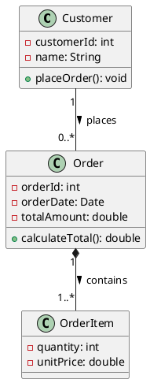
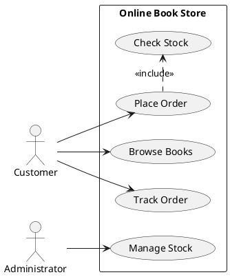
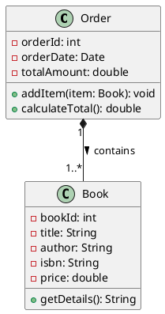

# Unified Modeling Language (UML) & Modern Software Architecture

> **Learning Objectives:**
> By the end of this lesson, you will be able to:
> *   Define what Unified Modeling Language (UML) is and identify its core building blocks.
> *   Describe the main UML diagrams (Class, Use Case, Package, etc.) and apply them to real-life software design scenarios.
> *   Understand modern evolution including **UML 2.5.1**, **C4 architecture diagrams**, **text-based modeling (Mermaid/PlantUML)**, and **AI-assisted diagramming**.
> *   Create version-controlled, executable diagrams directly in Markdown.

---

## A. Lesson Preview & Review

Good day everyone! Welcome to today's lesson on **Unified Modeling Language (UML)**. UML is a powerful standard visual language for modeling and designing software systems. Today, we will explore its various elements and how they are used to create effective and efficient designs.

Whether you are new to UML or have some experience, I am confident you will learn something new and valuable today. We will cover everything from traditional building blocks to modern diagrams-as-code approaches. Let's get started!

---

## B. Main Lesson

### 1. What is Unified Modeling Language (UML)?
**Unified Modeling Language (UML)** is a standard visual modeling language used to specify, visualize, construct, and document the artifacts of software systems, as well as for business modeling and other non-software systems. 

UML is a **general-purpose modeling language** that provides a standard way to write a system's blueprints, including conceptual things such as business processes and system functions as well as concrete things such as classes written in a specific programming language, database schemas, and reusable software components.

UML includes a set of graphical notation techniques to create visual models of object-oriented software systems. It enables developers to communicate effectively with stakeholders—such as customers and project managers—by providing a common visual language.

> **Modern Update: UML 2.5.1 and the Shift to Text-Based Modeling**
> The current standard is **UML 2.5.1** (formalized by the OMG). However, the biggest modern shift is the move from drawing tools to **Diagram-as-Code**. Tools like **Mermaid.js** and **PlantUML** allow you to define diagrams using plain text that can be stored in Git, version-controlled, and reviewed like source code. This is particularly valuable for AI-assisted development, as LLMs can easily generate and understand text-based diagram definitions.

### 2. UML Building Blocks
UML includes a set of building blocks (diagram elements) used to create visual models. The main building blocks are:

1.  **Class:** A blueprint for an object, representing a group of objects with similar characteristics and behavior. Represented by a rectangle with the class name, attributes, and operations.
2.  **Object:** An instance of a class. Represented by a rectangle with the object's name and class.
3.  **Interface:** Defines a contract for a set of operations that a class must implement. Represented by a lollipop symbol.
4.  **Package:** A container for a set of related classes and interfaces. Represented by a folder symbol.
5.  **Use case:** A sequence of interactions between a user and a system, representing a specific functionality. Represented by an oval.
6.  **Actor:** A person or system that interacts with the system. Represented by a stick figure.
7.  **Association:** A relationship between two classes. Represented by a solid line.
8.  **Generalization:** A relationship between a superclass and a subclass. Represented by a hollow arrow pointing to the superclass.
9.  **Dependency:** A relationship where a change in one class affects another. Represented by a dashed arrow.
10. **Aggregation:** A "whole-part" relationship where the part can exist independently. Represented by a hollow diamond.
11. **Composition:** A stronger "whole-part" relationship where the part cannot exist without the whole. Represented by a filled diamond.

### 3. UML Architecture & Diagram Classification
**UML architecture** refers to the use of UML diagrams to represent the structure and organization of a software system, including its components, relationships, and interactions. 

UML diagrams are classified into two main categories:

#### A. Structural Diagrams (Static)
These represent the static structure of a system, showing the objects, classes, and interfaces that make up the system, and the relationships between them.
*   **Class diagrams:** Show the static structure, classes, interfaces, and their relationships.
*   **Object diagrams:** Show a snapshot of the system's objects and their relationships at a specific point in time.
*   **Package diagrams:** Show the organization of the system into packages and their dependencies.
*   **Component diagrams:** Show the physical structure of the system, including components and their relationships.
*   **Deployment diagrams:** Show the physical deployment of the system on hardware.

#### B. Behavioral Diagrams (Dynamic)
These represent the dynamic behavior of a system, showing the interactions between objects and classes, and the flow of control.
*   **Use-case diagrams:** Show the functional requirements of the system, including use cases and actors.
*   **State machine diagrams:** Show the states and transitions of an object.
*   **Activity diagrams:** Show the flow of control and activities within a system.
*   **Sequence diagrams:** Show the interactions and message passing between objects over time.

> **Modern Update: The C4 Model for Architecture**
> While UML is excellent for code-level design, many modern architecture teams use the **C4 Model** for high-level system architecture. C4 stands for **Context, Containers, Components, and Code**. It provides a hierarchical, "zoomable" set of diagrams that are often generated as code (e.g., via Structurizr DSL or C4-PlantUML), making them much easier to keep up-to-date than traditional UML diagrams.

### 4. Visualizing Modern UML: PlantUML Examples

Let's look at how these diagrams are defined in modern development using text-based syntax.

#### A. Class Diagram (E-Commerce Order System)
A class diagram models the static structure of an e-commerce system. 

*This defines a Customer who can place many Orders, and an Order that contains many OrderItems. The `*--` denotes a composition relationship.*

#### B. Use Case Diagram (Online Bookstore)
A use case diagram captures the functional requirements and the actors who interact with the system.

*Here, the `<<include>>` relationship shows that "Place Order" always involves "Check Stock".*

> **Pro Tip:** In modern DevOps, you don't need to manually draw these diagrams. You write the text (PlantUML or Mermaid) in a Markdown file, and your Git-based workflow renders the diagram automatically. This means your architecture documentation lives right next to your code and is version-controlled.

### 5. Modern Trends: AI-Assisted Modeling and SysML v2
The discipline of software architecture modeling is being reshaped by artificial intelligence and domain-specific standards.

*   **AI-Assisted Diagramming:** Large Language Models (LLMs) can now generate PlantUML or Mermaid code from natural language prompts. For example, you can prompt an AI: *"Generate a PlantUML C4 Container diagram for a web application with a React frontend, Node.js API, and PostgreSQL database."* The AI produces the text-based diagram, which you can then refine and commit to version control.
*   **SysML v2:** For systems engineering (hardware + software), **SysML v2** (Systems Modeling Language) was recently introduced. It addresses the complexity of modern cyber-physical systems by providing a more precise, textual notation that integrates with standard software development workflows.

---

## C. Analogies and Use Cases

### The Architectural Blueprint Analogy
Think of building a house:
*   **Use Case Diagram:** The conversation with the client: "Do you want a garage? How many bedrooms?" It captures *what* the house must do.
*   **Class Diagram:** The detailed blueprint showing walls, doors, and electrical outlets. It captures the *static structure*.
*   **Sequence Diagram:** A step-by-step video showing the electrician wiring a light switch: "First the wire goes here, then to the breaker."
*   **C4 Model:** A set of maps: one showing the city (System Context), one showing the neighborhood (Containers), and one showing the floor plan (Components).

### Real-World Use Case: Modernizing a Legacy System
A team is rewriting a 15-year-old banking application. 
1.  They use **AI-assisted modeling** to parse the old COBOL code and generate PlantUML **Class Diagrams**, helping them understand the legacy data structures.
2.  They use **C4 diagrams** to map out the new cloud-native architecture.
3.  They use **Sequence diagrams** to design the interactions for the new mobile app's login flow.
4.  All diagrams are stored as **Mermaid or PlantUML text** inside the project's Git repository, so any developer can update and regenerate them with a simple commit.

---

## D. Lesson Wrap-Up / FAQs

### Summary
**UML** is a standardized visual language for modeling software systems. Its diagrams are split into **structural** (Class, Package, Component) and **behavioral** (Use Case, Sequence, Activity) categories. In modern development, UML is increasingly expressed as code (PlantUML, Mermaid) to enable version control, automated rendering, and integration with AI tooling. The **C4 model** and **SysML v2** represent the cutting edge of architectural modeling for complex, modern systems.

### Frequently Asked Questions (FAQs)

**Q: How are UML diagrams classified?**
**A:** UML diagrams are classified into two main categories: **Structural diagrams** (representing the static structure, such as classes and interfaces) and **Behavioral diagrams** (representing the dynamic behavior, such as state transitions and interactions).

**Q: What is the purpose of Package diagrams in UML?**
**A:** Package diagrams are used to represent the organization of a software system into packages and their dependencies. They provide a high-level view of the system's structure and organization, helping teams understand how different parts of the system are related and interact.

**Q: Do I still need to draw UML diagrams manually?**
**A:** While you can still use drawing tools, the modern best practice is **Diagram-as-Code**. You write text (PlantUML or Mermaid), and a tool renders the diagram. This makes diagrams version-controllable, easily updateable, and AI-friendly.

**Q: What is the difference between Aggregation and Composition?**
**A:** **Aggregation** is a "has-a" relationship where the part can exist independently of the whole (e.g., a Department has Professors; if the Department closes, the Professors still exist). **Composition** is a stronger "owns-a" relationship where the part cannot exist without the whole (e.g., a House has Rooms; if the House is destroyed, the Rooms cease to exist).

---

## E. Guided Drills / Code Projects

### Exercise: Create a Class Diagram for a Simple Book Store System

**Scenario:** Model a simple book store system where an `Order` contains multiple `Book` items.

**Task:** Use the PlantUML syntax below to generate the diagram.

**Explanation:**
1.  **Classes:** We identified two main classes: `Order` and `Book`.
2.  **Attributes:** We defined relevant attributes for each (e.g., `orderId`, `title`).
3.  **Methods:** We added operations like `addItem()` and `calculateTotal()`.
4.  **Relationship:** The `*--` denotes a **composition** relationship, meaning an `Order` is composed of one or more `Book` objects. If the order is deleted, the order items are also deleted.
5.  **Cardinality:** `"1" *-- "1..*"` indicates that one Order can contain one or more Books.

---

## F. Skill-Building Check

Test your understanding of the concepts covered in this module.

### Part 1: Identification
*Match the following UML diagrams with their corresponding description.*

| Choices | |
| :--- | :--- |
| A. Class diagrams | F. Use-case diagrams |
| B. Object diagrams | G. State machine diagrams |
| C. Package diagrams | H. Activity diagrams |
| D. Component diagrams | I. Sequence diagrams |
| E. Deployment diagrams | J. Composite structure diagrams |

1.  Represent the organization of a software system into packages and their dependencies. (**C. Package diagrams**)
2.  Represent the physical structure of a software system. (**D. Component diagrams**)
3.  Represent the functional requirements of a software system. (**F. Use-case diagrams**)
4.  Represent the static structure of a software system, including its classes, interfaces, and their relationships. (**A. Class diagrams**)
5.  Represent the dynamic structure of a software system, including its objects and their relationships. (**B. Object diagrams**)
6.  Represent the physical deployment of a software system, including its hardware and software components. (**E. Deployment diagrams**)
7.  Represent the dynamic behavior of a system, including the states and transitions of objects and classes. (**G. State machine diagrams**)
8.  Represent the flow of control and activities within a system. (**H. Activity diagrams**)
9.  Represent the interactions and message passing between objects and classes. (**I. Sequence diagrams**)
10. Represent the internal structure of a class or an object and how they are composed of other parts. (**J. Composite structure diagrams**)

### Part 2: True or False
*Determine if the statement is true or false based on your knowledge and understanding.*

1.  UML is a general-purpose modeling language used only for software systems. (**False** - *It is also used for business modeling and non-software systems.*)
2.  A Class diagram represents the dynamic behavior of a system. (**False** - *It represents the static structure.*)
3.  A Use Case diagram is used to represent the functional requirements of a system. (**True**)
4.  An Actor is a person or system that interacts with the system being modeled. (**True**)
5.  In modern development, UML diagrams can be version-controlled as text using tools like PlantUML or Mermaid. (**True**)
6.  The C4 model is primarily used for modeling low-level code implementation. (**False** - *The C4 model is for high-level architecture, from System Context down to Code.*)