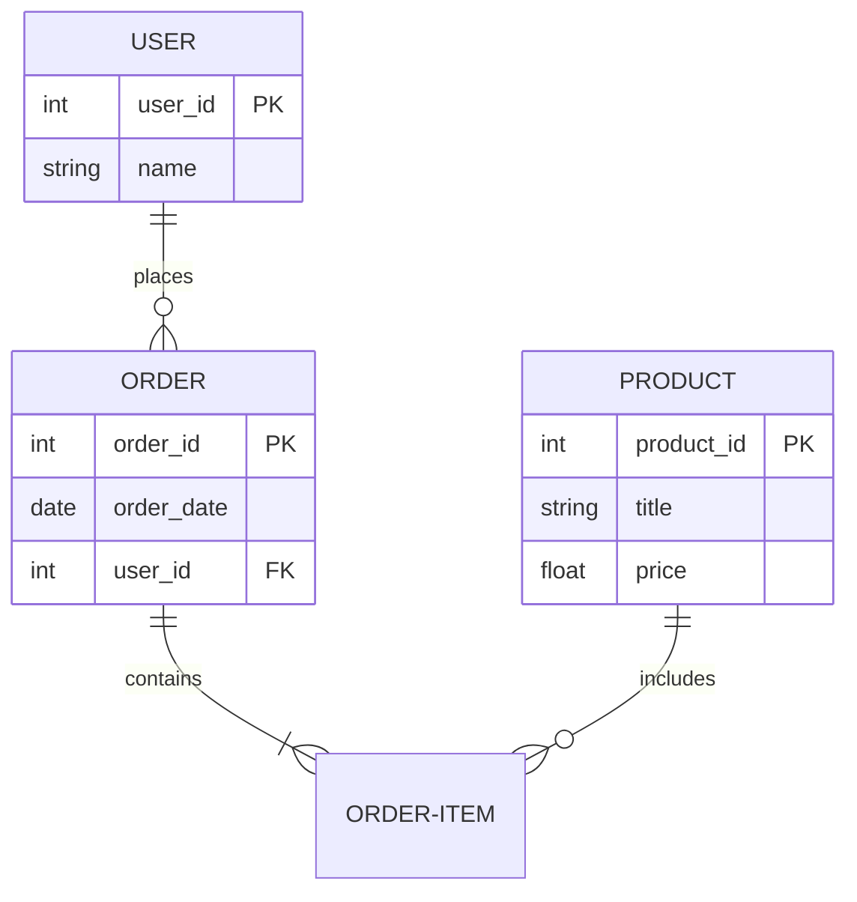

# Relational Database Model: Foundations & Modern Evolution

> **Learning Objectives:**
> By the end of this lesson, you will be able to:
> * Define the relational database model and explain its logical view of data.
> * Describe how basic relational components and integrity constraints are implemented.
> * Understand modern extensions including **HTAP**, **NewSQL**, **cloud-native architectures**, and **vector search integration**.
> * Recognize how modern SQL has evolved beyond the original relational model to support semi-structured data.

---

## A. Lesson Preview & Review

Good day, students! Today we are exploring the **Relational Database Model**—the backbone of modern data management. We will discuss how data is organized into tables, how integrity constraints ensure accuracy, and how relationships between tables are established. We will also explore the evolution of this model, from its traditional roots to modern cloud-native, AI-integrated systems. Let's dive in!


---

## B. Main Lesson

### 1. The Relational Database Model

A **relational database model** is a type of database management system (DBMS) that organizes data into one or more **tables** (or "relations") of rows and columns, with a unique key identifying each row. The tables are connected by relationships, defined by common columns (or fields) between tables.

The relational model takes a **logical view of data**—it represents data independently of its physical storage. This logical representation is in terms of **entities**, **attributes**, and **relations**. This independence from physical storage allows for a more intuitive and user-friendly way of working with data.

> **Example:** In a bookstore database, a table called **"Books"** might have columns for `title`, `author`, `ISBN`, and `price`. Each row represents a different book. A separate **"Authors"** table might have columns for `author_name` and `biography`. A foreign key constraint can ensure that any book in the "Books" table has a corresponding entry in the "Authors" table.

### 2. Relational Integrity Constraints

**Relational integrity constraints** are rules used to ensure the consistency and correctness of data in a relational DBMS. They enforce business rules and relationships between tables.

| Constraint Type | Purpose |
| :--- | :--- |
| **Primary Key** | Ensures each row in a table has a unique identifier. |
| **Foreign Key** | Ensures values in a foreign key column match values in the primary key of another table. |
| **Unique** | Ensures no two rows have the same value in a specific column. |
| **Check** | Ensures values in a column meet specific conditions or criteria. |
| **Not Null** | Ensures a column cannot contain a null value. |
| **Domain** | Ensures values in a column are of a specific data type or range. |

### 3. Relationships in the Relational Model

There are three main types of relationships in a relational DBMS:

| Relationship Type | Description | Example |
| :--- | :--- | :--- |
| **One-to-One (1:1)** | A row in one table is related to only one row in another table, and vice versa. | A `User` has one `Profile`. |
| **One-to-Many (1:N)** | A row in one table is related to many rows in another table. | A `User` can place many `Orders`. |
| **Many-to-Many (M:N)** | Many rows in one table are related to many rows in another table. Resolved via a **junction table**. | A `Student` enrolls in many `Courses`; a `Course` has many `Students`. |

> **Pro Tip:** In modern development, **Diagram-as-Code** tools like Mermaid and PlantUML allow you to define these relationships in text files that are version-controlled alongside your application code.



### 4. Operations in the Relational Model

| Operation | Description |
| :--- | :--- |
| **SELECT** | Retrieves specific rows/columns from one or more tables. |
| **PROJECT** | Retrieves specific columns. |
| **JOIN** | Combines data from two or more tables based on a common column. |
| **UNION** | Combines results of two or more SELECT statements. |
| **INSERT** | Adds new rows to a table. |
| **UPDATE** | Modifies existing data. |
| **DELETE** | Removes rows from a table. |
| **CREATE** | Creates a new table. |
| **ALTER** | Modifies the structure of a table. |
| **DROP** | Removes a table or other object. |

### 5. Modern Evolution of Relational Databases

The traditional relational model has evolved significantly. Key modern developments include:

* **HTAP (Hybrid Transactional/Analytical Processing):** Modern databases support both transactional (OLTP) and analytical (OLAP) workloads in a single engine, often using row and column representations simultaneously.
* **NewSQL:** A class of modern relational DBMS that provides the same scalable performance of NoSQL for OLTP workloads while maintaining ACID guarantees.
* **Cloud-Native Architecture:** Decoupling of storage and compute enables elastic scaling, serverless operation, and high availability.
* **AI and Vector Search Integration:** Modern relational databases (e.g., via `pgvector` in PostgreSQL) can store high-dimensional vector embeddings for semantic search, powering AI applications and RAG architectures without needing a separate vector database.
* **Modern SQL Features:** SQL has evolved to support **window functions**, **recursive queries**, **JSON/document support**, and **CTEs (Common Table Expressions)**, breaking the traditional "relational-only" constraint.
* **Multi-Model Databases:** A single database kernel can now natively support relational, document, vector, time-series, and spatial data, reducing the need for multiple specialized databases.

> **Pro Tip:** Gartner predicts that by 2025, over 70% of new cloud-native applications will move away from traditional monolithic database architectures toward distributed data platforms.

---

## C. Analogies and Use Cases

### The Filing Cabinet Analogy (Revisited)
* **Relational Table:** A meticulously organized filing cabinet drawer. Each folder (row) has a unique label (primary key), and every folder has the same set of tabs (columns).
* **Foreign Key:** A cross-reference note inside a folder that points to another folder in a different cabinet.
* **Modern HTAP Database:** A filing cabinet that can instantly generate a pie chart of all its contents while you are still filing new documents into it.

### Real-World Use Case: AI-Powered E-Commerce
An e-commerce platform uses a **cloud-native relational database** (e.g., PostgreSQL with `pgvector`). Transactional data (orders, users) is stored in standard tables. Product descriptions are converted into **vector embeddings** and stored in a vector column. When a customer searches for "comfortable running shoes," the database performs a **semantic similarity search** using the vectors while simultaneously joining transactional data to check inventory—all within a single SQL query.

---

## D. Lesson Wrap-Up / FAQs

### Summary
The **relational model** organizes data into tables with rows and columns, linked by keys and governed by **integrity constraints**. While its core principles remain unchanged, modern relational databases have evolved dramatically: they now support **HTAP workloads**, **cloud-native elasticity**, **AI-driven vector search**, and **multi-model data**, making them more powerful and versatile than ever before.

### Frequently Asked Questions (FAQs)

**Q: What are the advantages of using the relational model?**
**A:** High data integrity, flexibility in data modeling, ease of use, standardized SQL querying, and widespread support across platforms and software.

**Q: What are the disadvantages of the relational model?**
**A:** Difficulty handling very large amounts of unstructured data, complexity in designing and maintaining the schema, and challenges with complex relationships and poor performance on unstructured data.

**Q: What is the difference between a primary key and a foreign key?**
**A:** A **primary key** uniquely identifies a row in its own table. A **foreign key** is a column in one table that references the primary key of another table, establishing a relationship between the two tables.

**Q: What is NewSQL?**
**A:** NewSQL is a class of modern relational databases that combines the **ACID guarantees** and **SQL interface** of traditional RDBMS with the **horizontal scalability** of NoSQL systems.

**Q: Can relational databases store AI embeddings?**
**A:** Yes. Modern relational databases like PostgreSQL (via `pgvector`), SQL Server, and Oracle now support native vector data types and similarity search, allowing them to power AI applications directly.

---

## E. Guided Drills / Code Projects

### Exercise: Build a Simple Relational Schema

**Task:** Define a relational schema for a bookstore using SQL. Create tables for `Authors`, `Books`, and `Orders`, ensuring proper primary and foreign keys.

```sql
-- Create Authors table
CREATE TABLE Authors (
    author_id INT PRIMARY KEY,
    name VARCHAR(100) NOT NULL,
    biography TEXT
);

-- Create Books table
CREATE TABLE Books (
    book_id INT PRIMARY KEY,
    title VARCHAR(200) NOT NULL,
    isbn VARCHAR(13) UNIQUE,
    price DECIMAL(10, 2) CHECK (price > 0),
    author_id INT,
    FOREIGN KEY (author_id) REFERENCES Authors(author_id)
);

-- Create Orders table
CREATE TABLE Orders (
    order_id INT PRIMARY KEY,
    order_date DATE NOT NULL,
    book_id INT,
    quantity INT DEFAULT 1,
    FOREIGN KEY (book_id) REFERENCES Books(book_id)
);

-- Example SELECT with JOIN
SELECT Books.title, Authors.name, Orders.order_date
FROM Orders
JOIN Books ON Orders.book_id = Books.book_id
JOIN Authors ON Books.author_id = Authors.author_id
WHERE Authors.name = 'John Smith';
```

**Expected Outcome:** A working relational schema that enforces referential integrity and allows for complex queries across related tables.

---

## F. Skill-Building Check

### Part 1: Multiple Choice
*Select the best answer.*

**1. Which operation is used to retrieve specific columns of data from one or more tables?**
a) SELECT
b) PROJECT
c) JOIN
> **Correct Answer: b.** PROJECT retrieves specific columns (while SELECT retrieves rows).

**2. Which operation is used to combine the results of two or more SELECT statements into a single result set?**
a) SELECT
b) PROJECT
c) UNION
> **Correct Answer: c.** UNION combines result sets.

**3. Which operation is used to add new rows of data to a table?**
a) SELECT
b) INSERT
c) UPDATE
> **Correct Answer: b.** INSERT adds new rows.

**4. Which operation is used to modify the structure of a table?**
a) SELECT
b) INSERT
c) ALTER
> **Correct Answer: c.** ALTER modifies table structure.

**5. Which operation is used to remove rows of data from a table?**
a) SELECT
b) DELETE
c) UPDATE
> **Correct Answer: b.** DELETE removes rows.

**6. Which operation is used to remove a table or other object from the database?**
a) SELECT
b) ALTER
c) DROP
> **Correct Answer: c.** DROP removes database objects.

**7. Which operation is used to create a new table?**
a) SELECT
b) INSERT
c) CREATE
> **Correct Answer: c.** CREATE creates new tables.

### Part 2: Fill in the Blanks
*Complete the statement with the correct term.*

1. A **Relational** database model organizes data into one or more tables (or "relations") of rows and columns.
2. In a relational DBMS, the basic components of the relational model are implemented through **Tables**.
3. **Relational Integrity Constraints** are rules used to ensure the consistency and correctness of data in a relational DBMS.
4. **SELECT**, **Project**, **Join**, **Union**, **Intersection**, **Difference**, **Insert**, **Update**, **Delete**, **Create**, **Alter**, and **Drop** are examples of relational model operations.
5. **SQL (Structured Query Language)** is the standard language used to interact with relational databases.
6. The relationships between tables in a relational DBMS are established through **Keys**.
7. Primary keys and foreign keys are used to **establish** relationships between tables in a relational DBMS.