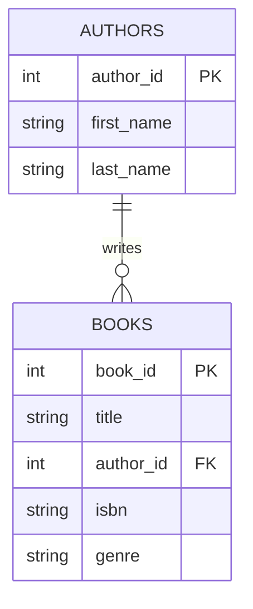

# Relational Database Design: From Concept to Implementation

> **Learning Objectives:**
> By the end of this lesson, you will be able to:
> *   Explain the features of a good relational database design.
> *   Enumerate and execute the standard relational database design processes.
> *   Understand modern advancements including **Schema-as-Code**, **Cloud-native DBaaS**, and **AI-assisted design**.
> *   Translate conceptual business requirements into a functional physical database schema.

---

## A. Lesson Preview & Review

Welcome, students! Today we are discussing the essential features and processes of designing a good relational database. Relational databases are the workhorses of the software industry, powering everything from banking systems to e-commerce platforms. 

In this lesson, we will focus on the best practices for designing a database that is organized, efficient, and easy to use. We will walk through the complete design lifecycle—from gathering requirements to physical implementation—and see how modern DevOps practices are changing the way we build databases today. Let's begin!


---

## B. Main Lesson

### 1. What is Relational Database Design?
A **relational database design** is a structured way of organizing data using a series of tables that are related to one another through a system of **keys**. 

*   **Fields (Columns):** Describe the different types of data stored (e.g., `title`, `price`).
*   **Records (Rows):** Represent individual instances of that data (e.g., "The Great Gatsby").
*   **Keys:** Used to link tables together. A **Primary Key** uniquely identifies a record in a table, while a **Foreign Key** links to the primary key of another table to establish relationships.

> **Pro Tip:** A good relational design minimizes data redundancy (storing the same data in multiple places) and maintains data integrity (ensuring the data is accurate and consistent).

#### Example: A Library Database
Consider a simple library system with a `books` table and an `authors` table. The `author_id` acts as the bridge between them.

**`books` table**

| book_id (PK) | title | author_id (FK) | ISBN | genre |
| :--- | :--- | :--- | :--- | :--- |
| 1 | The Great Gatsby | 1 | 978-14231033 | Fiction |
| 2 | To Kill a Mockingbird | 2 | 439-55523-5 | Fiction |
| 3 | The Catcher in the Rye | 3 | 553-22245-4 | Fiction |
| 4 | The Lord of the Rings | 4 | 553-22245-4 | Fantasy |

**`authors` table**

| author_id (PK) | first_name | last_name |
| :--- | :--- | :--- |
| 1 | F. | Scott |
| 2 | Harper | Lee |
| 3 | J.D. | Salinger |
| 4 | J.R.R. | Tolkien |

> **Modern Update: Diagram-as-Code**
> Traditionally, database designs were drawn on whiteboards or in tools like Visio. Today, modern engineering teams often use **Diagram-as-Code** tools like Mermaid.js. This allows the ER diagram to live directly in the project's documentation (like GitHub), ensuring it is always updated alongside the code.



### 2. The Relational Database Design Process
Designing a database is not just about typing `CREATE TABLE` commands. It is a structured lifecycle. Here are the core steps:

#### Step 1: Requirements Gathering
The database designer works with stakeholders to understand the specific needs and requirements of the database. This involves determining what data needs to be stored, how it will be used, and what business rules apply.
*   *Modern Context:* Designers now often translate Agile user stories and business logic directly into data requirements, sometimes using AI tools to analyze legacy systems or unstructured documents to suggest potential entities.

#### Step 2: Conceptual Design
The designer creates a high-level, conceptual view of the database. This includes identifying the main **entities** (objects) in the system and the **relationships** between them. 
*   *Output:* An Entity-Relationship (ER) Diagram. It remains independent of any specific database software.

#### Step 3: Logical Design
The designer creates a logical data model. This defines the specific data elements (attributes), the relationships between them, and the constraints (rules) that need to be applied to the data.
*   *Output:* A refined schema, often in Third Normal Form (3NF), ensuring data redundancy is minimized.

#### Step 4: Physical Design
The designer creates a physical data model tailored to a specific DBMS (like PostgreSQL, MySQL, or SQL Server). This defines the specific data structures, file organization, and **indexing methods** required to optimize performance.
*   *Modern Context:* This step now heavily considers cloud infrastructure. Will this be a single-node database, or a distributed **Cloud-Native** database? How will partitioning and sharding be handled?

#### Step 5: Implementation
The final step, in which the database is actually created. This includes generating the schema, creating the tables, configuring the DBMS, and populating it with initial data.

#### Step 6: Testing and Maintenance
The database is tested to ensure it meets performance and functional requirements. Any issues are identified and addressed. The database is then continuously maintained, backed up, and monitored as the organization grows.

> **Modern Update: Schema Migrations & Version Control**
> In modern software delivery, we don't just "implement" a database once. We use **Schema Migration tools** (like Flyway, Liquibase, or Prisma Migrate) to treat database changes as code. Every change is tracked in a Git repository, tested in CI/CD pipelines, and deployed automatically to production, ensuring zero downtime.

---

## C. Analogies and Use Cases

### The Building Construction Analogy
*   **Requirements Gathering:** The client says, "I need a 3-bedroom house with a large kitchen."
*   **Conceptual Design:** The architect draws a rough sketch showing the rooms and how they connect (ER Diagram).
*   **Logical Design:** The detailed blueprint specifying exact measurements, door types, and electrical layouts (Schema definition).
*   **Physical Design:** Deciding to use steel beams instead of wood, choosing the specific HVAC system, and optimizing where to put load-bearing walls (Choosing the DBMS, adding indexes).
*   **Implementation:** Pouring the concrete and building the walls (Executing the SQL).

### Real-World Use Case: Modern E-Commerce Platform
A modern online store doesn't just use one giant relational database. While the **Relational Database** (e.g., PostgreSQL) handles the core transaction data (Customers, Orders, Sales), the design process ensures the schema is optimized for fast transactions. 
For the product catalog, they might use a **Document database** (NoSQL) to handle varying product attributes (a shirt has sizes, a laptop has RAM). The relational design process helps the architect draw the boundaries between what data stays in the relational core and what data can live in specialized systems.

---

## D. Lesson Wrap-Up / FAQs

### Summary
Designing a relational database is a methodical process that moves from **Requirements Gathering** to **Conceptual, Logical, and Physical Design**, culminating in **Implementation** and ongoing **Maintenance**. A well-designed database ensures data integrity, reduces redundancy, and scales efficiently. By incorporating modern practices like Schema Migrations and Diagram-as-Code, teams can manage database changes as safely and rapidly as application code.

### Frequently Asked Questions (FAQs)

**Q: What is the purpose of the Conceptual Design stage?**
**A:** It creates a high-level, technology-independent view of the data. It identifies the main entities and their relationships, primarily using an Entity-Relationship (ER) diagram, to ensure all stakeholders agree on the data structure before technical details are decided.

**Q: How does Logical Design differ from Physical Design?**
**A:** **Logical Design** defines the specific data elements, attributes, and constraints (like primary and foreign keys), but it remains independent of any specific database software. **Physical Design** takes that logical model and maps it to a specific DBMS (like MySQL), defining the exact data types, indexing strategies, and storage structures needed for optimal performance.

**Q: Can AI design a database for me now?**
**A:** AI tools can certainly accelerate the process by generating initial ER diagrams from natural language prompts, writing the SQL `CREATE TABLE` statements, and suggesting indexing strategies. However, human oversight is still critical to ensure the design accurately reflects complex business rules, data privacy requirements, and long-term scalability needs.

---

## E. Guided Drills / Code Projects

### Exercise: Design a Relational Database for an Online Store
**Scenario:** You need to design a database for a small online clothing store. It must track customers, products, and sales.

**Step 1: Requirements Gathering**
*   **Entities:** Customers, Products, Sales.
*   **Data to store:** 
    *   Customers: Name, Address, Email.
    *   Products: Name, Description, Price, Quantity in stock.
    *   Sales: The product sold, the customer who bought it, the date of sale, the quantity, and the price at the time of sale.
*   **Business Rules:**
    1.  Products must have a unique name.
    2.  Product prices must be positive.
    3.  Customers must have a unique email.

**Step 2: Conceptual Design (ER Diagram)**
*(See Mermaid diagram in the main lesson above for the Library example. Try drawing one for this Store scenario!).*

**Step 3: Logical Design (Defining the Tables)**
Here is the SQL to create the logical structure based on the requirements:

```sql
-- Create the Customers table
CREATE TABLE Customers (
    customer_id INT PRIMARY KEY AUTO_INCREMENT,
    first_name VARCHAR(50) NOT NULL,
    last_name VARCHAR(50) NOT NULL,
    email VARCHAR(100) UNIQUE NOT NULL,
    address TEXT
);

-- Create the Products table
CREATE TABLE Products (
    product_id INT PRIMARY KEY AUTO_INCREMENT,
    name VARCHAR(100) UNIQUE NOT NULL,
    description TEXT,
    price DECIMAL(10, 2) CHECK (price > 0),
    quantity_in_stock INT NOT NULL DEFAULT 0
);

-- Create the Sales (Junction) table
-- Because a customer can buy many products, and a product can be bought by many customers,
-- we use a Sales table to link them (Many-to-Many relationship).
CREATE TABLE Sales (
    sale_id INT PRIMARY KEY AUTO_INCREMENT,
    customer_id INT,
    product_id INT,
    sale_date DATE NOT NULL,
    quantity INT NOT NULL,
    sale_price DECIMAL(10, 2) NOT NULL,
    FOREIGN KEY (customer_id) REFERENCES Customers(customer_id),
    FOREIGN KEY (product_id) REFERENCES Products(product_id)
);
```

---

## F. Skill-Building Check

Test your understanding of the concepts covered in this module.

### Part 1: Fill in the Blanks
*Complete the statement with the correct term.*

1.  The process of creating a structured plan for a database is called **Relational Database Design**.
2.  In the **Requirements Gathering** stage, the designer works with stakeholders to understand the specific needs and requirements of the database.
3.  In the **Conceptual Design** stage, the designer creates a high-level view of the database, including identifying the main entities and relationships. It also involves creating an **Entity-Relationship (ER)** diagram to visualize the data model.
4.  In the **Physical Design** stage, the designer creates a physical data model that defines the specific database design, including data structures, file organization, and **indexing** methods.
5.  The final step in the database design process is **Implementation**, in which the database is created, populated with data, and configured.

### Part 2: Multiple Choice
*Identify the best answer from the following questions.*

**1. Which design phase is completely independent of the specific database software (DBMS) being used?**
a) Physical Design
b) Logical Design
c) Implementation
d) Performance Tuning
> **Correct Answer: b.** Logical Design focuses on data structures and rules, remaining agnostic to the specific DBMS platform until the Physical Design phase.

**2. What is the primary goal of identifying a foreign key in a relational database?**
a) To uniquely identify a record within its own table.
b) To encrypt sensitive data.
c) To establish a link to a primary key in another table, creating a relationship.
d) To automatically delete old records.
> **Correct Answer: c.** Foreign keys create the "relational" part of a relational database by linking tables together.

**3. Which modern practice allows database schema changes to be version-controlled and automatically deployed via CI/CD pipelines?**
a) Schema-as-Code (Migration tools)
b) Manual SQL execution
c) Whiteboard design
d) Waterfall methodology
> **Correct Answer: a.** Tools like Flyway or Liquibase treat database changes as code, enabling automated, safe deployments.