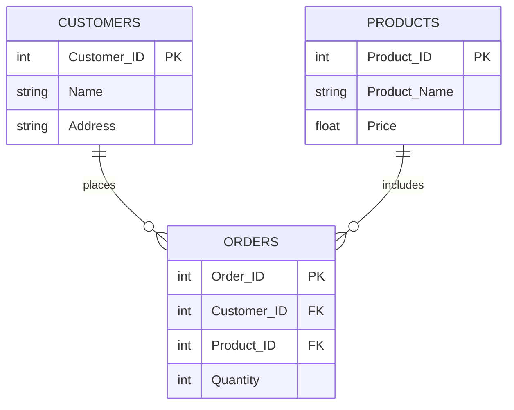

# Relational Database Design: Normalization

> **Learning Objectives:**
> By the end of this lesson, you will be able to:
> *   Explain what normalization is and its role in the database design process.
> *   Identify the various normal forms from First Normal Form (1NF) through Boyce-Codd Normal Form (BCNF).
> *   Understand the trade-offs between normalization and modern **denormalization** practices.
> *   Recognize how modern NoSQL and cloud-native architectures handle data redundancy differently.

---

## A. Lesson Preview & Review

Welcome, students! Today we are discussing the concept of **Normalization** in relational database design. 

Normalization is the process of organizing data in a database to minimize data redundancy and improve data integrity. We will go through the different normal forms and the guidelines for achieving them. We will also look at how modern software engineering balances the strict rules of normalization with the performance needs of modern, scalable applications. Let's get started!

---

## B. Main Lesson

### 1. What is Database Normalization?
**Normalization** is the process of organizing data in a database to minimize data redundancy and improve data integrity. It involves dividing larger tables into smaller, more manageable tables and establishing relationships between them. 

This process is an important step in database design because it ensures data is stored in a consistent, logical manner. It makes queries and updates easier, less prone to errors, and can improve performance by reducing the amount of data that needs to be processed.

### 2. The Normal Forms
Normalization is typically done in a series of steps, known as **normal forms**. Each normal form builds on the previous one and introduces additional constraints. 

| Normal Form | Requirement | Description |
| :--- | :--- | :--- |
| **1NF** (First Normal Form) | Atomic values & Primary Key | All tables must have a primary key, and all attributes must be atomic (contain a single value, not lists or arrays). |
| **2NF** (Second Normal Form) | No Partial Dependencies | Must be in 1NF, and all non-key attributes must depend on the *entire* primary key (relevant for composite keys). |
| **3NF** (Third Normal Form) | No Transitive Dependencies | Must be in 2NF, and no non-key attribute should depend on another non-key attribute. |
| **BCNF** (Boyce-Codd) | Superkey Dependency | A stricter version of 3NF. Every determinant must be a candidate key. |
| **4NF & 5NF** | Multivalued & Join Dependencies | Highly specialized forms dealing with complex relational structures. Rarely used in standard application development. |
| **6NF** | Irreducible Relations | Decomposes tables to the absolute minimum level of relations with zero redundancy. |

> **Important Note:** Not all databases need to be in the highest normal form. The level of normalization required depends on the specific use case, performance requirements, and the architecture of the database.

### 3. Visualizing the Process: A Retail Store Example

Let's look at an example of how normalization transforms a poorly designed table.

#### Step 0: The Initial Messy Table (Unnormalized)
Imagine a retail store tracking orders. Initially, the table might look like this:

| Order ID | Customer Info | Product Info | Quantity | Price |
| :--- | :--- | :--- | :--- | :--- |
| 1 | John Doe, 123 Main St | Pen, Notebook | 2, 1 | 2, 5 |
| 2 | Jane Smith, 456 Oak Ave | Pen | 1 | 2 |

*Issues here:* Multiple values in a single cell (violates 1NF). The customer's address is repeated (redundancy). If an address changes, we have to update every order (update anomaly).

#### Step 1: First Normal Form (1NF)
We break out the multi-valued attributes (Pen, Notebook) and give every row a unique primary key.

| Order ID | Customer ID | Customer Name | Product ID | Product Name | Quantity | Price |
| :--- | :--- | :--- | :--- | :--- | :--- | :--- |
| 1 | 1 | John Doe | 1 | Pen | 2 | 2 |
| 1 | 1 | John Doe | 2 | Notebook | 1 | 5 |
| 2 | 2 | Jane Smith | 1 | Pen | 1 | 2 |

*Issues here:* The primary key is now a composite key (`Order ID` + `Product ID`). However, `Customer Name` depends only on `Customer ID` (partial dependency). The `Product Name` depends only on `Product ID`.

#### Step 2: Second Normal Form (2NF)
We remove partial dependencies by splitting the table into distinct entities: Customers, Products, and Orders.

**Customers Table**
| Customer ID (PK) | Customer Name | Address |
| :--- | :--- | :--- |
| 1 | John Doe | 123 Main St |
| 2 | Jane Smith | 456 Oak Ave |

**Products Table**
| Product ID (PK) | Product Name | Price |
| :--- | :--- | :--- |
| 1 | Pen | 2 |
| 2 | Notebook | 5 |

**Orders Table**
| Order ID (PK) | Customer ID (FK) | Product ID (FK) | Quantity |
| :--- | :--- | :--- | :--- |
| 1 | 1 | 1 | 2 |
| 1 | 1 | 2 | 1 |
| 2 | 2 | 1 | 1 |

#### Step 3: Third Normal Form (3NF)
In 2NF, if the `Orders` table contained a `Customer Address` column, that would be a transitive dependency (`Order ID` -> `Customer ID` -> `Customer Address`). By splitting the tables in Step 2, we have eliminated redundancy. The tables above are now in **3NF**.

### 4. Modern Update: Denormalization and NoSQL

While normalization (3NF/BCNF) is the gold standard for **Online Transaction Processing (OLTP)** systems (like banking, where data accuracy is paramount), modern software architecture introduces important trade-offs.

*   **Denormalization for Analytics (OLAP):** In data warehousing and analytics, query speed is more important than strict data integrity. Analysts often use **Star Schemas** or **Snowflake Schemas** (highly denormalized structures) to avoid expensive `JOIN` operations.
*   **NoSQL and Document Databases:** Modern applications often use NoSQL databases (like MongoDB or DynamoDB). These databases **explicitly avoid normalization**. Instead of splitting data into multiple tables (like the 2NF example above), they nest related data inside a single JSON-like document. 
    *   *Example:* A single `Order` document in MongoDB would contain the customer info, the product details, and the quantity all in one file. This makes reading the data incredibly fast, at the cost of potential data duplication.
*   **JSON in Relational Databases:** Modern SQL databases (like PostgreSQL with `JSONB`) allow developers to store semi-structured, unnormalized data in a single column, blending the worlds of relational integrity and NoSQL flexibility.

> **Pro Tip:** Think of normalization as a spectrum. For core financial transactions, normalize to 3NF. For a product catalog or user profiles, consider denormalization or a NoSQL document model to optimize for read speed.

---

## C. Analogies and Use Cases

### The Inventory Analogy
*   **Unnormalized:** A giant spreadsheet where every row contains the entire history of a customer, their address, and the products they bought. If a customer moves, you have to manually change their address in 50 different rows, risking typos. (Data anomaly).
*   **Normalized (3NF):** A filing system with separate folders for Customers, Products, and Orders. The Orders folder just has a note saying "See Customer folder #123". If the customer moves, you only update the address in one place (the Customer folder).
*   **Denormalized (Modern Analytics):** A printed report that lists every order alongside the full customer address and product name. It's redundant, but it's incredibly fast for a manager to read without having to flip between different folders.

### Real-World Use Case: E-Commerce Checkout vs. Recommendation Engine
*   **Checkout System (OLTP):** Uses a highly normalized **Relational Database (3NF)**. When you buy a product, the system must ensure the price is accurate, the inventory is decremented exactly once, and the transaction is ACID-compliant.
*   **Recommendation Engine (OLAP):** Uses a **Data Warehouse** or **NoSQL** system. It stores massive, flattened, denormalized data (e.g., "User X bought Product Y"). The redundancy doesn't matter here because the goal is to run fast analytical queries over billions of records to find patterns.

---

## D. Lesson Wrap-Up / FAQs

### Summary
**Normalization** is the process of structuring a relational database to reduce redundancy and improve data integrity. It progresses through normal forms (1NF to BCNF). While strict normalization (usually up to 3NF) is crucial for transactional systems, modern architectures often employ **denormalization** or **NoSQL document models** to optimize read performance and handle massive scale in analytical or flexible workloads.

### Frequently Asked Questions (FAQs)

**Q: What is the difference between 1NF and 2NF?**
**A:** **1NF** requires that every column contains atomic values and that the table has a primary key. **2NF** requires the table to be in 1NF and that all non-key columns are dependent on the *entire* primary key, not just a part of it (removing partial dependencies).

**Q: What is the difference between 3NF and BCNF?**
**A:** **3NF** removes transitive dependencies (non-key columns depending on other non-key columns). **BCNF** is a stricter version of 3NF that ensures every determinant in the table is a candidate key. BCNF handles edge cases where a table has multiple overlapping candidate keys.

**Q: When should you stop normalizing a database?**
**A:** Generally, normalizing up to **3NF** or **BCNF** is sufficient for most OLTP applications. Going into 4NF, 5NF, or 6NF often creates too many tables, which can degrade performance because queries require too many `JOIN` operations to reassemble the data.

**Q: Does normalization apply to modern NoSQL databases?**
**A:** Not strictly. NoSQL databases are designed for horizontal scaling and flexible schemas, often using an **embedded data model** (storing related data together in one document) rather than normalizing it across multiple tables. This is a form of intentional denormalization.

---

## E. Guided Drills / Code Projects

### Exercise: Normalize a Library Database

**Scenario:** A library has an unnormalized "Loans" table that tracks books, authors, and members. 

**Initial Table:**
| Loan ID | Member Name | Member Phone | Book Title | Author Name | Loan Date | Return Date |
| :--- | :--- | :--- | :--- | :--- | :--- | :--- |
| 1 | Alice | 555-0100 | DB Systems | Elmasri | 2023-10-01 | 2023-10-15 |
| 2 | Bob | 555-0101 | DB Systems | Elmasri | 2023-10-02 | 2023-10-16 |

**Tasks:**
1.  **1NF:** Identify the primary key.
2.  **2NF:** Remove partial dependencies. Create separate tables for Members and Books. (Note: A book can have multiple authors, but for this simple exercise, we will assume one author per book).
3.  **3NF:** Remove transitive dependencies. Ensure that the author's name is not redundantly stored in the Book table (create an Authors table).
4.  **Write the SQL:** Write the `CREATE TABLE` statements to implement your final normalized schema.

**Expected Final Schema:**
*   **Members:** `Member_ID (PK)`, `Name`, `Phone`
*   **Authors:** `Author_ID (PK)`, `Name`
*   **Books:** `Book_ID (PK)`, `Title`, `Author_ID (FK)`
*   **Loans:** `Loan_ID (PK)`, `Member_ID (FK)`, `Book_ID (FK)`, `Loan_Date`, `Return_Date`

---

## F. Skill-Building Check

Test your understanding of the concepts covered in this module.

### Part 1: True or False
*Determine if the statement is true or false based on your knowledge and understanding.*

1.  The first normal form (1NF) ensures that each table has a primary key and that all the attributes are atomic. (**True**)
2.  The second normal form (2NF) ensures that all non-key attributes are dependent on the entire primary key. (**True**)
3.  The third normal form (3NF) ensures that there are no partial dependencies. (**False** - *3NF is about removing transitive dependencies. 2NF handles partial dependencies.*)
4.  The Boyce-Codd normal form (BCNF) ensures that all non-trivial functional dependencies are on a superkey. (**True**)
5.  The fourth normal form (4NF) is a widely used normal form in everyday database design. (**False** - *4NF and 5NF are very specialized and rarely used in standard app development.*)
6.  Normalization is only necessary for large databases with complex data relationships. (**False** - *Even small databases benefit from reducing redundancy and update anomalies.*)
7.  Normalization improves data integrity but reduces data redundancy. (**True**)
8.  Modern NoSQL databases generally embrace normalization to ensure strict ACID compliance. (**False** - *NoSQL often relies on denormalization and embedding data for read performance.*)

### Part 2: Multiple Choice
*Identify the best answer from the following questions.*

**1. Which normal form requires that every column contain only a single, indivisible value?**
a) 1NF
b) 2NF
c) 3NF
d) BCNF
> **Correct Answer: a.** 1NF requires atomic values.

**2. A table is in 2NF if it is in 1NF and:**
a) It contains no transitive dependencies.
b) All non-key attributes depend on the entire primary key.
c) It has no multi-valued dependencies.
d) Every determinant is a candidate key.
> **Correct Answer: b.** 2NF removes partial dependencies.

**3. What is the primary reason modern data warehouses (OLAP) often use denormalized schemas?**
a) To save storage space.
b) To improve query performance by reducing the number of JOINs.
c) To enforce strict ACID rules.
d) Because normalization is no longer considered a best practice.
> **Correct Answer: b.** Denormalization reduces complex JOINs, making analytical read queries much faster.