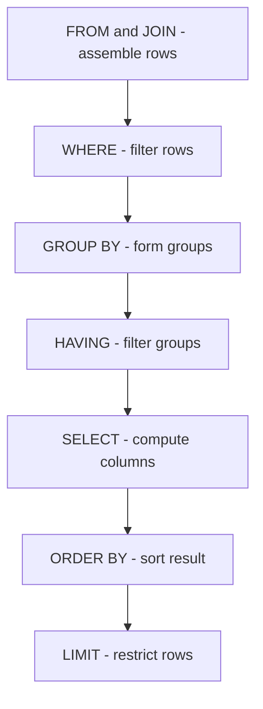

# Introduction to Database Programming: Modern SQL Essentials

> **Learning Objectives:**
> By the end of this lesson, you will be able to:
> *   Discuss the basic concepts of SQL and how databases store information via tables.
> *   Explain the differences between **DDL**, **DML**, and **DQL** (and the modern additions of DCL and TCL).
> *   Identify standard and modern SQL data types, including **JSON**, **ARRAY**, and **VECTOR**.
> *   Enforce data integrity using SQL constraints and understand modern best practices.
> *   Write basic SQL queries to create, manipulate, and retrieve data.

---

## A. Lesson Preview & Review

Welcome to the world of database programming! Today we focus on **SQL (Structured Query Language)**—the universal language for interacting with relational databases. 

We will cover how data is organized into tables, the three main categories of SQL commands (DDL, DML, DQL), and the various data types and constraints used to build robust schemas. We will also look at how modern SQL has evolved to handle semi-structured data (JSON), arrays, and AI embeddings (Vectors), making it more powerful than ever. Let's get started!


---

## B. Main Lesson

### 1. Basic Concepts of SQL
**SQL (Structured Query Language)** is the standard programming language used for managing and manipulating relational databases.

*   **Tables:** The basic building block of a database. Data is organized into rows (records) and columns (fields).
*   **Schema:** The structure of the database, defining tables, fields, relationships, and constraints.
*   **Primary Key:** A unique identifier for each record in a table (e.g., `CustomerID`).
*   **Foreign Key:** A field that references the primary key of another table, creating a link between them.
*   **Indexes:** Data structures that speed up data retrieval operations.

### 2. The Evolution of SQL: DDL, DML, DQL (and beyond)
Originally, SQL commands were grouped into three main categories. Modern database management also includes **DCL** (Data Control Language) and **TCL** (Transaction Control Language).

| Category | Purpose | Common Commands |
| :--- | :--- | :--- |
| **DDL** (Data Definition Language) | Defines the structure of the database. | `CREATE`, `ALTER`, `DROP`, `TRUNCATE` |
| **DML** (Data Manipulation Language) | Manages the data within the tables. | `INSERT`, `UPDATE`, `DELETE` |
| **DQL** (Data Query Language) | Retrieves data from the database. | `SELECT` |
| **DCL** (Data Control Language) | Manages access and permissions. | `GRANT`, `REVOKE` |
| **TCL** (Transaction Control Language) | Manages transactions. | `COMMIT`, `ROLLBACK`, `SAVEPOINT` |

> **Modern Best Practice: DDL as Code**
> In modern DevOps, **DDL** is no longer just typed into a console. Teams use **Schema-as-Code** tools (like Flyway, Liquibase, or Prisma Migrate) to version-control their `CREATE TABLE` and `ALTER TABLE` statements, ensuring database changes are tracked and deployed automatically through CI/CD pipelines.

#### Visualizing SQL Query Execution Order
While you write SQL starting with `SELECT`, the database engine actually executes the clauses in a different order to optimize performance.



### 3. SQL Data Types: From Traditional to Modern
When creating tables, you must specify the data type for each column. While traditional types (INT, VARCHAR, DATE) remain standard, modern databases have introduced powerful new types.

| Category | Traditional Types | Modern Additions (2025/2026) |
| :--- | :--- | :--- |
| **Numeric** | `INT`, `BIGINT`, `DECIMAL`, `FLOAT` | - |
| **String** | `CHAR`, `VARCHAR`, `TEXT` | - |
| **Date/Time** | `DATE`, `TIME`, `DATETIME`, `TIMESTAMP` | - |
| **Boolean** | `BOOLEAN` (Often stored as 0/1) | **Native `BOOLEAN`** (True/False directly, e.g., Oracle 23ai) |
| **Semi-Structured** | - | **`JSON`**, **`JSONB`**, **`VARIANT`** (Optimized binary storage for JSON documents) |
| **Collections** | - | **`ARRAY`** (Native storage for lists/tags, reducing JSON overhead) |
| **AI / Vectors** | - | **`VECTOR(n)`** (Stores high-dimensional embeddings for AI similarity search) |

> **Pro Tip:** Modern databases like SQL Server 2025 and Oracle 23ai allow you to store **JSON** natively with automatic validation and dot-notation querying (e.g., `SELECT ProductData.name FROM Products`).

### 4. SQL Constraints: Enforcing Data Integrity
Constraints are rules applied to columns to ensure the accuracy and reliability of the data. Modern best practices recommend **naming your constraints explicitly** (e.g., `CONSTRAINT chk_positive_price CHECK (price >= 0)`) rather than relying on system-generated names, which can vary across environments.

*   **NOT NULL:** Ensures a column cannot have a NULL value.
*   **UNIQUE:** Ensures all values in a column are different.
*   **PRIMARY KEY:** Uniquely identifies each row. A table can have only one primary key.
*   **FOREIGN KEY:** Links to a primary key in another table, enforcing referential integrity.
*   **CHECK:** Ensures values meet a specific condition (e.g., `price > 0`).
*   **DEFAULT:** Sets a default value if none is provided.

---

## C. Analogies and Use Cases

### The Spreadsheet vs. Database Analogy
*   **Table:** A single sheet in a spreadsheet.
*   **Row:** A single row of data.
*   **Primary Key:** A unique ID column that you never duplicate.
*   **Foreign Key:** A formula that looks up a value in another sheet.
*   **Index:** A filter or pivot table that lets you find data instantly without scrolling through thousands of rows.

### Real-World Use Case: AI-Powered Search
A modern e-commerce platform uses a **`VECTOR`** column to store product embeddings. When a user searches for "comfortable running shoes," the database performs a **semantic similarity search** using the vector data, returning products that are conceptually similar, even if the exact keywords don't match.

---

## D. Lesson Wrap-Up / FAQs

### Summary
**SQL** is the foundational language for relational databases. It is categorized into **DDL** (structure), **DML** (manipulation), and **DQL** (querying). Modern SQL has evolved to support **JSON**, **Arrays**, and **Vectors**, allowing relational databases to handle semi-structured and AI-driven data natively. Enforcing data integrity through **constraints** and following **schema-as-code** best practices are essential for building robust, scalable applications.

### Frequently Asked Questions (FAQs)

**Q: What is the difference between DDL and DML?**
**A:** **DDL** (Data Definition Language) defines the structure (e.g., `CREATE TABLE`). **DML** (Data Manipulation Language) manages the data inside those tables (e.g., `INSERT`, `UPDATE`, `DELETE`).

**Q: What is a Primary Key?**
**A:** A primary key is a column or set of columns that uniquely identifies every record in a table. It must contain unique values and cannot be NULL.

**Q: What is a Foreign Key?**
**A:** A foreign key is a column in one table that references the primary key of another table. It creates a relationship between the tables and enforces referential integrity.

**Q: Why are Vector data types important now?**
**A:** Vector data types allow databases to store high-dimensional embeddings used by AI models for semantic search, recommendation systems, and RAG (Retrieval-Augmented Generation) applications.

---

## E. Guided Drills / Code Projects

### Exercise: Build a Modern Employee Table

**Task:** Create a table called `Employee` with appropriate data types and constraints. Then, perform basic DML operations.

```sql
-- 1. DDL: Create the table with constraints
CREATE TABLE Employee (
    id INT PRIMARY KEY,
    name VARCHAR(100) NOT NULL,
    age INT CHECK (age >= 18),
    gender VARCHAR(20),
    salary DECIMAL(10, 2) DEFAULT 30000.00,
    skills JSON, -- Modern JSON type
    embedding VECTOR(1536) -- Modern AI Vector type
);

-- 2. DML: Insert data
INSERT INTO Employee (id, name, age, gender, salary, skills)
VALUES (1, 'John Smith', 30, 'male', 50000, '["SQL", "Python"]');

INSERT INTO Employee (id, name, age, gender, salary)
VALUES (2, 'Jane Doe', 25, 'female', 40000);

-- 3. DQL: Retrieve data
-- Find employees earning more than 45000
SELECT name, salary FROM Employee WHERE salary > 45000;

-- 4. DML: Update data
-- Give all employees a 10% raise
UPDATE Employee SET salary = salary * 1.1;

-- 5. DML: Delete data
-- Remove an employee
DELETE FROM Employee WHERE id = 2;
```

---

## F. Skill-Building Check

### Part 1: Multiple Choice
*Identify the best answer.*

**1. What does SQL stand for?**
a) Sequential Query Language
b) Structured Query Language
c) Simple Query Language
d) Syntax Query Language
> **Correct Answer: b.** SQL stands for Structured Query Language.

**2. Which of the following is a DQL statement?**
a) CREATE
b) INSERT
c) SELECT
d) DROP
> **Correct Answer: c.** `SELECT` is the primary Data Query Language statement used to retrieve data.

**3. What is a primary key?**
a) A column that references another table
b) A unique identifier for each record in a table
c) A data structure that speeds up retrieval
d) A condition that a column's value must meet
> **Correct Answer: b.** The primary key uniquely identifies each row.

**4. What does the following SQL statement do?**
```sql
SELECT Name, Address FROM Customers WHERE ID = 1;
```
a) Creates a new table
b) Retrieves the name and address of the customer with ID 1
c) Deletes the customer with ID 1
d) Updates the address of the customer with ID 1
> **Correct Answer: b.** It is a DQL query that retrieves specific columns for a specific row.

**5. Which of the following is a modern SQL data type used for AI applications?**
a) INT
b) VARCHAR
c) VECTOR
d) BOOLEAN
> **Correct Answer: c.** `VECTOR` stores high-dimensional embeddings for AI similarity search.

### Part 2: True or False
*Determine if the statement is true or false.*

1.  DDL statements are used to manipulate the data inside a table. (**False** - *DDL defines the structure; DML manipulates data.*)
2.  A foreign key uniquely identifies a record in its own table. (**False** - *A primary key does that. A foreign key links to a primary key in another table.*)
3.  Modern relational databases can natively store JSON documents. (**True** - *Types like JSON and JSONB allow this.*)
4.  An index improves the speed of data retrieval operations. (**True**)
5.  The `WHERE` clause filters rows before the `GROUP BY` clause is processed. (**True** - *As shown in the execution order diagram.*)