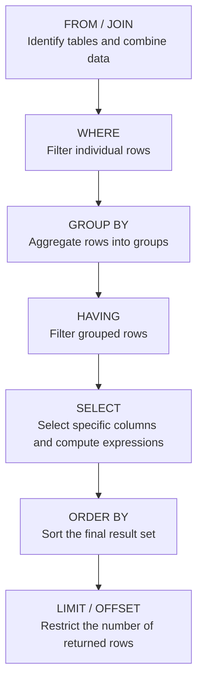

# Basic SQL: Data Query Language (DQL)

> **Learning Objectives:**
> By the end of this lesson, you will be able to:
> *   Discuss the Data Query Language and the `SELECT` command.
> *   Explain and apply aggregate functions (`SUM`, `COUNT`, `AVG`, `MIN`, `MAX`) used in queries.
> *   Group and summarize data using the `GROUP BY` clause.
> *   Sort query results using the `ORDER BY` clause.
> *   Understand modern data analysis techniques, including **Window Functions** and **Query Execution Order**.

---

## A. Lesson Preview & Review

Welcome students! Today, we are focusing on **Data Query Language (DQL)**. While DML is about changing data, DQL is about *retrieving* and *analyzing* it. We will cover essential concepts such as grouping and summarizing data using aggregate functions like `SUM`, `COUNT`, and `AVG`, as well as sorting and filtering query results.

By the end of this lesson, you should have a solid understanding of how to use these tools to extract actionable insights from raw data. Let's get started!


---

## B. Main Lesson

### 1. The SELECT Statement
**Data Query Language (DQL)** is a subset of SQL used to retrieve data from a database. The primary command is the **`SELECT`** statement, which is used to select, filter, sort, and retrieve specific data from one or more tables.

**Basic Syntax:**
```sql
-- Retrieve all columns from a table
SELECT * FROM employees;

-- Retrieve specific columns from a table
SELECT first_name, last_name FROM employees;
```

**Filtering with WHERE:**
You can use the `WHERE` clause to filter rows based on specific conditions.
```sql
-- Retrieve employees with a salary greater than 50,000
SELECT * FROM employees WHERE salary > 50000;
```

### 2. Aggregate Functions
Aggregate functions perform a calculation on a set of values and return a single value. They are essential for summarizing data.

| Function | Description | Example |
| :--- | :--- | :--- |
| **`SUM()`** | Returns the sum of all values in a column. | `SELECT SUM(salary) FROM employees;` |
| **`COUNT()`** | Returns the number of rows in a column. | `SELECT COUNT(*) FROM employees;` |
| **`AVG()`** | Returns the average of all values in a column. | `SELECT AVG(salary) FROM employees;` |
| **`MIN()`** | Returns the minimum value in a column. | `SELECT MIN(salary) FROM employees;` |
| **`MAX()`** | Returns the maximum value in a column. | `SELECT MAX(salary) FROM employees;` |
| **`COUNT(DISTINCT)`** | Returns the number of unique non-null values. | `SELECT COUNT(DISTINCT department) FROM employees;` |

### 3. Grouping and Sorting
To analyze data by categories, we use `GROUP BY`. To organize the final output, we use `ORDER BY`.

*   **`GROUP BY`**: Groups rows that have the same values in specified columns into summary rows.
    ```sql
    -- Returns the total salary for each department
    SELECT department, SUM(salary) 
    FROM employees 
    GROUP BY department;
    ```
*   **`ORDER BY`**: Sorts the result set in ascending (`ASC`) or descending (`DESC`) order.
    ```sql
    -- Sorts employees by salary from highest to lowest
    SELECT * FROM employees ORDER BY salary DESC;
    ```

> **Pro Tip: The Missing Link - `HAVING`**
> The `WHERE` clause filters individual rows *before* grouping. If you want to filter the *groups* created by `GROUP BY` (e.g., show only departments where the total salary is > 200,000), you must use the **`HAVING`** clause.
> ```sql
> SELECT department, SUM(salary) 
> FROM employees 
> GROUP BY department
> HAVING SUM(salary) > 200000;
> ```

### 4. Modern Update: How SQL Actually Executes
When you write a query, you start with `SELECT`. However, the database engine processes the clauses in a different logical order to optimize performance. Understanding this helps write better queries.


*Knowing that `SELECT` runs late in the process helps explain why you cannot use a column alias defined in the `SELECT` clause inside the `WHERE` clause.*

### 5. Modern Update: Window Functions
While `GROUP BY` collapses rows into a single summary row, modern SQL supports **Window Functions** (using the `OVER()` clause). These allow you to perform aggregate calculations *without* losing the individual row details.

```sql
-- Adds a column showing the total salary of the employee's department 
-- alongside each employee's individual row
SELECT first_name, department, salary, 
       SUM(salary) OVER(PARTITION BY department) as dept_total_salary
FROM employees;
```

---

## C. Analogies and Use Cases

### The Supermarket Receipt Analogy
*   **`SELECT *`**: Looking at the entire receipt line by line.
*   **`WHERE`**: Highlighting only the items that cost more than $10.
*   **`GROUP BY`**: Sorting the items into categories (Produce, Dairy, Meat) to see which category you spent the most on.
*   **`SUM` / `AVG`**: Calculating the total spent on dairy or the average price of a meat item.
*   **`HAVING`**: After grouping, deciding to only look at categories where you spent more than $50.

### Real-World Use Case: AI-Assisted Data Analysis (Text-to-SQL)
Modern AI tools (like ChatGPT, Copilot, or specialized BI tools) can generate complex DQL queries from natural language. For example, a manager might ask, *"What was the average sales price per category in Q3?"* The AI translates this into a `SELECT category, AVG(price) FROM sales WHERE date BETWEEN '2023-07-01' AND '2023-09-30' GROUP BY category;` query. Understanding DQL is crucial for verifying that the AI generated the correct logic.

---

## D. Lesson Wrap-Up / FAQs

### Summary
**DQL** is the language of data retrieval, anchored by the **`SELECT`** statement. By combining filtering (`WHERE`), aggregation (`SUM`, `COUNT`, `AVG`), grouping (`GROUP BY`), and sorting (`ORDER BY`), you can transform raw data into meaningful business insights.

### Frequently Asked Questions (FAQs)

**Q: What is the difference between aggregate functions and regular functions?**
**A:** Aggregate functions operate on a *set* of values (multiple rows) and return a single value (e.g., `SUM`). Regular scalar functions operate on a single value and return a single value (e.g., `UPPER('hello')`).

**Q: Can aggregate functions be used with the WHERE clause?**
**A:** No, aggregate functions cannot be directly used in a `WHERE` clause. The `WHERE` clause filters individual rows *before* aggregation happens. To filter based on an aggregate result, you must use the `HAVING` clause.

**Q: What does `COUNT(*)` do compared to `COUNT(column_name)`?**
**A:** `COUNT(*)` counts all rows in the result set, including rows with `NULL` values. `COUNT(column_name)` counts only the rows where that specific column is not `NULL`.

---

## E. Guided Drills / Code Projects

### Exercise: Analyze Sales Data

**Scenario:** You have a database called `sales` with a table called `sales_data`.

| sales_id | product_name | category | date | quantity | price |
| :--- | :--- | :--- | :--- | :--- | :--- |
| 1 | Product A | Electronics | 2022-01-01 | 10 | 100 |
| 2 | Product B | Clothes | 2022-01-02 | 5 | 50 |
| 3 | Product C | Electronics | 2022-01-03 | 20 | 150 |
| 4 | Product D | Books | 2022-01-04 | 15 | 25 |

**Task:** Write SQL queries to answer the following business questions:

1.  How many total products were sold? (Sum of quantity)
    ```sql
    SELECT SUM(quantity) FROM sales_data;
    -- Result: 50
    ```
2.  How many total transactions are recorded? (Count of rows)
    ```sql
    SELECT COUNT(*) FROM sales_data;
    -- Result: 4
    ```
3.  What is the average price of a product?
    ```sql
    SELECT AVG(price) FROM sales_data;
    -- Result: 81.25
    ```
4.  What are the minimum and maximum prices?
    ```sql
    SELECT MIN(price), MAX(price) FROM sales_data;
    -- Result: 25, 150
    ```
5.  How many distinct categories are there?
    ```sql
    SELECT COUNT(DISTINCT category) FROM sales_data;
    -- Result: 3
    ```
6.  How many products were sold in each category?
    ```sql
    SELECT category, SUM(quantity) 
    FROM sales_data 
    GROUP BY category;
    ```
7.  Build a report showing total revenue (`quantity * price`) by category and date.
    ```sql
    SELECT category, date, SUM(quantity * price) as total_sales 
    FROM sales_data 
    GROUP BY category, date;
    ```

---

## F. Skill-Building Check

### Part 1: True or False
*Determine if the statement is true or false based on your knowledge of DQL.*

1.  Aggregate functions can only be used in `SELECT` statements. (**False** - *They can also be used in `HAVING` and `ORDER BY` clauses.*)
2.  The `COUNT()` function counts the number of rows in a table. (**True**)
3.  The `AVG()` function calculates the minimum value of a column. (**False** - *`AVG()` calculates the average. `MIN()` calculates the minimum.*)
4.  The `SUM()` function calculates the total value of a column. (**True**)
5.  The `MIN()` function calculates the maximum value of a column. (**False** - *`MIN()` calculates the minimum.*)
6.  The `MAX()` function calculates the minimum value of a column. (**False** - *`MAX()` calculates the maximum.*)
7.  The `GROUP BY` clause is used to group the results of a `SELECT` statement by one or more columns. (**True**)
8.  The `WHERE` clause is executed *after* the `GROUP BY` clause. (**False** - *`WHERE` filters rows before grouping; `HAVING` filters after.*)

### Part 2: Multiple Choice
*Identify the best answer from the following questions.*

**1. Which SQL function is used to find the highest value in a column?**
a) `MIN()`
b) `MAX()`
c) `TOP()`
d) `HIGH()`
> **Correct Answer: b.** `MAX()` returns the maximum value.

**2. If you want to count unique values in a column, ignoring duplicates, which syntax should you use?**
a) `COUNT(*)`
b) `COUNT(ALL column_name)`
c) `COUNT(DISTINCT column_name)`
d) `SUM(column_name)`
> **Correct Answer: c.** `COUNT(DISTINCT ...)` counts unique values.

**3. Which clause is used to filter the results of an aggregate function?**
a) `WHERE`
b) `GROUP BY`
c) `HAVING`
d) `ORDER BY`
> **Correct Answer: c.** `HAVING` is specifically designed to filter grouped data.