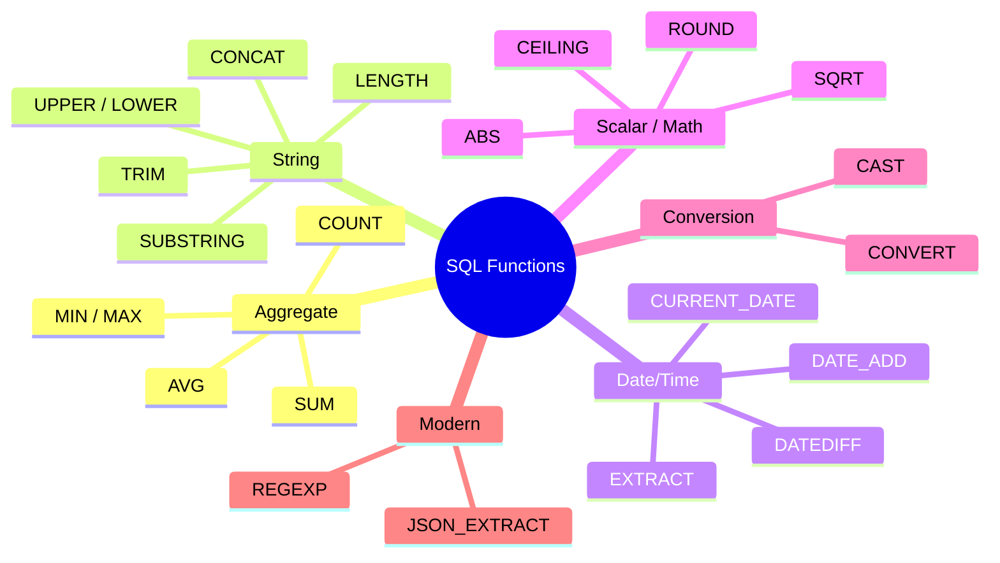

# Basic SQL: SQL Functions

> **Learning Objectives:**
> By the end of this lesson, you will be able to:
> *   Explain the purpose and classification of SQL functions.
> *   Enumerate and apply different types of SQL functions (Aggregate, String, Date/Time, Scalar, and Conversion).
> *   Understand how modern SQL dialects handle data transformations differently.
> *   Utilize advanced functions like JSON manipulation and Regular Expressions for modern data processing.

---

## A. Lesson Preview & Review

Hello students! Today we are discussing **SQL functions**. While basic SQL statements allow you to retrieve and filter data, SQL functions are the "power tools" that let you transform, format, and calculate data directly within the database engine. 

We will cover aggregate functions, string functions, date/time functions, scalar (mathematical) functions, and conversion functions. By the end of this lesson, you will know how to manipulate raw data into exactly the format your application needs. Let's get started!


---

## B. Main Lesson

### 1. What are SQL Functions?
**SQL functions** are pre-built, reusable pieces of code that perform specific operations on data within a database. They accept input values (arguments) and return a single output value. 

Functions can be used in almost any part of a SQL statement, including `SELECT`, `WHERE`, `ORDER BY`, and `HAVING`.

### 2. Types of SQL Functions



#### A. Aggregate Functions
These perform calculations on a set of values and return a single value. *(Covered in detail in Module 19).*
*   `COUNT()`, `SUM()`, `AVG()`, `MIN()`, `MAX()`

#### B. String Functions
These manipulate text data. 
> **Modern Update: Dialect Differences**
> The SQL standard uses the `||` operator for concatenation (e.g., `first_name || ' ' || last_name`). However, many databases support the `CONCAT()` function. Be aware of your specific database dialect (MySQL, PostgreSQL, SQL Server) as functions like `LENGTH()` (MySQL/Postgres) vs `LEN()` (SQL Server) often vary.

| Function | Description | Example |
| :--- | :--- | :--- |
| **`CONCAT()`** | Joins two or more strings together. | `SELECT CONCAT(first_name, ' ', last_name) FROM employees;` |
| **`LENGTH()`** | Returns the number of characters in a string. | `SELECT LENGTH(first_name) FROM employees;` |
| **`UPPER()` / `LOWER()`** | Converts a string to all uppercase/lowercase. | `SELECT UPPER(email) FROM employees;` |
| **`SUBSTRING()`** | Extracts a portion of a string. | `SELECT SUBSTRING(email, 1, 5) FROM employees;` |
| **`TRIM()`** | Removes leading and trailing spaces. | `SELECT TRIM(first_name) FROM employees;` |

#### C. Date and Time Functions
These functions extract, format, or calculate differences between dates and times.

| Function | Description | Example |
| :--- | :--- | :--- |
| **`CURRENT_DATE`** | Returns the current date. | `SELECT CURRENT_DATE;` |
| **`EXTRACT()`** | Extracts a specific part of a date (Year, Month, Day). | `SELECT EXTRACT(YEAR FROM hire_date) FROM employees;` |
| **`DATEDIFF()`** | Returns the difference between two dates. | `SELECT DATEDIFF(CURRENT_DATE, hire_date) FROM employees;` |
| **`DATE_ADD()`** | Adds a time interval to a date. | `SELECT DATE_ADD(hire_date, INTERVAL 10 DAY) FROM employees;` |

> **Pro Tip:** Date manipulation is highly dialect-specific. PostgreSQL uses `hire_date + INTERVAL '10 days'`, whereas SQL Server uses `DATEADD(day, 10, hire_date)`.

#### D. Scalar (Math) Functions
These perform mathematical calculations on numeric data.
*   **`ROUND()`**: Rounds a number to a specified number of decimal places.
*   **`CEILING()`**: Rounds a number up to the nearest integer.
*   **`FLOOR()`**: Rounds a number down to the nearest integer.
*   **`ABS()`**: Returns the absolute (positive) value of a number.
*   **`SQRT()`**: Returns the square root of a number.

#### E. Conversion Functions
Used to convert data from one type to another (e.g., converting a string to an integer, or a date to a string).
*   **`CAST()`**: Standard SQL syntax for converting data types.
    ```sql
    -- Convert a numeric ID to a string
    SELECT CAST(employee_id AS CHAR) FROM employees;
    
    -- Convert a string to a date (in some dialects)
    SELECT CAST('2023-10-01' AS DATE);
    ```

### 3. Modern Update: JSON and Regex Functions
Modern databases are no longer just storing simple text and numbers. They handle complex data structures. 

*   **JSON Functions:** If you have a column of type `JSON` or `JSONB`, you can extract data using functions like `JSON_EXTRACT()` (MySQL) or the `->` operator (PostgreSQL).
    ```sql
    -- Extracting a key from a JSON column
    SELECT profile -> 'age' FROM users;
    ```
*   **Regular Expressions:** Databases now support regex for complex string matching.
    ```sql
    -- Find users whose email matches a specific pattern
    SELECT * FROM users WHERE email REGEXP '^[a-zA-Z0-9._%+-]+@company\.com$';
    ```

---

## C. Analogies and Use Cases

### The Data Processing Factory Analogy
Think of the database as a factory.
*   **Raw Data (Strings/Numbers/Dates):** The raw materials (steel, plastic, wire).
*   **Scalar/Math Functions:** The cutting and shaping machines that resize the raw materials (e.g., `ROUND`, `CEILING`).
*   **String Functions:** The assembly line that joins parts together (`CONCAT`) or paints them (`UPPER`).
*   **Conversion Functions:** The packaging department that changes the format so it can be shipped (e.g., `CAST`).
*   **Aggregate Functions:** The quality control manager who summarizes the output (e.g., "How many total items did we produce?").

### Real-World Use Case: AI Data Preparation
Before feeding data into a Machine Learning model or an LLM, data scientists use SQL functions to clean the data. 
They might use `TRIM()` to remove accidental spaces from user inputs, `EXTRACT(YEAR FROM purchase_date)` to create a new feature for the model, and `LOWER()` to ensure text consistency before generating vector embeddings.

---

## D. Lesson Wrap-Up / FAQs

### Summary
**SQL Functions** are essential tools for transforming raw data. **String functions** clean and format text, **Date/Time functions** handle temporal calculations, **Scalar functions** perform math, and **Conversion functions** change data types. Understanding these functions—and knowing that their exact syntax may vary between SQL dialects (MySQL, PostgreSQL, SQL Server)—is crucial for effective database programming.

### Frequently Asked Questions (FAQs)

**Q: Are there performance implications when using SQL functions?**
**A:** Yes. Applying functions to columns in a `WHERE` clause (e.g., `WHERE UPPER(last_name) = 'SMITH'`) can often prevent the database from using an index on that column, leading to slow queries. It is generally better to clean the input data on the application side or use functional indexes.

**Q: Is it possible to create custom functions in SQL?**
**A:** Yes, most modern databases support **User-Defined Functions (UDFs)** or **Stored Procedures** using procedural languages like PL/pgSQL (PostgreSQL), T-SQL (SQL Server), or PL/SQL (Oracle). However, complex business logic is often better handled in the application code (e.g., Python, Java) to keep the database lean and scalable.

**Q: How do I handle NULL values with functions?**
**A:** Most functions will return `NULL` if any of their arguments are `NULL`. To handle this, use the **`COALESCE()`** function (or `IFNULL()` in MySQL), which returns the first non-null value in a list.
`SELECT COALESCE(phone_number, 'Not Provided') FROM customers;`

---

## E. Guided Drills / Code Projects

### Exercise: Customer Data Transformation

**Scenario:** You have a table `orders` with columns: `order_id`, `customer_name`, `order_date`, `order_total`, and `quantity`.

**Tasks:**
1.  **String Function:** Combine the customer's first and last name into a single uppercase column.
2.  **Date Function:** Find the date of delivery for all orders made today (assume a 5-day shipping time).
3.  **Scalar Function:** Round the `order_total` to the nearest whole number.
4.  **Conversion Function:** Convert the `order_date` to a string format.
5.  **Aggregate Function:** Find the total sales for all orders.

```sql
-- 1. String Function: Combine and Uppercase
SELECT UPPER(CONCAT(first_name, ' ', last_name)) AS full_name 
FROM orders;

-- 2. Date Function: Delivery date (5 days from today)
-- (Syntax varies by DB, this is standard-ish/MySQL style)
SELECT DATE_ADD(CURRENT_DATE, INTERVAL 5 DAY) AS delivery_date 
FROM orders;

-- 3. Scalar Function: Round total
SELECT ROUND(order_total) AS rounded_total 
FROM orders;

-- 4. Conversion Function: Date to String
SELECT CAST(order_date AS CHAR) AS date_string 
FROM orders;

-- 5. Aggregate Function: Total Sales
SELECT SUM(order_total) AS total_sales 
FROM orders;
```

---

## F. Skill-Building Check

### Part 1: True or False
*Identify whether the statement is true or false.*

1.  Aggregate functions are used to perform calculations on multiple rows of data and return a single value. (**True**)
2.  String functions are used to manipulate data stored in character strings. (**True**)
3.  Date and time functions are used to manipulate data stored in date and time data types. (**True**)
4.  Scalar functions are used to manipulate entire columns of data, not individual values. (**False** - *Scalar functions operate on individual values/rows, not aggregating the whole column.*)
5.  Conversion functions are used to convert data between different data types. (**True**)
6.  The specific syntax for SQL functions is identical across all SQL servers. (**False** - *Syntax varies significantly between MySQL, PostgreSQL, SQL Server, etc.*)
7.  SQL functions allow you to retrieve and manipulate data in a way that suits your needs. (**True**)

### Part 2: Multiple Choice
*Identify the best answer from the following questions.*

**1. Which function is used to remove leading and trailing spaces from a string?**
a) `CLEAN()`
b) `TRIM()`
c) `CUT()`
d) `SUBSTRING()`
> **Correct Answer: b.** `TRIM()` is the standard SQL function for removing whitespace from the beginning and end of a string.

**2. If you want to combine the `first_name` and `last_name` columns into one, which function should you use?**
a) `MERGE()`
b) `JOIN()`
c) `CONCAT()`
d) `APPEND()`
> **Correct Answer: c.** `CONCAT()` joins strings together. (Alternatively, the `||` operator in standard SQL).

**3. Which function extracts a specific part of a date, such as just the year?**
a) `GET_YEAR()`
b) `EXTRACT()`
c) `DATE_PART()`
d) Both b and c (depending on the dialect)
> **Correct Answer: d.** `EXTRACT(YEAR FROM date)` is standard, while `DATE_PART('year', date)` is common in PostgreSQL.

**4. What is the output of `SELECT ROUND(4.567, 1);`?**
a) 4
b) 4.5
c) 4.6
d) 5
> **Correct Answer: c.** `ROUND(value, decimal_places)` rounds to 1 decimal place, making 4.567 become 4.6.