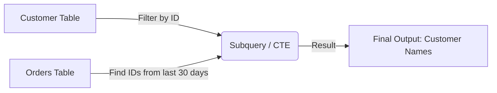

# Advanced SQL: Views, Indexes, and Complex Queries

> **Learning Objectives:**
> By the end of this lesson, you will be able to:
> *   Explain the difference between views, indexes, and clauses in SQL.
> *   Describe practical uses for indexes and their performance trade-offs.
> *   Describe modern methods of filtering results (including standard `FETCH` syntax).
> *   Apply views, indexes, clauses, and subqueries in SQL.
> *   Understand modern alternatives to subqueries, such as **Common Table Expressions (CTEs)**.

---

## A. Lesson Preview & Review

Welcome students! Today we are diving into advanced SQL concepts. As your databases grow, simple `SELECT *` queries won't cut it anymore. We need tools to organize our data (Views), speed up our searches (Indexes), and write complex logic cleanly (Subqueries and CTEs).

We will explore how to manipulate data safely and efficiently, ensuring your applications perform well even under heavy loads. Let's get started!


---

## B. Main Lesson

### 1. What is a View?
In SQL, a **view** is a virtual table based on the result of a `SELECT` statement. It does not store data physically (unless it is a *Materialized View*); instead, the `SELECT` statement is executed every time the view is queried.

*   **Purpose:** Simplify complex queries, restrict access to sensitive columns (security), and provide a consistent interface to underlying data.
*   **Modern Update: Materialized Views:** While standard views execute on the fly, a **Materialized View** physically stores the result. This is heavily used in modern Data Warehousing and Analytics to pre-calculate expensive aggregations (like daily sales totals) so dashboards load instantly. They require periodic refreshing.

### 2. What is an Index?
An **index** is a data structure that improves the speed of data retrieval operations on a database table. It works exactly like the index at the back of a textbook: instead of reading the whole book (scanning the whole table), you find the page number (the pointer) instantly.

**Practical Uses:**
*   **Speeding up `SELECT`, `UPDATE`, and `DELETE`:** By reducing the amount of data the database engine needs to scan.
*   **Enforcing Uniqueness:** Unique indexes prevent duplicate values.
*   **Facilitating `JOIN` operations:** Drastically speeds up joins on foreign keys.

> **The Trade-off (Pro Tip):**
> Indexes are not magic bullets. While they speed up reads, they **slow down write operations (`INSERT`, `UPDATE`, `DELETE`)** because the index must be updated every time the table changes. They also consume additional disk space. Only create indexes on columns frequently used in `WHERE` clauses or `JOIN` conditions.

### 3. Filtering Results: Clauses
A **clause** is a specific part of a SQL statement. We use different clauses to filter data to a manageable level.

| Clause | Purpose | Example |
| :--- | :--- | :--- |
| **`WHERE`** | Filters rows *before* any grouping. | `SELECT * FROM customers WHERE age > 25;` |
| **`GROUP BY`** | Groups rows that have the same values. | `SELECT city, SUM(sales) FROM orders GROUP BY city;` |
| **`HAVING`** | Filters groups *after* `GROUP BY`. | `SELECT city, COUNT(*) FROM orders GROUP BY city HAVING COUNT(*) > 100;` |
| **`LIMIT`** | Restricts the number of returned rows (MySQL/PostgreSQL). | `SELECT * FROM customers LIMIT 10;` |
| **`TOP`** | Restricts returned rows (SQL Server). | `SELECT TOP 10 * FROM customers;` |
| **`FETCH FIRST`** | **Modern SQL Standard** for restricting rows. | `SELECT * FROM customers FETCH FIRST 10 ROWS ONLY;` |

### 4. Subqueries vs. Modern CTEs
A **subquery** is a `SELECT` statement embedded within another SQL statement. They are often used in the `WHERE` clause.

*Example: Find customers who placed an order in the last 30 days.*
```sql
SELECT name 
FROM customers 
WHERE id IN (
    SELECT customer_id 
    FROM orders 
    WHERE order_date > CURRENT_DATE - INTERVAL '30' DAY
);
```
*(Note: Date syntax varies by DB. `CURRENT_DATE - INTERVAL '30' DAY` works in PostgreSQL; SQL Server uses `DATEADD(day, -30, GETDATE())`).*

> **Modern Update: Common Table Expressions (CTEs)**
> Deeply nested subqueries become impossible to read. Modern SQL developers prefer **CTEs** using the `WITH` clause. They make complex queries readable from top to bottom.
> ```sql
> -- The Modern Way (CTE)
> WITH RecentOrders AS (
>     SELECT customer_id 
>     FROM orders 
>     WHERE order_date > CURRENT_DATE - INTERVAL '30' DAY
> )
> SELECT name 
> FROM customers 
> WHERE id IN (SELECT customer_id FROM RecentOrders);
> ```



---

## C. Analogies and Use Cases

### The Library Analogy
*   **Table:** A massive library with millions of books.
*   **Index:** The library's card catalog. Instead of walking every aisle looking for "Harry Potter," you look it up in the catalog to find the exact aisle and shelf.
*   **View:** A curated reading list posted on the wall (e.g., "Top 10 Sci-Fi Books"). It doesn't create new books; it just presents the existing books in a specific way.
*   **Subquery / CTE:** Asking the librarian, "Please find the names of all authors who wrote a book published after 2020."

### Real-World Use Case: Dashboard Performance
A company has a massive `sales` table with 50 million rows. The CEO wants a dashboard showing daily sales. Running `SELECT SUM(amount) FROM sales` every time the CEO refreshes takes 10 seconds. 
**The Solution:** They create a **Materialized View** that pre-calculates daily sales every midnight. When the CEO opens the dashboard, the query hits the materialized view and loads in 50 milliseconds.

---

## D. Lesson Wrap-Up / FAQs

### Summary
**Views** provide virtual tables to simplify complex logic and secure data. **Indexes** act as turbo-chargers for read operations, at the cost of slightly slower writes. We use **Clauses** like `WHERE` and `HAVING` to filter data precisely, and modern syntax like `FETCH FIRST` for pagination. Finally, while **Subqueries** handle complex logic, modern best practices favor **CTEs (`WITH` clause)** for readability and maintenance.

### Frequently Asked Questions (FAQs)

**Q: What is the difference between SQL and MySQL?**
**A:** **SQL** is the standard query language used to interact with relational databases. **MySQL** is a specific Relational Database Management System (RDBMS) that *uses* SQL. Think of SQL as the English language, and MySQL as a specific publishing company that prints books in English.

**Q: What is the difference between a view and a table?**
**A:** A **table** is a physical object that actually stores data on the disk. A **view** is a virtual table; it stores no data itself, but rather executes a saved `SELECT` query against the underlying tables whenever you access it.

**Q: When should I use a CTE instead of a subquery?**
**A:** Use a CTE when your query requires multiple steps or complex logic. CTEs are evaluated top-down, making the code much easier for other developers (and your future self) to read. Subqueries are fine for simple, one-off checks.

**Q: Does creating too many indexes slow down my database?**
**A:** Yes. Every time you `INSERT` or `UPDATE` a row, the database must also update every index tied to that table. If you have 10 indexes on a table, a single insert becomes 11 operations. Only index columns you actually search by.

---

## E. Guided Drills / Code Projects

### Exercise: E-Commerce Database Optimization

**Scenario:** You have a `customers` table and an `orders` table. Write the SQL to perform the following tasks:

1.  **Create an Index:** Speed up searches by customer email.
2.  **Create a View:** Create a view that shows the total money spent by each customer.
3.  **Use a CTE:** Find all customers who have spent more than $500.

```sql
-- 1. Create an Index
CREATE INDEX idx_customer_email ON customers (email);

-- 2. Create a View
CREATE VIEW customer_total_spend AS
SELECT c.name, SUM(o.price) AS total_sales
FROM customers c
JOIN orders o ON c.id = o.customer_id
GROUP BY c.name;

-- 3. Use a CTE to filter the View
WITH BigSpenders AS (
    SELECT name, total_sales 
    FROM customer_total_spend
    WHERE total_sales > 500
)
SELECT * FROM BigSpenders;
```

---

## F. Skill-Building Check

### Part 1: Fill in the Blanks
*Complete the statement with the correct term.*

1.  An **Index** is a data structure that allows for faster retrieval of data from a table by quickly locating the location of specific values.
2.  A **View** is a virtual table based on the result of a SELECT statement.
3.  The **WHERE** clause is used to filter the rows returned by a SELECT statement.
4.  A **Subquery** is a SELECT statement embedded within another statement.
5.  The **HAVING** clause is used to filter groups based on a specific condition (after `GROUP BY`).
6.  The **LIMIT** (or **TOP**, or **FETCH FIRST**) clause is used to restrict the number of rows returned.

### Part 2: Multiple Choice
*Identify the best answer from the following questions.*

**1. Which of the following is a major disadvantage of creating too many indexes on a table?**
a) It makes `SELECT` queries slower.
b) It takes up physical disk space and slows down `INSERT`/`UPDATE` operations.
c) It prevents you from using `JOIN`s.
d) It deletes old data automatically.
> **Correct Answer: b.** Indexes must be updated during write operations, creating a performance penalty for writes.

**2. What is a Materialized View?**
a) A view that cannot be updated.
b) A view that physically stores the query results on disk.
c) A view that only works in MySQL.
d) A view created using a subquery.
> **Correct Answer: b.** Materialized views cache the data, unlike standard views which execute on the fly.

**3. Which modern clause is standardized to limit the number of rows returned, replacing `TOP` and `LIMIT`?**
a) `RESTRICT`
b) `FETCH FIRST n ROWS ONLY`
c) `MAX ROWS n`
d) `ONLY n`
> **Correct Answer: b.** `FETCH FIRST` is part of the SQL:2008 standard and is supported by modern databases like PostgreSQL and Oracle.