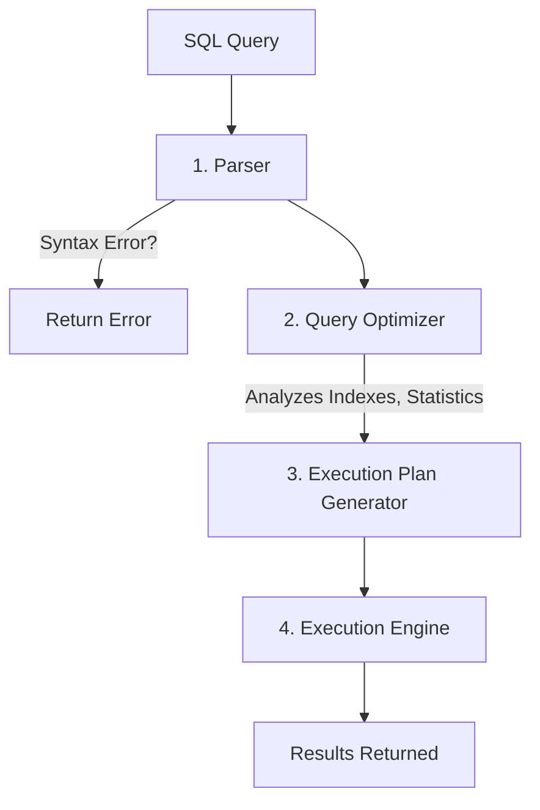

# SQL Optimization: Performance, Indexing, and Execution Plans

> **Learning Objectives:**
> By the end of this lesson, you will be able to:
> *   Explain the importance of SQL optimization and identify common techniques (Indexing, Partitioning, Denormalization).
> *   Understand the lifecycle of a query: how it is written versus how the DBMS processes it.
> *   Analyze query performance using metrics and execution plans (`EXPLAIN`).
> *   Apply modern optimization strategies, including **AI-driven tuning**, **CTEs**, and **in-memory caching**.

---

## A. Lesson Preview & Review

Welcome students! Today we are discussing **SQL Optimization**. As databases grow to millions or billions of rows, poorly written queries can bring an application to a grinding halt. 

We will cover various techniques and strategies to improve the performance of SQL queries, including indexing, query structuring, and database design. By the end of this lesson, you should have a solid understanding of how to diagnose slow queries and optimize your database for maximum performance and scalability. Let's get started!


---

## B. Main Lesson

### 1. What is SQL Optimization?
**SQL optimization** is the process of improving the performance of a database by reducing the resources (CPU, memory, I/O) required to execute a query. This leads to faster query execution times, lower cloud infrastructure costs, and better application scalability.

### 2. Core Optimization Techniques

| Technique | Description | Best Used For |
| :--- | :--- | :--- |
| **Indexing** | Creating data structures (B-Trees, Hash indexes) on frequently searched columns. | Speeding up `SELECT`, `WHERE`, and `JOIN` operations. |
| **Normalization** | Organizing data to minimize redundancy (up to 3NF/BCNF). | Transactional systems (OLTP) where data integrity is critical. |
| **Denormalization** | Intentionally adding redundancy to reduce complex `JOIN`s. | Analytical reporting (OLAP) and read-heavy dashboards. |
| **Partitioning** | Splitting a large table into smaller, manageable chunks (e.g., by date or region). | Huge tables where queries only target a specific subset of data. |
| **Query Structuring** | Avoiding `SELECT *`, filtering early, and using `EXISTS` instead of `IN` for large datasets. | General query writing. |

> **Modern Update: AI-Driven Database Tuning**
> Traditional optimization requires a human Database Administrator (DBA) to constantly analyze slow logs. Modern **Cloud-Native Databases** (like AWS Aurora, Azure SQL, and Oracle Autonomous Database) use **Machine Learning** to automatically learn query patterns, create missing indexes, and rewrite inefficient execution plans without human intervention.

### 3. Metrics for Analyzing Query Performance
To optimize a query, you must measure it. Modern DBAs look at:

*   **Execution Time:** Total time from submission to results.
*   **I/O Operations:** Disk reads/writes. High I/O usually means a "Full Table Scan" is happening (no index was used).
*   **CPU & Memory Usage:** High usage may indicate complex sorting, massive `JOIN`s, or missing indexes.
*   **Wait Time:** Time the query spends waiting for locks or resources.
*   **Explain Plan:** A detailed breakdown of *how* the DBMS plans to execute the query.

### 4. Written Queries vs. SQL Processing
When you write a query in human-readable SQL, the database does not just execute it directly. It goes through a rigorous process:


1.  **Parsing & Syntax Checking:** The DBMS verifies the SQL is valid.
2.  **Query Optimization:** The optimizer evaluates multiple ways to get the data. It checks available indexes, table statistics, and data distribution.
3.  **Execution Plan:** The optimizer chooses the *most efficient* path (e.g., "Use index on `last_name`, then filter by `city`").
4.  **Execution:** The engine runs the plan and returns the results.

### 5. Modern Best Practices in Query Writing

*   **Use `EXPLAIN ANALYZE`:** In modern databases (PostgreSQL, MySQL), prefixing a query with `EXPLAIN ANALYZE` will run the query and show the actual execution plan, including where time is being spent.
*   **Avoid `SELECT *`:** Only retrieve the columns you need. It reduces I/O and network traffic.
*   **Use Common Table Expressions (CTEs) over Subqueries:** While subqueries work, using `WITH` clauses makes complex queries readable and often helps the optimizer plan better.
*   **Beware of "Sargable" Queries:** Avoid using functions on indexed columns in the `WHERE` clause. 
    *   *Bad:* `WHERE YEAR(order_date) = 2024` (Forces a full scan).
    *   *Good:* `WHERE order_date >= '2024-01-01' AND order_date < '2025-01-01'` (Uses the index).

---

## C. Analogies and Use Cases

### The Restaurant Kitchen Analogy
*   **The Query:** A customer's complex order (e.g., a 5-course meal with specific substitutions).
*   **The DBMS:** The Head Chef.
*   **The Optimizer:** The Chef looks at the order and decides: "Should I cook the steak first or boil the pasta? Do I have the ingredients prepped (indexed)?"
*   **The Execution Plan:** The step-by-step recipe the Chef follows.
*   **Caching:** Pre-chopped vegetables (Mise en place). If the same order comes in again, it's much faster because the prep work is done.

### Real-World Use Case: E-Commerce Black Friday
An e-commerce site is struggling with slow page loads during Black Friday. The `products` table has 5 million rows. 
1.  They run `EXPLAIN ANALYZE` on their product search query and find it's doing a *Full Table Scan* (checking all 5 million rows).
2.  They add an **Index** on the `category_id` column.
3.  They implement **Caching** using Redis for the most popular product pages. 
Result: Query time drops from 4.5 seconds to 15 milliseconds.

---

## D. Lesson Wrap-Up / FAQs

### Summary
**SQL Optimization** is the art and science of making queries run faster. It involves strategic **Indexing**, intelligent **database design** (Normalization vs. Denormalization), and understanding how the **Query Optimizer** generates execution plans. By analyzing metrics like I/O and CPU usage, and utilizing modern tools like **EXPLAIN**, developers can eliminate bottlenecks and scale their applications efficiently.

### Frequently Asked Questions (FAQs)

**Q: What are some common techniques used in SQL optimization?**
**A:** Common techniques include indexing frequently searched columns, normalizing (or strategically denormalizing) tables, partitioning large tables, utilizing caching, and rewriting queries to be more efficient (e.g., avoiding `SELECT *`).

**Q: How can I measure the performance of a SQL query?**
**A:** You can measure performance using execution time, CPU and memory usage, I/O operations, and by analyzing the **execution plan** (using tools like `EXPLAIN` or `EXPLAIN ANALYZE`).

**Q: Should I put an index on every column?**
**A:** No! Indexes speed up reads but slow down writes (`INSERT`, `UPDATE`, `DELETE`) because the index must be updated. They also consume disk space. Only index columns frequently used in `WHERE`, `JOIN`, or `ORDER BY` clauses.

**Q: What is the difference between a Subquery and a View?**
**A:** A **Subquery** is a temporary query embedded inside another query. A **View** is a named, persistent (but virtual) table stored in the database schema that can be reused by multiple queries or applications.

---

## E. Guided Drills / Code Projects

### Exercise: Optimize a Slow Query

**Scenario:** You have a `customers` table with 2 million rows. The following query is taking 5 seconds to run:
```sql
SELECT * FROM customers 
WHERE LOWER(email) = 'john.doe@example.com';
```
*Why is it slow?* Using the `LOWER()` function on the `email` column prevents the database from using the index on the `email` column (it has to scan every row to lowercase it first).

**Task 1: Rewrite the query to be "Sargable" (Index-friendly).**
*Assume the data is already stored in lowercase.*
```sql
-- Optimized Query:
SELECT customer_id, first_name, last_name 
FROM customers 
WHERE email = 'john.doe@example.com';
```
*(Notice we also replaced `SELECT *` with specific columns to reduce I/O).*

**Task 2: Implement a Function-Based Index (Modern Solution)**
If you *must* search case-insensitively, modern databases support Function-Based Indexes.
```sql
-- Create an index on the lowercased email
CREATE INDEX idx_customer_email_lower ON customers (LOWER(email));

-- Now this query will use the new index and be fast!
SELECT * FROM customers 
WHERE LOWER(email) = 'john.doe@example.com';
```

---

## F. Skill-Building Check

### Part 1: Fill in the Blanks
*Complete the statement with the correct term.*

1.  **Indexing** is a technique used to quickly locate and access specific rows in a table based on the values in one or more columns.
2.  **Normalization** is the process of organizing data in a database so that it is stored in the most efficient way possible (reducing redundancy).
3.  **Partitioning** is a technique that can be used to split a large table into smaller, more manageable chunks.
4.  **Denormalization** is the process of replicating data across multiple tables in order to improve query performance (often used in data warehousing).
5.  **Query optimization** is the process of reordering the operations performed in a query to improve performance.
6.  **Query Profiling** is the process of measuring the performance of a query to identify which operations are taking a long time to execute.
7.  **Caching** is the process of storing the result of a query in memory so that it can be quickly retrieved the next time the query is executed.
8.  **Statistics** are used by the query optimizer to make better decisions when executing a query.

### Part 2: Multiple Choice
*Identify the best answer.*

**1. What is the primary purpose of an execution plan?**
a) To make the SQL code look pretty.
b) To outline the specific steps the DBMS will take to execute a query.
c) To store the results of a query on the disk.
d) To enforce data integrity.
> **Correct Answer: b.** The execution plan shows how the DBMS will retrieve the data (e.g., which indexes to use, join order).

**2. Which metric indicates that a query is scanning too much data from the disk?**
a) High CPU usage
b) High I/O operations
c) Low memory usage
d) High wait time
> **Correct Answer: b.** High I/O (Input/Output) usually means the database is reading from the hard drive instead of memory, often due to missing indexes or full table scans.

**3. Why is `SELECT *` generally considered bad practice for performance?**
a) It causes syntax errors.
b) It prevents the use of indexes.
c) It retrieves unnecessary columns, increasing I/O and network traffic.
d) It deletes data accidentally.
> **Correct Answer: c.** Retrieving more data than needed slows down the query and uses more bandwidth.

**4. Which modern technique allows a database to automatically create indexes and rewrite bad queries without human intervention?**
a) AI-driven database tuning / Autonomous databases
b) Denormalization
c) Vertical scaling
d) Partitioning
> **Correct Answer: a.** Cloud providers like Oracle and AWS use ML to auto-tune databases.