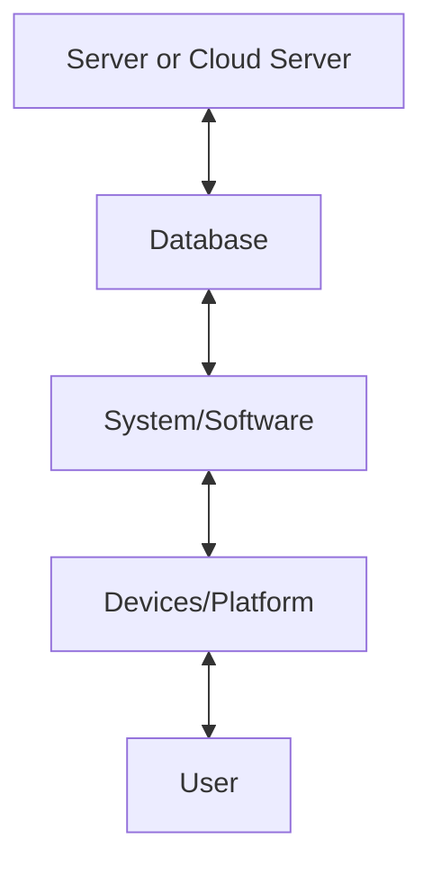

# Database Security and Integrity: Information Flow Model

> **Course:** Information Assurance and Security  
> **Module:** 12 — Database Security and Integrity: Information Flow Model  
> **Learning Format:** Individual Activity (Solo Work)

---

## A. Lesson Preview & Review

Hello students! Today, we are reinforcing your knowledge with communications between systems, servers, networks, databases, and users by understanding the **Information Flow Model** and how to secure it.

By the end of this module, you should be able to identify the risks involved in the information model of your projects and apply risk management to it. 

> **Important Note:** What we are doing is somewhat of a risk management process. Instead of looking solely at physical assets, we look at **information** and the **flow of information**, which is, in actuality, also a critical asset.

**Learning Targets:**
By the end of this module, you will be able to:
1.  Understand Database and Systems Information Flow Model.
2.  List risks in your project's information flow.

---

## B. Main Lesson

### What is an Information Flow Model?
An **Information Flow Model** describes the flow of data/information within your system. A very good example of this is a **Data Flow Diagram (DFD)**. 

However, a DFD is only part of the information flow model. A Data Flow Diagram describes each step of your system's activities, events, and entities, relating them and explaining how data is transferred between entities. 

> **Note:** For the sake of this course, we will limit ourselves to the field of Data Flow Diagrams. This makes the concept more accomplishable and easily understood, though real-world information flow models often include servers, databases, network devices, and end devices.

**Example: Basic Buying, Ordering, and Shipping Process**
*   A **User** places an **order**.
*   The **order information** goes to the **Orders** process.
*   **Shipping information** is sent to **Fulfillment**, while **billing information** goes to the **Invoices** process.
*   The **User** provides their **name and address** to both the **Process Order** and **Ship Products** entities.
*   **Invoices, statements, and payments** flow between the **Collect Payment** entity and the **Users**.

### Information Flow Security and Integrity
Our goal is to secure the flow of information from each part of the system. A good way to do this is to display a flow model or diagram, and then ask critical questions about its security:

*   *In the "Collect Payment" and "Users" entities:* Are the invoices, statements, payments, and inquiries secure?
*   *When the User processes an Order:* Are the user name and user address secure?
*   *Is the process of transferring Billing information* between the process order and invoices secure?

You have to secure each and every one of these information flows to guarantee overall security. This is a risk management process where we identify the information and the flow of information.

#### Identifying Threats in the Information Flow
The next question you should ask is: **What are the threats involved in the identified information flow?** 
This is done through brainstorming, discussions, and checking out news and potential threats in your area, country, and type of organization. A lot of it is through imagination and thinking of scenarios.

**Examples of Threats in our DFD:**
*   **Payments between user and collect payment entities:** Can be exploited if not using a secure connection.
*   **Statements:** Can be hacked and changed in value if not secure enough.
*   **User name or address:** Could be mistaken by human error.
*   **Ordered product:** Could be different from the received product.
*   **Transferring Billing Information:** This process can be attacked by **Man-in-the-Middle (MitM) attacks**.

### Threat Categorization
Ideally, the next step is to categorize the threat by its level of **Impact** and **Likelihood**.

*   **Impact Scale:** Very Low, Low, Moderate, High, Very High.
*   **Likelihood Scale:** Very Unlikely, Unlikely, Moderately Likely, Likely, Very Likely.

| Information Flow | Threat | Impact | Likelihood |
| :--- | :--- | :--- | :--- |
| Payments | Exploited if not using a secure connection. | High | Unlikely |
| Statements | Hacked and changed value if not secure enough. | Very High | Unlikely |
| User Info | Name or address mistaken by human error. | Low | Likely |
| Product Info | Ordered product different from received product. | Low | Unlikely |
| Billing Info | Attacked by Man-in-the-Middle (MitM) attacks. | Very High | Unlikely |

### Securing the Database's Flow
A database on its own is actually not that secure. It can be attacked through **Buffer Overflow Exploitations**. 
*   **Buffer Overflow:** Occurs when a process attempts to write more data to a fixed-length block of memory than it is allowed to hold. 

Sometimes a database interacting with another database can also have detrimental effects. This usually happens in huge projects involving multiple teams and multiple databases that interact near the halfway point of the project. Sometimes there can be issues with the vulnerabilities between them, thus the information flow should be checked and secured.

### Other Components of the Information Flow Model
An Information Flow Model can also have interactions between Server to Database, Database to System/Software, System/Software to Devices/Platform, and Device/Platform to User. All of these can be seen in the reverse way as well.

*Each arrow represents information transferred or flow between the components. Each of these flows needs to be secured.*

---

## C. Analogies and Use Cases

### The "Water Pipe" Analogy
Think of information flow as a complex plumbing system in a building.
*   **The Data:** The water flowing through the pipes.
*   **The Entities:** The sinks, faucets, and water heaters (Users, Databases, Systems).
*   **The Vulnerabilities:** Leaky pipes, weak joints, or a compromised main water source.
*   **The Threats:** A contaminant introduced at the source (Server) will flow through the entire system and affect every user. A Man-in-the-Middle attack is like someone secretly siphoning water from a pipe in the basement and replacing it with dirty water.

### Real-World Use Case: A University Registration System
A student registers for classes online.
1.  **Flow 1 (User -> System):** Student enters their ID and password. *Threat: Brute-force login attempt.*
2.  **Flow 2 (System -> Database):** System queries the database for available courses. *Threat: SQL Injection.*
3.  **Flow 3 (Database -> System):** Database returns the list of courses. *Threat: Data tampering (changing the course list).*
4.  **Flow 4 (System -> User):** System displays the schedule. *Threat: Session hijacking (another user sees the schedule).*

By mapping out these flows, the university can implement specific controls (like HTTPS, parameterized queries, and MFA) for each step.

---

## D. Lesson Wrap-Up / FAQs

### Key Takeaways
*   **Information Flow Models** (like DFDs) map how data moves between entities, systems, and users.
*   Every arrow in an information flow diagram represents a potential vulnerability.
*   **Risk Management** is applied to information flow by categorizing threats based on **Impact** and **Likelihood**.
*   **Buffer Overflow** occurs when a process writes more data than a fixed-length memory block can hold, compromising database security.
*   Securing information flow requires continuous checking, especially when multiple databases or systems interact with each other.

### Frequently Asked Questions
**1. Are there other user access controls beyond MySQL?**
**A:** Yes. The concepts discussed here apply to other types of databases as well, such as SQL Server, MariaDB, PostgreSQL, and NoSQL databases. Each has its own specific implementation of User Access Controls, but the principles remain the same.

**2. Why is a database on its own considered "not that secure"?**
**A:** A database is a tool; it relies on the environment and the applications interacting with it for protection. If it is left with default passwords, unpatched, or accessed via insecure network flows, it is highly vulnerable to attacks like buffer overflows and SQL injections.

**3. What is a "Man-in-the-Middle" (MitM) attack in the context of an information flow?**
**A:** A MitM attack occurs when an attacker secretly intercepts and relays messages between two parties who believe they are communicating directly with each other. In an information flow model, this would be an attacker positioning themselves on the arrow between two entities to steal or alter the data.

**4. How do I decide what to secure first when looking at a DFD?**
**A:** Use your Threat Categorization table. Prioritize flows with a combination of **Very High Impact** and **Likely/Moderately Likely** occurrence. These are the critical vulnerabilities that could cause the most damage.

---

## E. Guided Drills / Code Projects

### Solo Project Update: Mapping Your Information Flow
**Project Overview:** 
For Module 12, you will expand your ongoing project by creating a Data Flow Diagram (DFD) for your chosen system and applying risk management principles to the identified flows. 

> *Note: This was originally designed as a group activity. We are adapting it as a **solo activity**. You will act as the sole system analyst and security consultant.*

**Project Guidelines:**
*   **Format:** Individual work.
*   **Objective:** Draft the main data flow diagram of a standard activity of your system. Identify all possible information flows that are vulnerable.
*   **Submission:** Add this to your project documentation.

**Step-by-Step Deliverable:**
1.  **Draw a DFD:** Create a simple diagram showing the flow of data between users, processes, and data stores.
2.  **Identify Flows:** List at least 5 information flows from your diagram.
3.  **Apply Risk Management:** Categorize the threats associated with each flow using the Impact and Likelihood matrix.

**Draft your analysis below:**

| Information Flow | Potential Threat | Impact (Low/Med/High) | Likelihood (Unlikely/Likely) | Proposed Security Control |
| :--- | :--- | :--- | :--- | :--- |
| *Example: User Login -> Database* | *SQL Injection* | *High* | *Likely* | *Parameterized Queries* |
| *Example: Database -> User Dashboard* | *Data Leakage* | *Very High* | *Unlikely* | *HTTPS & Access Control* |
| *Your Flow 1* | | | | |
| *Your Flow 2* | | | | |
| *Your Flow 3* | | | | |

---

## F. Skill-Building Check

### Check for Understanding (10 mins Quiz)

**1. What is the importance of having a secure information flow?**
*Guidance:* A secure information flow ensures that data is not intercepted, modified, or destroyed as it moves between entities (users, servers, databases, systems). It protects the **Confidentiality, Integrity, and Availability** of data. If one flow is insecure (e.g., a Man-in-the-Middle attack on billing information), it can compromise the entire system and the trust of the users.

**2. Identify at least 5 information flows in your school. Between you and the entities of the school and its systems.**
*Guidance:* Your answer should list specific data movements. For example:
1.  **Student to Registrar System:** Entering personal details for enrollment.
2.  **Teacher to Grading Database:** Inputting final grades for students.
3.  **Finance System to Bank:** Transmitting tuition payment data.
4.  **School Server to Email System:** Sending official announcements to students.
5.  **Student Portal to Library Database:** Requesting a book loan.

**3. Multiple Choice: What occurs when a process attempts to write more data to a fixed-length block of memory than it is allowed to hold?**
A. Man-in-the-Middle Attack
B. Buffer Overflow Exploitation
C. SQL Injection
D. Phishing
**Correct Answer: B** (Buffer overflow is the classic definition of writing excess data to a fixed-length memory buffer).

**4. Multiple Choice: Which of the following is the best first step to secure an Information Flow Model?**
A. Buying the most expensive firewall.
B. Mapping the data flow and identifying all entities and interactions.
C. Firing the current IT team.
D. Ignoring the data flows and focusing only on the database.
**Correct Answer: B** (You cannot secure what you do not understand. Mapping the DFD is the foundational step).