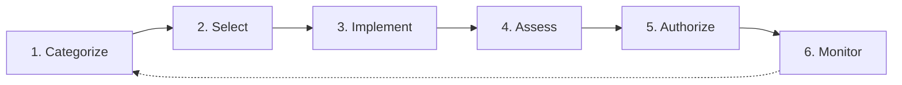

# Risk Management Framework: Authorization and Monitoring

> **Course:** Information Assurance and Security  
> **Module:** 19 — Risk Management Framework (Step 5 and 6)  
> **Learning Format:** Individual Activity (Solo Work)

---

## A. Lesson Preview & Review

Welcome back, future security officers! Today, we are finishing our journey through the Risk Management Framework (RMF) by focusing on **Step 5: Authorize Information Systems** and **Step 6: Monitor Security Controls**.

**Quick Review:**
*   **Step 5:** Authorize Information Systems
*   **Step 6:** Monitor Security Controls

Step 5 is mostly focused on the executives or owners of the organization, as they are the ones who give final approval. Step 6 focuses on improving upon Step 4 (Assessing Security Controls), ensuring that our security measures remain effective over time.

---

## B. Main Lesson

### Step 5: Authorize Information Systems
Authorizing information systems is **not** done by the security officers. It is authorized by the executives or the owners of the organization. The role of the security officer is to create the documentation to inform the executives so they can make an informed decision.

When authorizing the RMF, executives must:

1.  **Accept or decline** the provided security controls.
2.  **Assign an employee** to handle and observe each of the risks and security controls.
3.  **Accept the costs** of implementing the security controls.
4.  **Finally, accept the damages** if the security control fails or if the security control was declined.

#### Why do we need authorization?
Basically, if we are able to authorize our RMF or security controls, this will ensure that the owners or executives are aware of the current state of their security and risks, and how they are managed. They will also be aware of the costs and whether they are still within budget. Ultimately, they will have the final say on what risk treatment to choose: **Prevent, Reduce, Transfer, or Accept**.

> **Pro Tip:** Authorization is not just a formality—it is the bridge between a security recommendation and an actual implemented control. Without executive sign-off, the recommended controls will not be funded or implemented.

### Step 6: Monitor Security Controls
As mentioned previously, the monitoring step of RMF is to improve upon the assessing security controls step. This step is **continuous**, meaning the risk and the selected security controls will be monitored unless something changes or needs changes.

**Examples of triggers for change:**
*   It is found out that the risk is no longer a highly severe risk, and thus the cost for it should be reduced.
*   A new technology has been introduced, and thus a new security control will be implemented.

#### What Happens After Monitor Security Controls?
After the 6th step of the Risk Management Framework, the process loops back to the **first step: Categorization of the Information System**. 

While monitoring, when we see changes, we will have to go back to the first step and perform the process all over again so that we will not miss any details of the risk. The RMF is a cyclical, never-ending process.

*The RMF Cycle: Step 6 loops back to Step 1.*

---

## C. Analogies and Use Cases

### The "Home Security System" Analogy
Think of the RMF as upgrading your home security.
*   **Step 5 (Authorize):** You (the homeowner) review the quotes for a new alarm system. You decide it's too expensive and negotiate a cheaper package, or you decide to go with the premium package. You sign the contract and pay the deposit. You also agree that if the alarm fails to stop a burglar, you accept the risk of losing your TV.
*   **Step 6 (Monitor):** Two years later, you review the system. You realize that your neighborhood is now much safer, so you downgrade the monitoring service to save money. Or, a new type of smart lock is invented, so you update your system. This triggers a new assessment (back to Step 1) to decide if the new lock is worth the cost.

### Real-World Use Case: A Retail Store's Point-of-Sale System
A retail store identifies the risk of credit card data theft.
*   **Authorization:** The IT security officer recommends a new encrypted POS system. The business owner reviews the cost, approves the budget, and assigns the Store Manager to oversee the rollout.
*   **Monitoring:** Six months later, the Store Manager notices that the new system is working well, but the monthly license fee has increased. The manager reports this back to the owner. The owner decides to switch vendors to a cheaper alternative, which triggers a full reassessment of the risk (starting the RMF cycle again).

---

## D. Lesson Wrap-Up / FAQs

### Key Takeaways
*   **Step 5 (Authorize)** is the responsibility of executives and owners, not security officers. Security officers provide the documentation to facilitate this decision.
*   Executives must accept the controls, the costs, and the residual damages if the controls fail.
*   **Step 6 (Monitor)** is a continuous process that ensures controls remain effective, cost-efficient, and relevant.
*   The RMF is a **cyclical process**. After monitoring, it loops back to Step 1 to re-categorize and reassess risks as the environment changes.

### Frequently Asked Questions
**1. How important is the Authorization of Information Systems?**
**A:** It is very important. The security controls that are recommended will not be implemented if they are not authorized by the owners. Without authorization, there is no budget, no accountability, and no implementation.

**2. Who is responsible for monitoring security controls?**
**A:** While the security officer may oversee the process, the actual monitoring is often assigned to a specific employee or manager within the department that owns the asset, as directed by the executives during the Authorization step.

**3. What triggers a loop back to Step 1?**
**A:** Any significant change. This includes a change in the risk landscape (new threats), a change in the asset (new technology), or a change in the organization's budget or risk appetite.

**4. What happens if an executive declines a recommended security control?**
**A:** If a control is declined, the executive is officially **accepting the risk**. They must be aware that if the risk occurs, the organization (and potentially the executive personally) will bear the full damages.

---

## E. Guided Drills / Code Projects

### Solo Project Update: Conclusion Chapter
**Project Overview:** 
For Module 19, you will finalize your ongoing project by adding a **Conclusion chapter**. This section will summarize the authorization and monitoring phases for your chosen organization.

> *Note: This is a solo activity. You are acting as the sole security consultant.*

**Project Guidelines:**
*   **Format:** Individual work.
*   **Objective:** Draft a professional conclusion that outlines who authorizes the plan and how it will be monitored.
*   **Submission:** Add this to your project document.

**Step-by-Step Deliverable:**

**Part 1: Draft Your Conclusion**
Create a new section titled "Conclusion." In this section, you must include the following two components:

**1. Authorized Information Systems:**
Conclude that whatever is recommended in your project will ultimately be decided by the organization's owner and executives. Remind them that they are free to apply whatever recommendations you provided, and that the final action is decided upon by their executives.

**2. Monitor Security Controls:**
Add a statement that regardless of whether the organization accepts or rejects your recommendations, they must still assign people to monitor the organization's risks and security controls. This ensures the framework remains effective.

**Draft your Conclusion below:**

> *Example:*
> **Conclusion**
> The security recommendations provided in this report are subject to the final approval of the organization's owners and executives. The implementation of any controls, as well as the acceptance of associated costs and residual risks, rests solely with the executive team. Furthermore, regardless of the decision made regarding these recommendations, the organization must assign dedicated personnel to continuously monitor its risks and security controls to ensure the ongoing safety and resilience of its assets.

---

## F. Skill-Building Check

### Part 1: Check for Understanding (Short Answer)
*Answer the question from the module directly.*

**1. What is the next step after Monitor Security Controls? And what is being performed in that step?**
*Guidance:* The next step is **Step 1: Categorize Information Systems**. In this step, the security team re-evaluates the assets and re-prioritizes the risks based on any changes that occurred during the monitoring phase. The entire RMF process is restarted to ensure no new details are missed.

### Part 2: Multiple Choice

**2. Who is responsible for authorizing information systems in the RMF?**
A. The IT Security Officers
B. The Employees
C. The Executives or Organization Owners
D. The Customers
**Correct Answer: C** (Authorization is strictly an executive-level decision).

**3. What is the primary purpose of the Monitor Security Controls step?**
A. To punish employees who violate security policies.
B. To continuously ensure the risk and selected security controls remain effective and cost-efficient.
C. To permanently stop all cyber attacks.
D. To sell the company's security software.
**Correct Answer: B** (Monitoring is an ongoing process to evaluate the effectiveness and cost of controls).

**4. If a security control is implemented but later found to be too expensive, what should happen?**
A. Ignore it and keep paying.
B. The organization should accept the risk immediately.
C. The monitoring process should identify this, and the RMF cycle should restart to find a cheaper alternative.
D. The security officer should be fired.
**Correct Answer: C** (Monitoring detects cost issues, triggering a loop back to Step 1 to reassess).

**5. What does an executive implicitly accept if they decline a recommended security control?**
A. They accept the risk and any resulting damages.
B. They accept a promotion.
C. They accept that the security officer is bad at their job.
D. Nothing, they are safe.
**Correct Answer: A** (Declining a control means accepting the risk and its potential consequences).