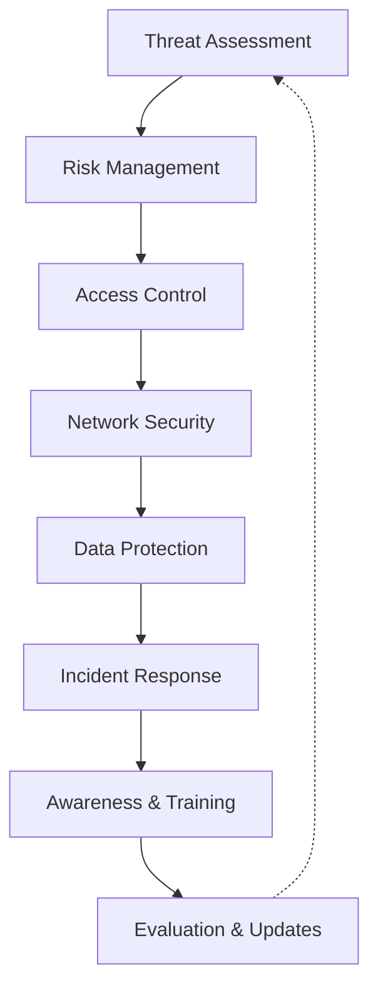

# Security Architecture Design

> **Course:** Information Assurance and Security  
> **Module:** 3 — Security Architecture Design  
> **Learning Format:** Individual & Group Activities

---

## A. Lesson Preview & Review

Welcome back, students! Today we are tackling **Security Architecture Design**. Normally, this is an extremely wide concept. In this module, we will explore it in a general, easily understood perspective so you can apply it in any organization, alongside an IT-specific example.

Our world is extremely technology-based. It is important to understand that all security operations of a company work in harmony with all decision-making strategies and ultimately reach the company's goals, objectives, and security requirements.

**Quick Review Activity:**
Can you think of an activity that can still be done nowadays *without* technology involved—whether personal, for work, or for school? And even if you manage to find one, wouldn't it be better with technology?

*   **Provide an example of an activity that does not need IT in any form:** [Your Answer]
*   **If you can provide any, try to improve it with IT:** [Your Answer]

**Learning Targets:**
By the end of this module, you will be able to:
1.  Understand the concept of a Security Architecture Design.
2.  Understand the concept of security architecture design in the IT field.

---

## B. Main Lesson

### What is Security Architecture Design?
**Security Architecture Design** refers to the process of creating a comprehensive and effective security framework for an organization's information systems. 

This process has the goal of making sure that business continues, even if there are disasters. It involves designing and implementing various security controls, policies, and procedures to protect the **confidentiality, integrity, and availability** (the CIA Triad) of data and resources.

### Core Components of Security Architecture Design
A robust security architecture comprises eight fundamental aspects:

1.  **Threat Assessment:** Identifying potential threats and vulnerabilities that can impact the organization's systems. This includes analyzing external threats (hackers, malware, physical breaches) and internal risks (insider threats, data leakage).
2.  **Risk Management:** Once threats are identified, a risk management process is implemented to prioritize and address them. This involves assessing the potential impact of each risk and determining appropriate mitigation strategies.
3.  **Access Control:** Mechanisms that ensure only authorized individuals have appropriate access to sensitive information and resources.
4.  **Network Security:** Measures implemented to protect the organization's network infrastructure from unauthorized access and attacks (e.g., firewalls, IDS/IPS, VPNs, secure protocols).
5.  **Data Protection:** Implementing measures to protect data at rest and in transit. This includes encryption, data masking, Data Loss Prevention (DLP) solutions, and secure data storage practices.
6.  **Incident Response:** Having a plan in place to handle security incidents effectively and ensure business continuity. This includes detecting, responding to, conducting forensic investigations, and recovering from the incident while minimizing impact.
7.  **Security Awareness and Training:** Educating employees about security best practices is crucial for maintaining a secure environment. Programs and regular training ensure employees understand their roles and responsibilities in safeguarding assets.
8.  **Regular Evaluation and Updates:** Security architecture is not a one-time task. It requires periodic evaluation, updates, and testing to address emerging threats, technology advancements, and changes in the organization's environment.

> **Pro Tip:** The specific approach may vary depending on the organization's size, industry, and specific security requirements. It is crucial to involve security experts and professionals in the design process to ensure a robust and effective security framework.

### Security Architecture Design in Software Development
When it comes to Information Technology (IT) software development, security architecture design focuses on incorporating security measures into the **Software Development Life Cycle (SDLC)** to ensure applications are developed with security in mind.

Here are the 10 key practices:

| # | Practice | Description |
| :--- | :--- | :--- |
| **1** | **Secure Development Practices** | Implement secure coding practices and guidelines throughout the process. Includes input validation, proper error handling, and adherence to coding standards to prevent injections, XSS, or insecure direct object references. |
| **2** | **Authentication and Authorization** | Design robust mechanisms to control access to the software application. Involves secure user authentication, session management, and role-based access control (RBAC). |
| **3** | **Secure Communication** | Utilize secure communication protocols, such as HTTPS, to protect data transmitted between the software and users. Encryption safeguards sensitive information in transit. |
| **4** | **Input Validation and Output Encoding** | Validate and sanitize all user inputs to prevent SQL injection or cross-site scripting. Properly encode output to prevent malicious content from being displayed or executed by users' browsers. |
| **5** | **Secure Configuration Management** | Ensure default configurations are secure and do not expose unnecessary vulnerabilities. Disable unnecessary services, use strong default passwords, and follow the principle of least privilege. |
| **6** | **Data Protection** | Implement appropriate encryption mechanisms to protect sensitive data stored in databases or file systems. Apply hashing, symmetric or asymmetric encryption, and key management practices. |
| **7** | **Secure Third-Party Components** | Be mindful of the security of third-party libraries, frameworks, and modules. Keep them updated with the latest security patches and conduct regular security assessments. |
| **8** | **Logging and Monitoring** | Incorporate logging and monitoring capabilities to capture and analyze security events and potential threats. Helps in detecting and responding to incidents effectively. |
| **9** | **Secure Deployment and Configuration** | Ensure secure deployment by following best practices for server hardening, secure network configuration, and access control. Implement security testing and vulnerability scanning as part of the release process. |
| **10** | **Regular Security Assessments** | Conduct regular penetration testing and code reviews to identify and address vulnerabilities proactively before they are exploited. |

By integrating these security considerations into the software development process, organizations can build secure and resilient software applications that protect sensitive data, prevent unauthorized access, and minimize the risk of security breaches.

*The cyclical nature of Security Architecture Design.*

---

## C. Analogies and Use Cases

### The "Modern Bank Vault" Analogy
Think of Security Architecture Design as building a modern bank vault.
*   **Threat Assessment & Risk Management:** You assess who might try to rob the bank (threats) and how much money you'd lose if they succeed (risk).
*   **Access Control & Authentication:** The vault requires a keycard, a PIN, and a fingerprint scan to enter. Not everyone can walk in.
*   **Network Security & Data Protection:** The walls are reinforced concrete (firewalls), and the money is kept in locked boxes (encryption).
*   **Incident Response:** If an alarm goes off, there is a clear plan for the guards to respond and apprehend the intruder.
*   **Evaluation:** Every year, you hire a team to test the vault's security to ensure it's still impenetrable.

### Real-World Use Case: Building an Online Banking App
A development team is tasked with creating a new mobile banking application.
*   *Secure Development Practices:* They use pre-approved code libraries and conduct peer reviews to prevent vulnerabilities.
*   *Data Protection:* All customer passwords are hashed and salted. Account numbers are encrypted.
*   *Secure Communication:* The app forces HTTPS connections to prevent eavesdropping on public Wi-Fi.
*   *Regular Security Assessments:* Before launch, they hire a third-party ethical hacker to perform a penetration test on the app.

---

## D. Lesson Wrap-Up / FAQs

### Key Takeaways
*   **Security Architecture Design** is a comprehensive framework that ensures business continuity and protects the confidentiality, integrity, and availability of data.
*   It involves 8 core components, from Threat Assessment to Regular Evaluation.
*   In software development, it requires integrating security into every phase of the SDLC (Secure Development Practices, Authentication, Data Protection, etc.).
*   It is not a one-time task; it requires continuous monitoring, evaluation, and updates.

### Frequently Asked Questions
**1. Is it important to memorize all concepts of Security Architecture Design?**
**A:** No, it is far more important to *understand* its concepts, especially if you are an IT developer. Focus on the practical application of these principles in your software development projects rather than rote memorization.

**2. What is the primary goal of security architecture design?**
**A:** The primary goal is to minimize risk and protect information systems by ensuring business continuity, even in the face of disasters or cyberattacks.

**3. How does security architecture design differ between a large enterprise and a small startup?**
**A:** The core principles remain the same, but the implementation scales. A large enterprise might have dedicated security teams, complex network segmentation, and formal incident response teams. A small startup might rely on cloud providers for security, use standard frameworks, and have a simpler, more consolidated architecture.

**4. Why is "Regular Evaluation and Updates" considered part of the architecture?**
**A:** Because the threat landscape is constantly changing. A design that was secure yesterday might be vulnerable today due to new malware or exploits. Continuous evaluation ensures the architecture adapts to new risks.

---

## E. Guided Drills / Code Projects

### Project Group Update: Software Development Security Draft
**Project Overview:** 
With your knowledge of this topic, create a draft for the purpose of your project in IAS 2, which includes Security Architecture and Design in Software Development.

> *Note: This is a foundational activity. You are drafting the security guidelines your group will follow for your capstone project.*

**Project Guidelines:**
*   **Format:** Individual or Group work (as instructed).
*   **Objective:** Draft a 1-page security architecture guideline for your upcoming software project.
*   **Submission:** Add this draft to your project documentation.

**Step-by-Step Deliverable:**
Review the 10 key practices of Secure Software Development and write a short, actionable plan addressing the following:

1.  **Authentication:** How will users log into your system? (e.g., Username/Password, OAuth, MFA?)
2.  **Input Validation:** What is your strategy to prevent SQL Injection or XSS?
3.  **Data Protection:** How will you store user passwords and sensitive data securely?
4.  **Third-Party Components:** How will you ensure the libraries you use are safe and up-to-date?
5.  **Testing:** When will you conduct your security assessments or penetration testing?

**Draft your plan below:**

> *Example Draft:*
> **Capstone Security Architecture Plan**
> *   **Authentication:** We will implement a standard JWT (JSON Web Token) authentication system with hashed passwords using bcrypt.
> *   **Input Validation:** All user inputs will be validated on both the client-side and server-side using regular expressions to prevent XSS and SQL Injection.
> *   **Data Protection:** Sensitive user data will be encrypted at rest using AES-256. 
> *   **Third-Party Components:** We will use `npm audit` (or equivalent) to check for vulnerabilities in our dependencies before deployment.
> *   **Testing:** We will conduct a peer code review and one round of automated vulnerability scanning before the final defense.

---

## F. Skill-Building Check

### Check for Understanding (5 mins Quiz)

*Write your answer before the number.*

**1. What is the primary goal of security architecture design?**
a) Ensuring confidentiality of data
b) Achieving high system availability
c) Minimizing risk and protecting information systems
d) Enforcing strict access control policies
**Correct Answer: C** (While A, B, and D are parts of it, the overarching goal is minimizing risk and protecting the systems comprehensively).

**2. True or False:**
Defense in depth is a principle of security architecture design that emphasizes the use of multiple layers of security controls.
**Correct Answer: True** (Defense in depth is a core concept in security architecture).

**3. Which of the following is an important consideration in security architecture design for business continuity?**
a) Confidentiality of data during normal operations
b) Protection against denial-of-service attacks
c) Development of a structured incident response plan
d) Compliance with industry regulations
**Correct Answer: C** (An incident response plan is specifically designed to ensure business continuity during a crisis).

**4. What is the purpose of a risk assessment in security architecture design?**
a) Identifying and mitigating potential risks and vulnerabilities
b) Developing access control policies
c) Conducting penetration testing
d) Implementing secure coding practices
**Correct Answer: A** (Risk assessment is the systematic process of identifying, evaluating, and prioritizing risks).

**5. Essay: Why do we need regular security assessments?**
*Guidance:* Your answer should discuss how the threat landscape, technology, and organizational environments are constantly changing. Regular assessments (like penetration testing and code reviews) proactively identify new vulnerabilities before attackers can exploit them, ensuring the security architecture remains effective and up-to-date over time.