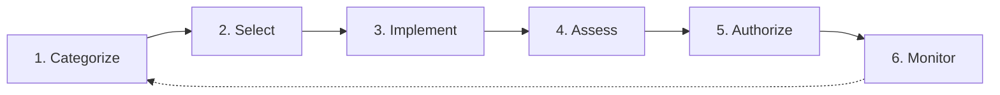

# Introduction to Risk Management Framework (RMF)

> **Course:** Information Assurance and Security  
> **Module:** 5 — Risk Management Framework  
> **Learning Format:** Individual & Group Activities

---

## A. Lesson Preview & Review

Welcome back, future security officers! Today, we are leveling up our risk management skills by exploring the **Risk Management Framework (RMF)**. 

Before we dive into this 6-step process, let's quickly review a core concept from our previous module.

**Quick Review:**
*   **Risk:** Refers to the potential loss, damage, or destruction of assets.
*   **Example:** A hacking attempt on a database could result in data loss and financial penalties.

> **Important Distinction:** An RMF is a **framework**, *not a regulation*. It is a structured guide that helps organizations select the necessary security measures and controls to protect themselves, their employees, and their assets. 

In this module, we will focus on the first two steps of the framework in detail, building a foundation that we will apply progressively throughout the rest of the course. Don't worry about information overload; we will take this one step at a time.

---

## B. Main Lesson

### Why is the Risk Management Framework Important?
According to Global Risk Reports, cyber attacks are consistently ranked among the top 10 risks organizations encounter, alongside natural disasters and accidents. 

The RMF provides a continuous, cyclical process to ensure maximum security for an organization's assets with the **least amount of cost**. It assumes you have already identified your risks (from the previous module).

### The 6-Step Risk Management Framework

The RMF is a **never-ending process**. After monitoring security controls, the cycle loops back to categorizing information systems. This is because the risk landscape changes over time. For example, a city may not have been prepared for floods in the past, but after a major flood event, it implements new controls. The risk of flooding might decrease, but the cost of those controls might need to be reassessed. 

> **Pro Tip:** Continuous reassessment is the heart of RMF. A control that was perfect yesterday might be obsolete or too expensive tomorrow.

#### Step 1: Categorize Information Systems
This step is about creating **priority levels** (from least important to most important). For each risk you identify, you assign a priority based on its **likelihood** (how probable it is) and **severity** (how much damage it will cause). This will be explored further in the next modules using a risk matrix.

#### Step 2: Select Security Controls
This step involves choosing the best security controls for every identified risk. There are two main ways to categorize controls: by **Control Type** and by **Control Function**.

| Control Type | Description | Examples |
| :--- | :--- | :--- |
| **Physical** | Tangible barriers or protections. | Security guards, locked doors, fences, CCTV. |
| **Technical** | Technology-based solutions. | Firewalls, encryption, antivirus software. |
| **Administrative** | Policies, procedures, and guidelines. | Security awareness training, incident response plans. |

| Control Function | Description | Focus |
| :--- | :--- | :--- |
| **Preventative** | Stops an incident from happening. | Access control, fences. |
| **Detective** | Identifies when an incident occurs. | Intrusion detection systems, audit logs. |
| **Corrective** | Fixes or restores after an incident. | Backups, disaster recovery plans. |

> *Note: We will discuss these types and functions in much greater detail in Modules 13 and 14.*

#### Step 3: Implement Security Controls
This step is about applying the selected security controls to the identified risks. In a professional setting, this requires technical configuration and policy rollout. In this course, we will simulate this through labs or hands-on activities.

#### Step 4: Assess Security Controls
Here, you check if the selected control is truly the best fit for the situation. Risk Managers often realize a control is not suitable due to cost or effectiveness. 
*   *Example:* You might initially choose to hire security guards. However, upon assessment, you realize it's too expensive and switch to CCTV cameras—except for the specific part that captures intruders, which might still require a human presence.

#### Step 5: Authorize Information Systems
This step involves getting the executives or higher-ups to **approve** the security controls. It requires formal sign-off and issuing memos, policies, and ensuring compliance with relevant laws.

#### Step 6: Monitor Security Controls
This is the ongoing process of checking the overall control and the risk itself. 
*   Has the risk's likelihood or severity changed?
*   Has the control become too expensive or outdated?
If yes, the cycle repeats, and you may need to go back to Step 1.

*(Visual representation of the RMF cycle)*

---

## C. Analogies and Use Cases

### The "Home Renovation" Analogy
Think of the RMF as renovating an old house.
1.  **Categorize:** You list your priorities. The kitchen (critical asset) needs fixing before the guest room (low priority).
2.  **Select:** You decide to fix the kitchen with a new lock (Physical) and a smart alarm (Technical).
3.  **Implement:** You install them.
4.  **Assess:** You test the locks. Are they too stiff? Is the alarm too loud? You adjust.
5.  **Authorize:** You, as the homeowner, sign off on the final renovation.
6.  **Monitor:** A year later, you check if the locks are rusty or if the alarm needs new batteries. If the neighborhood becomes safer, you might downgrade the alarm system (re-categorize).

### Real-World Use Case: Hospital Data System
A hospital wants to protect patient records.
*   They **categorize** the database as "Priority 1" due to strict privacy laws.
*   They **select** a firewall (Technical, Preventative) and a backup server (Technical, Corrective).
*   After **implementing** and **assessing**, they realize the firewall blocks doctors from accessing records quickly. They adjust the rules.
*   The board of directors **authorizes** the new system.
*   They **monitor** for breaches. Six months later, a new ransomware strain emerges, changing the risk level. The cycle starts again.

---

## D. Lesson Wrap-Up / FAQs

### Key Takeaways
*   The RMF is a **6-step cyclical process** designed to maximize security while minimizing costs.
*   It is a framework, not a rigid regulation.
*   The process is continuous because risks, likelihood, and severity are dynamic.
*   Executive **authorization** is crucial to secure funding and enforce compliance.
*   Security controls are categorized by **Type** (Physical, Technical, Administrative) and **Function** (Preventative, Detective, Corrective).

### Frequently Asked Questions
**1. Are there other ways to select security controls?**
Yes. In addition to the general methods discussed, you can select controls based on specific categories such as maintenance, planning, media protection, and access controls. However, the Type and Function model is the most general and widely used baseline.

**2. Why do we need to authorize information systems?**
Authorization ensures that the executives or business owners—the people who fund the security initiatives—are fully aware of and approve the security controls. Without their approval, you may lack the budget, authority, or legal backing to implement the controls.

**3. What happens if we skip the "Monitor" step?**
If you skip monitoring, your security controls will eventually become outdated or ineffective. The risk environment changes, and a control that was once effective might now be too expensive or unable to stop new threats.

**4. Is the RMF only for cybersecurity?**
No. While heavily used in cybersecurity, the principles of RMF can be applied to any organizational risk, including physical security, natural disaster preparedness, and financial risk management.

**5. How do I know if a control is "too expensive"?**
It's a cost-benefit analysis. If the cost of implementing and maintaining the control exceeds the potential financial loss from the risk occurring, it might be considered too expensive. However, you must also factor in non-financial impacts like reputation damage or legal penalties.

---

## E. Guided Drills / Code Projects

### Course Project: Drafting Your RMF
**Project Overview:** 
For Module 5, your group will create a draft of your project's Risk Management Framework. This draft will focus on identifying your risks and starting the categorization and selection steps.

**Project Guidelines:**
*   **Group Size:** 3–5 members.
*   **Objective:** Create a table that maps out your identified risks and begins the RMF process.
*   **Submission:** Keep this document as part of your ongoing project documentation.

**Step-by-Step Deliverable:**
1.  **Review your identified risks** from Module 4 (e.g., Flooding, Hacking, Hardware Failure).
2.  **Create a Table** with the following columns: `Risks`, `Categorize (Priority)`, and `Select (Control Type & Function)`.
3.  **Fill in what you know.** You only need to fill up the Risks and Categorize columns. You can add as many rows as needed.
4.  **Look ahead:** For the "Select" column, write a brief note on what type of control you think would help (e.g., "Physical: Fences" or "Technical: Firewall").

| Risks | Categorize (Priority) | Select (Control Type & Function) |
| :--- | :--- | :--- |
| *Example: Flooding* | *Priority 2* | *Physical / Preventative (Sandbags, Drainage)* |
| *Example: Database Hacking* | *Priority 1* | *Technical / Preventative (Firewall, MFA)* |
| *Your Risk 1* | | |
| *Your Risk 2* | | |
| *Your Risk 3* | | |

> *Note: Detailed categorization based on likelihood and severity will be discussed in the next module. For now, assign a preliminary priority based on your group's best judgment.*

---

## F. Skill-Building Check

### Part 1: Identify the Step
*Identify which of the 6 RMF steps is being discussed in the following scenarios.*

1.  Picking out the security control best suited for the risk.
    **Answer: Step 2 - Select Security Controls**
2.  Determine the priority of the risk.
    **Answer: Step 1 - Categorize Information Systems**
3.  Informing the executives of the proposed control and documenting it.
    **Answer: Step 5 - Authorize Information Systems**
4.  Check if the selected control is truly the best suited for the risk.
    **Answer: Step 4 - Assess Security Controls**
5.  Apply the security control if ever the risk occurs.
    **Answer: Step 3 - Implement Security Controls** (Note: The prompt states "if ever the risk occurs", which aligns with the implementation of corrective controls, but generally, implementation is applying the control).

### Part 2: Multiple Choice

**6. Which of the following is an example of an Administrative Control?**
A. Installing a firewall.
B. Conducting annual security awareness training.
C. Building a perimeter fence.
D. Setting up an intrusion detection system.
**Correct Answer: B** (Administrative controls focus on policies and people).

**7. What is the primary reason the Risk Management Framework is a cyclical (never-ending) process?**
A. Because organizations always run out of money.
B. Because the risk landscape, likelihood, and severity change over time.
C. Because executives frequently change their minds.
D. Because laws require annual audits.
**Correct Answer: B** (The dynamic nature of risks necessitates continuous monitoring and reassessment).

**8. Which control function is designed to identify when an incident has occurred?**
A. Preventative
B. Corrective
C. Detective
D. Administrative
**Correct Answer: C** (Detective controls, like audit logs, are designed to detect incidents).