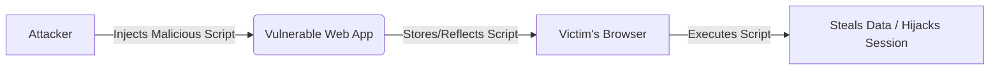

# Software Development Security: Cross-Site Scripting (XSS)

> **Course:** Information Assurance and Security  
> **Module:** 7 — Software Development Security: Cross-Site Scripting  
> **Learning Format:** Individual Activity (Solo Work)

---

## A. Lesson Preview & Review

Welcome, students! Today, we are tackling a critical web application vulnerability: **Cross-Site Scripting (XSS)**. As a future IT developer or security professional, your systems must be protected against XSS attacks. 

We will be learning how to perform this activity and defend against it using **DVWA (Damn Vulnerable Web Application)** and **XAMPP**. You will need to download and install these tools in your local environment. 

> **Pro Tip:** Keep a cheat sheet handy for this module. It will serve as a valuable reference in your future profession.

**Learning Targets:**
By the end of this module, you will be able to:
1.  Understand what Cross-Site Scripting is.
2.  Understand how to defend against Cross-Site Scripting.

---

## B. Main Lesson

### What is Cross-Site Scripting (XSS)?
**Cross-Site Scripting (XSS)** is a type of injection attack. The hacker/attacker aims to execute malicious scripts in the web browser of the victim by including malicious code in a legitimate web page or web application.

*   **How it works:** The actual attack occurs when the victim visits the web page or web application that executes the malicious code. The web page or web application becomes a **deliverer of the malicious script** to the user's browser.
*   **Common Targets:** Vulnerable websites commonly used for XSS attacks are forums, message boards, and web pages that allow comments.

### How Does XSS Work?
A web page or web application is vulnerable to XSS if it uses **unfiltered user input** in the output that it generates. This user input must then be parsed by the victim's browser. XSS attacks are possible in VBScript, ActiveX, Flash, and even CSS. However, they are most common in **JavaScript**, primarily because JavaScript is fundamental to most browsing experiences.

### Lab Setup Guide
To perform the hands-on activity, ensure you have XAMPP and DVWA installed.

1.  **Open XAMPP Control Panel:** Start both **Apache** and **MySQL**.
2.  **Open your browser:** Type in the address bar: `http://localhost/dvwa/`
3.  **Input your credentials:** Default username is `admin`, default password is `password`.
4.  **Set Security Level:** Click the DVWA Security button and set the security level to **low**, then press submit.
5.  **Navigate to XSS:** Click the **XSS (Reflected)** button from the choices on the left.

> **Note:** You can click the "View Source" button in the bottom right corner to show the code used in submitting the name. If you press that, a window will pop up.

---

## C. Analogies and Use Cases

### The "Trojan Horse" Analogy
Imagine a trusted town crier (the legitimate website) delivering messages to the townspeople (users). An attacker sneaks a malicious message into the town crier's satchel. When the crier delivers the message to an unsuspecting villager, the message jumps out and steals the villager's keys (session cookies). The villager trusted the crier, so they didn't suspect the message was harmful.

### Real-World Use Case: The MySpace Samy Worm (2005)
One of the most famous XSS attacks was the "Samy" worm on MySpace. A user named Samy inserted a JavaScript payload into his profile. When other users viewed his profile, the script executed, adding Samy as a friend and replicating itself onto the viewer's profile. Within 20 hours, over one million users were infected. This demonstrates how quickly XSS can spread through a vulnerable web application.

---

## D. Lesson Wrap-Up / FAQs

### Key Takeaways
*   **XSS** is an injection attack that targets the user's browser by injecting malicious scripts into trusted websites.
*   It occurs because of **unfiltered user input** being echoed back to the browser without proper validation or encoding.
*   XSS can be used to steal cookies, hijack sessions, deface websites, or spread malware.
*   Defense against XSS requires **Input Validation**, **Output Encoding**, and using secure coding practices like `htmlspecialchars()` in PHP.

### Frequently Asked Questions
**1. Are XSS common in websites?**
**A:** Nowadays, it is not as common due to better security practices, but some websites, especially forums, are still vulnerable. What you can do is test if a site is protected against XSS. If not, we highly suggest you avoid those sites.

**2. What is the difference between Cross-site and Cross-Site Scripting?**
**A:** The terminology can be confusing. "Cross-Site Scripting" (XSS) is an injection attack where malicious scripts are executed in the victim's browser. "Cross-Site Request Forgery" (CSRF), sometimes loosely referred to as "Cross-site," is a different attack where a user is tricked into performing an action on a web application in which they are currently authenticated. The module refers to XSS.

**3. What is the damage that XSS can make?**
**A:** XSS can lead to the theft of session cookies (allowing account takeover), defacement of websites, redirection to malicious sites, and the execution of arbitrary code on the victim's machine. It compromises the trust between the user and the website.

---

## E. Guided Drills / Code Projects

### Lab Activity: XSS Trials
**Activity Overview:** 
Perform the following trials in your DVWA environment. Record what happened, whether the script worked, and what the output was.

**Trial 1: Inputting a basic HTML XSS**
*   **Payload:** `<h1>John Doe</h1>`
*   **Action:** Input in the "What's your name" text field and press submit.
*   **Observation:** The text "John Doe" will be displayed as a large header. This proves the site has low security against XSS because basic HTML tags are executed.

**Trial 2: Inputting an actual script**
*   **Payload:** ``
*   **Action:** Input in the text field and press submit.
*   **Observation:** A pop-up alert box appears saying "Hacked". This means your website security is vulnerable to scripting.
*   **Source Code Analysis:** `echo '<pre>Hello ' . $_GET['name'] . '</pre>';`

**Trial 3: Inputting the previous script to the Medium level security**
*   **Action:** Change security level to **Medium**. Input ``.
*   **Observation:** The script did not work. It didn't even print the word ``. Click submit.
*   **Observation:** The script worked! It bypassed the security filter.
*   **Source Code Analysis:** The code `str_replace` only changes *lowercase* ``.
*   **Observation:** The script did not work.
*   **Source Code Analysis:** `$name = preg_replace( '/<(.*)s(.*)c(.*)r(.*)i(.*)p(.*)t/i', '', $_GET[ 'name' ] );`
*   *Explanation:* This replaces all occurrences of the `<script>` tag, whether capital, small, or mixed, with null. So `<script>` tag is useless.

**Trial 6: Event Handlers to bypass High security**
*   **Payload:** ``
*   **Observation:** The alert box pops up. This proves that the high difficulty is not secure enough. Event handlers (like `onerror`) can execute JavaScript without using script tags.

**Trial 7: The "Impossible" Security Fix**
*   **Observation:** When set to Impossible, the script does not work.
*   **Source Code Analysis:**
    *   `checkToken( $_REQUEST[ 'user_token' ], $_SESSION[ 'session_token' ], 'index.php' );` (Prevents Cross-Site Request Forgery)
    *   `$name = htmlspecialchars( $_GET[ 'name' ] );` (Converts HTML codes into their Character form).
*   **Meaning:** `<` is converted to `&lt;` and `>` to `&gt;`. Other codes like `&`, `"`, `'` are also converted.

---

## F. Skill-Building Check

### Check for Understanding (10 mins Quiz)

**Essay Question:**
Now we have to check if you truly understand this module. Why do you think we need to prevent XSS? Using your current knowledge of IT/Programming/Web development, explain the damage that XSS can make?

*Guidance:* Your answer should discuss the consequences of successful XSS attacks, including but not limited to: theft of sensitive user data (cookies, session tokens), account hijacking, defacement of the website, redirection of users to malicious sites, and the erosion of user trust. It is critical to prevent XSS to maintain the Confidentiality, Integrity, and Availability of user data and the application itself. Developers must employ secure coding practices like input validation and output encoding (`htmlspecialchars`).